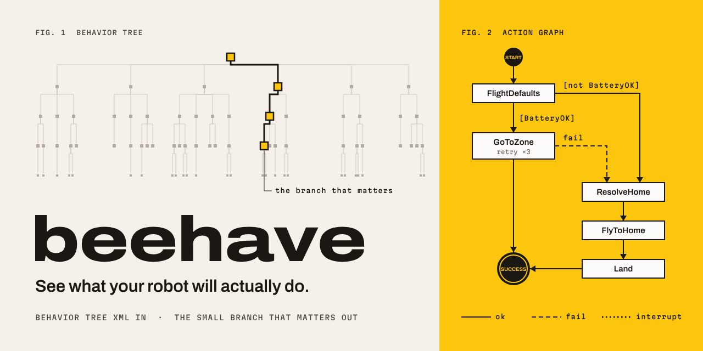
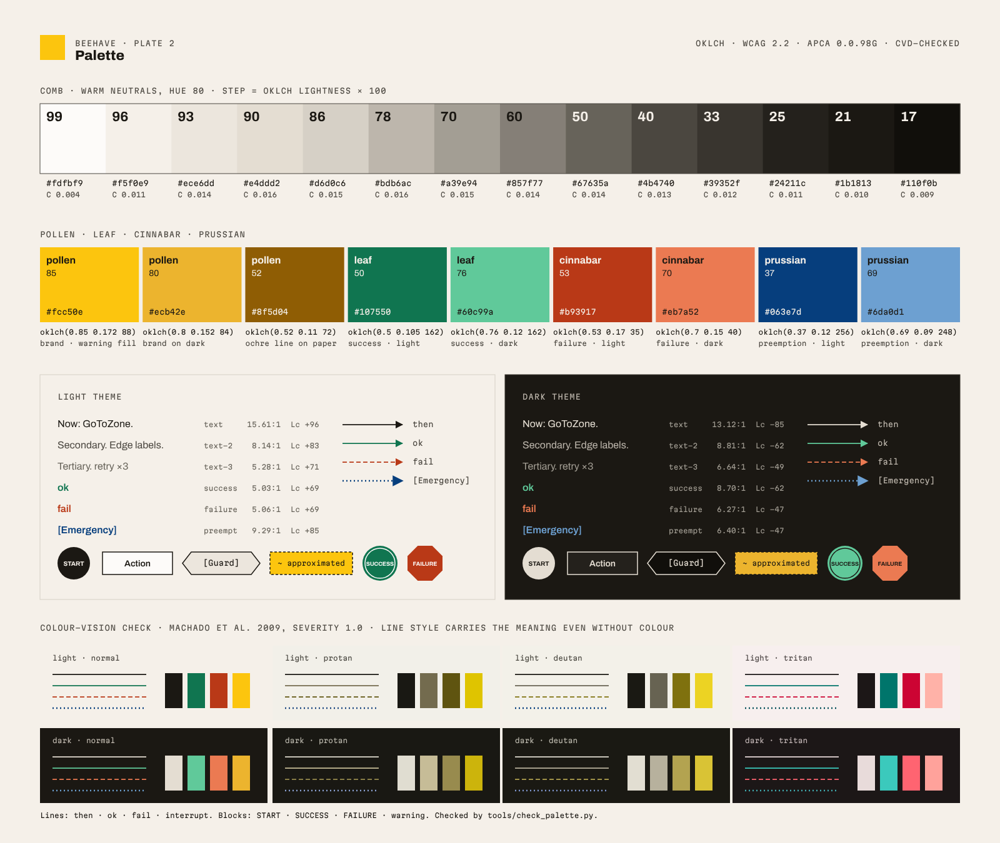
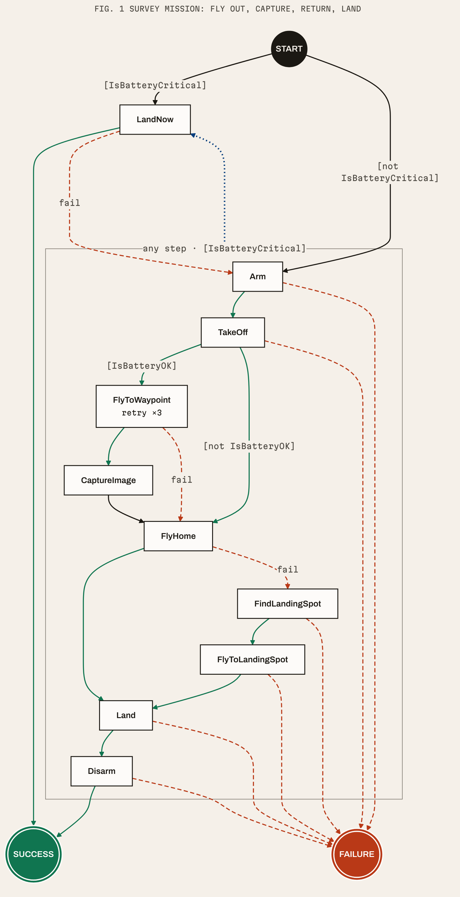
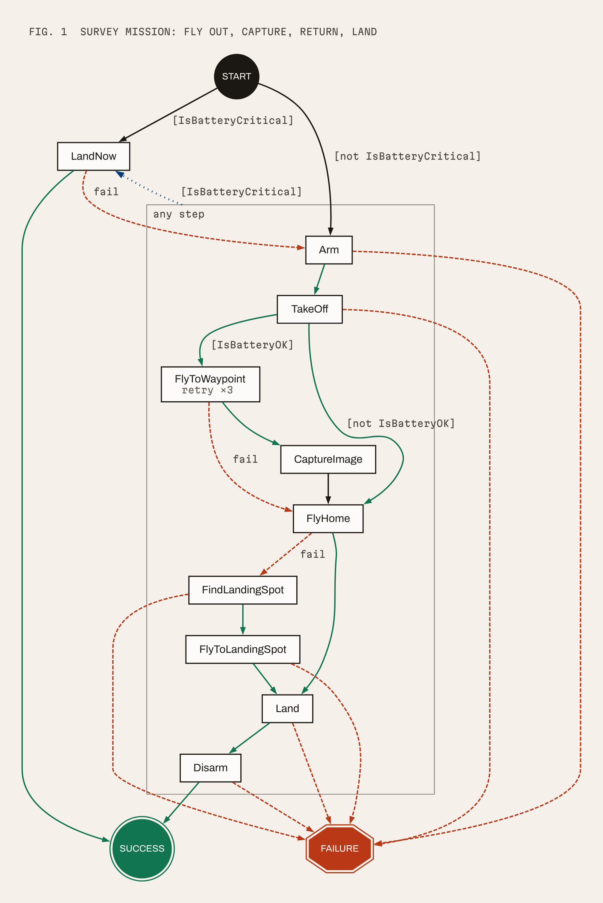

<picture>
  <source media="(prefers-color-scheme: dark)" srcset="logo/lockup-horizontal-dark.svg">
  
</picture>

# Brand guide

**See what your robot will actually do.**

This folder holds the Beehave identity: the logo, the palette, type, voice, and the
style that Beehave's own graph exports use. Everything here is open-licensed (see
[LICENSE.md](LICENSE.md)), and every colour decision is checked by a script you can run.



**Contents:** [Concept](#1-concept) · [Logo](#2-logo) · [Colour](#3-colour) ·
[Accessibility](#4-accessibility) · [Type](#5-type) · [Voice](#6-voice-and-tone) ·
[Graph style](#7-graph-style) · [Tokens](#8-tokens-and-tools) · [Sources](#9-sources)

---

## 1. Concept

Beehave reads a sprawling behavior tree and hands back the small branch that matters:
the actions a robot can take, in order, and the conditions that lead to each one.

**The name** is *behave* with a bee in it. A behavior tree says how a robot behaves;
a bee is the animal that best compresses a complex route into a message someone else
can read.

**The waggle dance.** A forager back from a long flight dances a small figure on the
comb. The angle of the straight waggle run gives the direction relative to the sun;
how long it waggles gives the distance. Then she loops back to the start and runs
again. Her nest-mates decode a kilometre of flight from a few centimetres of dance.
Beehave does the same for a robot: a thousand-node tree becomes a graph a person
can read at a glance. [[waggle]](#9-sources)

**Nectar guides.** Many flowers carry patterns, often visible only in ultraviolet,
that lead the bee straight to the reward. Our one bright colour, *pollen*, plays that
role. It marks the thing a human should look at, and nothing else. [[nectar]](#9-sources)

**Pruning.** A big tree, cut back to the one branch that bears fruit. The social image
shows exactly that: a pale tree, one branch picked out in pollen and ink, and the
action graph it turns into.

**Field plates.** The visual language comes from scientific plates and technical
drawing, not from software marketing. That means warm paper, carbon ink, one pigment,
numbered figures ("FIG. 1"), mono annotations with leader lines, square corners, and
a strict grid.

## 2. Logo

<table>
<tr>
<td align="center"><br><code>mark.svg</code></td>
<td align="center"><br><code>wordmark.svg</code></td>
<td align="center"><br><code>lockup-horizontal.svg</code></td>
</tr>
</table>

### The mark

A lowercase **b** built from two moves. The **stem** is a straight run. The **bowl**
is a loop that comes back into the stem with an arrowhead. It is half a waggle dance:
the run, then the return. Read as a graph, it is an action with an edge back into the
sequence, which is the shape of every retry in a behavior tree. It sits on a square
**pollen plate**: the nectar guide, the one patch of colour that says *look here*.

Construction: a 48 × 48 grid. Every edge falls on a multiple of 3 units, so the mark
lands on whole pixels at 16 px (3 units = 1 px) and 32 px (3 units = 2 px). The stem is
9 units wide, the bowl stroke 6, and the arrowhead 9 long and 13.5 tall, with its tip on
the stem.

### The wordmark

`beehave`, lowercase, in **Archivo Expanded ExtraBold** (wdth 125, wght 800) at
−0.01 em tracking, converted to outlines. The files need no fonts installed. In the
lockup the plate is exactly as tall as the ascender of the `b`, and the gap between
plate and word is 15/48 of the plate.

### Files

| File | Use |
|---|---|
| `logo/mark.svg` | Primary symbol: pollen plate + ink glyph. Avatars, app icons, docs. |
| `logo/mark-mono.svg` | Glyph only, `fill="currentColor"`. One-colour print, etching, inline in UI. |
| `logo/wordmark.svg` | Wordmark alone, ink. When the plate is already nearby. |
| `logo/lockup-horizontal.svg` | Plate + wordmark, for light backgrounds. README headers, slides. |
| `logo/lockup-horizontal-dark.svg` | Dimmed plate + paper wordmark, for dark backgrounds. |
| `logo/favicon.svg` | Mark with a built-in `prefers-color-scheme` switch to the dimmed plate. |
| `logo/favicon-32.png`, `logo/apple-touch-icon.png` | Raster fallbacks (32 px, 180 px full-bleed). |

```html
<link rel="icon" href="/favicon.svg" type="image/svg+xml">
<link rel="icon" href="/favicon-32.png" sizes="32x32">
<link rel="apple-touch-icon" href="/apple-touch-icon.png">
```

### Clear space and size

- **Clear space:** keep a margin of ¼ of the plate height on every side (12 units on
  the 48 grid). For the lockup, measure from the plate.
- **Minimum size:** mark 16 px (favicons only), 20 px elsewhere on screen, 6 mm in print.
  Lockup 20 px tall on screen, 8 mm in print. Below that, use the mark alone.

### Don't

- Don't recolour the plate. It is pollen (light) or dimmed pollen (dark), and the glyph is ink.
- Don't put the pollen plate on a pollen or yellow background. Use `mark-mono.svg` in ink.
- Don't use the mark, or pollen, as a status light in a product UI. Pollen means *look here*.
- Don't rotate, skew, stretch, outline, round the corners, or add shadows, gradients or glass.
- Don't retype the wordmark in another font, add a tagline inside the lockup, or rearrange it.
- Don't draw a cartoon bee next to it, and don't tile hexagons behind it.

## 3. Colour



### Five pigments

| Pigment | What it is | Job |
|---|---|---|
| **comb** | 14 warm neutrals, hue 80. Fresh wax comb is near white and darkens towards black with every brood cycle. [[comb]](#9-sources) | Paper, ink and everything between. |
| **pollen** | Gamboge-like chrome yellow. | Brand. Attention: warnings, the mark. |
| **leaf** | Bluish green. | Success. |
| **cinnabar** | Vermilion. | Failure. |
| **prussian** | Deep pigment blue. | Preemption (interrupts), focus rings. |

The names echo the pigment vocabulary of *Werner's Nomenclature of Colours* (1814/1821),
the chart naturalists, Darwin among them, used to record specimen colours in the field.
[[werner]](#9-sources)

**Steps are named by lightness.** `comb-96` has OKLCH lightness 0.96; `leaf-50` has 0.50.
Read two names and you know roughly how far apart they are in perceived lightness. That
gap is what drives contrast.

### Roles

Use roles in code, not primitives. Hex values are exact: every colour sits inside sRGB.

| Role | Light | Dark | Use |
|---|---|---|---|
| `bg` | `#f5f0e9` comb-96 | `#1b1813` comb-21 | Page background |
| `surface` | `#fdfbf9` comb-99 | `#24211c` comb-25 | Cards, action nodes |
| `sunken` | `#ece6dd` comb-93 | `#110f0b` comb-17 | Code blocks, condition nodes |
| `rule` | `#d6d0c6` comb-86 | `#39352f` comb-33 | Hairlines (decorative only) |
| `border` | `#857f77` comb-60 | `#857f77` comb-60 | Control borders, graph frames (≥ 3:1) |
| `text` | `#1b1813` comb-21 | `#e4ddd2` comb-90 | Body text, node labels and borders |
| `text-2` | `#4b4740` comb-40 | `#bdb6ac` comb-78 | Captions, edge and guard labels |
| `text-3` | `#67635a` comb-50 | `#a39e94` comb-70 | Notes such as `retry ×3` (12 px min) |
| `inverse` / `on-inverse` | `#1b1813` / `#f5f0e9` | `#e4ddd2` / `#1b1813` | START node, "now" block |
| `accent` / `on-accent` | `#fcc50e` / `#1b1813` | `#ecb42e` / `#1b1813` | Pollen fills and what sits on them |
| `accent-line` | `#8f5d04` pollen-52 | `#ecb42e` pollen-80 | Pollen as a line or underline on the page |
| `success` | `#107550` leaf-50 | `#60c99a` leaf-76 | Success edges, SUCCESS terminal |
| `failure` | `#b93917` cinnabar-53 | `#eb7a52` cinnabar-70 | Failure edges, FAILURE terminal |
| `preempt` | `#063e7d` prussian-37 | `#6da0d1` prussian-69 | Preemption edges |
| `on-status` | `#fdfbf9` | `#1b1813` | Text on success / failure / preempt fills |
| `edge` | `#1b1813` | `#e4ddd2` | Unconditional "then" edges |
| `warn-fill` / `warn-line` | `#fcc50e` / `#1b1813` | `#ecb42e` / `#1b1813` | Approximated or unsupported nodes |
| `focus` | `#063e7d` | `#6da0d1` | Focus ring, 2 px, 2 px offset |

<details>
<summary>All primitives with OKLCH values</summary>

| Token | OKLCH (L C h) | Hex |
|---|---|---|
| comb-99 | 0.990 0.004 80 | `#fdfbf9` |
| comb-96 | 0.958 0.011 80 | `#f5f0e9` |
| comb-93 | 0.928 0.014 80 | `#ece6dd` |
| comb-90 | 0.900 0.016 80 | `#e4ddd2` |
| comb-86 | 0.860 0.015 80 | `#d6d0c6` |
| comb-78 | 0.780 0.016 80 | `#bdb6ac` |
| comb-70 | 0.700 0.015 80 | `#a39e94` |
| comb-60 | 0.600 0.014 80 | `#857f77` |
| comb-50 | 0.500 0.014 80 | `#67635a` |
| comb-40 | 0.400 0.013 80 | `#4b4740` |
| comb-33 | 0.330 0.012 80 | `#39352f` |
| comb-25 | 0.250 0.011 80 | `#24211c` |
| comb-21 | 0.210 0.010 80 | `#1b1813` |
| comb-17 | 0.170 0.009 80 | `#110f0b` |
| pollen-85 | 0.850 0.172 88 | `#fcc50e` |
| pollen-80 | 0.800 0.152 84 | `#ecb42e` |
| pollen-52 | 0.520 0.110 72 | `#8f5d04` |
| leaf-50 | 0.500 0.105 162 | `#107550` |
| leaf-76 | 0.760 0.120 162 | `#60c99a` |
| cinnabar-53 | 0.530 0.170 35 | `#b93917` |
| cinnabar-70 | 0.700 0.150 40 | `#eb7a52` |
| prussian-37 | 0.370 0.120 256 | `#063e7d` |
| prussian-69 | 0.690 0.090 248 | `#6da0d1` |

</details>

### How the palette was built (OKLCH)

The palette is defined in **OKLCH**: lightness, chroma, hue in the OKLab space. In OKLab,
equal steps in L look like equal steps in brightness whatever the hue. HSL can't do
that: an HSL yellow and an HSL blue at "50 % lightness" look nothing alike.
[[oklab]](#9-sources) [[oklch]](#9-sources)

- **Lightness does the work.** Contrast follows from L, so every role was placed by
  lightness first. Text sits at L ≤ 0.50 on paper (L 0.96). Edges and status colours
  sit between L 0.37 and 0.53, so they reach 4.5:1 and can carry a label. In the dark
  theme everything is mirrored around L 0.21.
- **The neutral ramp is not grey.** Comb keeps hue 80 (warm) at chroma 0.004–0.016:
  enough to read as paper and carbon ink, not enough to tint the semantic colours. The
  usual cool slate neutral (hue around 255) is what makes so many dashboards look alike.
- **Chroma is budgeted.** Pollen gets the most (0.17) because it is the one loud colour.
  Status colours stay at 0.09–0.17. The dark-theme versions lose chroma as they gain
  lightness, so they don't glow.
- **Hue drifts on purpose.** Yellow turns olive when it gets dark at a fixed hue, so the
  deep pollen step moves from hue 88 to 72 and reads as ochre.
- **Hue relationships.** Leaf (162), cinnabar (35–40) and prussian (248–256) sit at
  roughly 120° intervals. They come from the Okabe–Ito colour-universal-design set
  (bluish green, vermilion, blue), which was chosen to stay distinguishable under
  colour-blindness. [[okabe-ito]](#9-sources) The lightness of each was then tuned with
  the simulator in `tools/check_palette.py` (see [§ 4](#colour-vision-deficiency)).

### Why not the usual palette

Interfaces produced by code assistants and SaaS templates converge on the same handful of choices:
an indigo or violet primary (Tailwind's `indigo-500`, `#6366F1`, and its neighbours),
purple-to-blue gradients, cyan or teal on navy, neon on black, slate grey with one blue
accent, glass panels, pastel blobs, and Inter-family type. The commonly cited
cause is that one framework's demo default (`bg-indigo-500` buttons) was copied into
thousands of templates and tutorials, which models then learned as "what modern looks
like". Its co-creator publicly apologised for it in August 2025.
[[defaults]](#9-sources)

Beehave avoids all of these, for reasons beyond taste:

| Avoided | Why, beyond "it's everywhere" |
|---|---|
| Indigo / violet gradients | Gradients put meaning nowhere; a graph needs every colour to mean one thing. |
| Cyan / teal on navy | Blue-green light is what dark-adapted eyes are most sensitive to: bad for night ops. |
| Neon on black | Halation and glare on field displays; pure black smears on cheap panels. |
| Slate + one blue accent | Cool greys fight the warm status colours and make every tool look the same. |
| Glassmorphism, pastel blobs | Translucency kills contrast guarantees; nothing in them survives printing. |
| Inter / Space Grotesk / Geist by default | See [§ 5](#5-type). |

What we use instead is rare in software and common in printed science: warm paper,
carbon ink, one chrome-yellow pigment, and a classic set of vermilion, green and
Prussian blue. That set is close to the primaries of constructivist posters and Swiss
transit maps, and it is old enough to look deliberate.

### Dark theme and field displays

Operators use the dark theme on ground-control screens at night and the light theme
in daylight.

- **Daylight: use the light theme.** Dark text on a light background measurably helps
  legibility for all ages (positive-polarity advantage), and it holds up better under
  glare. [[polarity]](#9-sources)
- **Night: the dark theme is dimmed, not inverted.** Text tops out at L 0.90
  (`#e4ddd2`), not white. The background is warm umber at L 0.21, not pure black, to
  avoid halation around text and smearing on cheap panels.
- **Keep blue-green small at night.** Rods, which carry dark adaptation, are most
  sensitive to blue-green and nearly blind to deep red. That is why night cockpits and
  observatories use dim red light. [[night]](#9-sources) Leaf and prussian are used only
  as thin lines, never as large fills, and the dark versions are desaturated.
- **No bright blocks in the dark.** The "now" step is a 3 px `text` frame in dark mode,
  not an inverted paper-coloured block. Pollen warning blocks are the one exception,
  because a warning should be seen.
- **Dim the display before you change colours.** Turning screen brightness down
  protects night vision far more than any palette can. For NVIS or night-vision-goggle
  setups, follow the display's own NVIS mode. This palette is not NVIS-certified.

## 4. Accessibility

Every pair below is a pairing we recommend; anything not listed is not recommended.
WCAG 2.2 AA is the gate: 4.5:1 for text, 3:1 for large text and non-text UI.
[[wcag]](#9-sources) APCA Lc is reported against its published targets (body 75,
secondary 60, short bold labels 45, non-text 30), but it is advisory because APCA is
still a draft for WCAG 3. [[apca]](#9-sources)

Output of `python3 .branding/tools/check_palette.py --markdown` (all checks pass):

<details open>
<summary><b>Contrast, light theme</b></summary>

| foreground | background | fg | bg | use | WCAG | verdict | APCA Lc | APCA |
|---|---|---|---|---|---|---|---|---|
| text | bg | #1b1813 | #f5f0e9 | body | 15.61:1 | pass | +95.9 | ok |
| text | surface | #1b1813 | #fdfbf9 | body | 17.14:1 | pass | +102.3 | ok |
| text | sunken | #1b1813 | #ece6dd | body | 14.27:1 | pass | +90.1 | ok |
| text-2 | bg | #4b4740 | #f5f0e9 | text | 8.14:1 | pass | +82.7 | ok |
| text-2 | surface | #4b4740 | #fdfbf9 | text | 8.94:1 | pass | +89.1 | ok |
| text-2 | sunken | #4b4740 | #ece6dd | text | 7.44:1 | pass | +76.9 | ok |
| text-3 | bg | #67635a | #f5f0e9 | label | 5.28:1 | pass | +71.4 | ok |
| text-3 | surface | #67635a | #fdfbf9 | label | 5.80:1 | pass | +77.7 | ok |
| on-inverse | inverse | #f5f0e9 | #1b1813 | body | 15.61:1 | pass | -97.3 | ok |
| on-accent | accent | #1b1813 | #fcc50e | text | 11.07:1 | pass | +75.5 | ok |
| warn-line | warn-fill | #1b1813 | #fcc50e | text | 11.07:1 | pass | +75.5 | ok |
| accent-line | bg | #8f5d04 | #f5f0e9 | label | 4.96:1 | pass | +69.2 | ok |
| success | bg | #107550 | #f5f0e9 | label | 5.03:1 | pass | +69.5 | ok |
| success | surface | #107550 | #fdfbf9 | label | 5.52:1 | pass | +75.8 | ok |
| failure | bg | #b93917 | #f5f0e9 | label | 5.06:1 | pass | +69.0 | ok |
| failure | surface | #b93917 | #fdfbf9 | label | 5.56:1 | pass | +75.3 | ok |
| preempt | bg | #063e7d | #f5f0e9 | label | 9.29:1 | pass | +85.3 | ok |
| preempt | surface | #063e7d | #fdfbf9 | label | 10.21:1 | pass | +91.6 | ok |
| on-status | success | #fdfbf9 | #107550 | label | 5.52:1 | pass | -80.9 | ok |
| on-status | failure | #fdfbf9 | #b93917 | label | 5.56:1 | pass | -80.4 | ok |
| on-status | preempt | #fdfbf9 | #063e7d | label | 10.21:1 | pass | -95.4 | ok |
| text | surface | #1b1813 | #fdfbf9 | ui | 17.14:1 | pass | +102.3 | ok |
| border | bg | #857f77 | #f5f0e9 | ui | 3.50:1 | pass | +58.4 | ok |
| border | surface | #857f77 | #fdfbf9 | ui | 3.84:1 | pass | +64.8 | ok |
| edge | bg | #1b1813 | #f5f0e9 | ui | 15.61:1 | pass | +95.9 | ok |
| warn-line | bg | #1b1813 | #f5f0e9 | ui | 15.61:1 | pass | +95.9 | ok |
| focus | bg | #063e7d | #f5f0e9 | ui | 9.29:1 | pass | +85.3 | ok |

</details>

<details open>
<summary><b>Contrast, dark theme</b></summary>

| foreground | background | fg | bg | use | WCAG | verdict | APCA Lc | APCA |
|---|---|---|---|---|---|---|---|---|
| text | bg | #e4ddd2 | #1b1813 | body | 13.12:1 | pass | -85.3 | ok |
| text | surface | #e4ddd2 | #24211c | body | 11.89:1 | pass | -84.2 | ok |
| text | sunken | #e4ddd2 | #110f0b | body | 14.20:1 | pass | -86.1 | ok |
| text-2 | bg | #bdb6ac | #1b1813 | text | 8.81:1 | pass | -62.2 | ok |
| text-2 | surface | #bdb6ac | #24211c | text | 7.98:1 | pass | -61.0 | ok |
| text-2 | sunken | #bdb6ac | #110f0b | text | 9.53:1 | pass | -63.0 | ok |
| text-3 | bg | #a39e94 | #1b1813 | label | 6.64:1 | pass | -48.9 | ok |
| text-3 | surface | #a39e94 | #24211c | label | 6.02:1 | pass | -47.7 | ok |
| on-inverse | inverse | #1b1813 | #e4ddd2 | body | 13.12:1 | pass | +85.0 | ok |
| on-accent | accent | #1b1813 | #ecb42e | text | 9.38:1 | pass | +66.8 | ok |
| warn-line | warn-fill | #1b1813 | #ecb42e | text | 9.38:1 | pass | +66.8 | ok |
| accent-line | bg | #ecb42e | #1b1813 | label | 9.38:1 | pass | -65.8 | ok |
| success | bg | #60c99a | #1b1813 | label | 8.70:1 | pass | -61.8 | ok |
| success | surface | #60c99a | #24211c | label | 7.88:1 | pass | -60.7 | ok |
| failure | bg | #eb7a52 | #1b1813 | label | 6.27:1 | pass | -46.9 | ok |
| failure | surface | #eb7a52 | #24211c | label | 5.68:1 | pass | -45.8 | ok |
| preempt | bg | #6da0d1 | #1b1813 | label | 6.40:1 | pass | -47.4 | ok |
| preempt | surface | #6da0d1 | #24211c | label | 5.80:1 | pass | -46.3 | ok |
| on-status | success | #1b1813 | #60c99a | label | 8.70:1 | pass | +63.0 | ok |
| on-status | failure | #1b1813 | #eb7a52 | label | 6.27:1 | pass | +48.8 | ok |
| on-status | preempt | #1b1813 | #6da0d1 | label | 6.40:1 | pass | +49.3 | ok |
| text | surface | #e4ddd2 | #24211c | ui | 11.89:1 | pass | -84.2 | ok |
| border | bg | #857f77 | #1b1813 | ui | 4.47:1 | pass | -33.5 | ok |
| border | surface | #857f77 | #24211c | ui | 4.05:1 | pass | -32.3 | ok |
| edge | bg | #e4ddd2 | #1b1813 | ui | 13.12:1 | pass | -85.3 | ok |
| warn-fill | bg | #ecb42e | #1b1813 | ui | 9.38:1 | pass | -65.8 | ok |
| focus | bg | #6da0d1 | #1b1813 | ui | 6.40:1 | pass | -47.4 | ok |

</details>

Two pollen notes. On paper, the pollen block itself is only 1.41:1 against the page.
That is fine because its dashed ink border (15.6:1) outlines it, and that border is
required. And pollen is never used for text on paper; use `accent-line` (`#8f5d04`).

### Colour-vision deficiency

Graphs must keep success, failure and preemption edges apart, and keep the START,
SUCCESS, FAILURE and warning fills apart. The checker simulates protanopia,
deuteranopia and tritanopia at full severity with the Machado, Oliveira & Fernandes
(2009) matrices, applied in linear RGB. [[machado]](#9-sources) It then requires:

- at least **0.08 ΔE<sub>OK</sub>** (about four just-noticeable steps) between any two
  graph colours under every simulation, and
- every edge colour still **≥ 3:1** against the background after simulation.

| Theme | Set | normal | protan | deutan | tritan |
|---|---|---|---|---|---|
| light | edges | 0.206 | 0.093 | 0.095 | 0.127 |
| light | fills | 0.250 | 0.093 | 0.095 | 0.302 |
| dark | edges | 0.162 | 0.108 | 0.091 | 0.084 |
| dark | fills | 0.151 | 0.108 | 0.091 | 0.127 |

Minimum ΔE<sub>OK</sub> per set; all pass. The first drafts failed in three places. Each
was fixed by moving lightness, not hue:

- **Tritanopia turns leaf and prussian both teal.** Fix: prussian sits far below leaf
  in lightness (0.37 vs 0.50 light; 0.69 vs 0.76 dark).
- **Deuteranopia turns leaf and a neutral edge the same beige** (dark theme). Fix:
  "then" edges are drawn in full ink, not mid-grey.
- **Deuteranopia brings leaf and cinnabar together** (dark). Fix: cinnabar drops to L 0.70.

**Colour is never the only signal.** Graphs are printed, faxed into reports, and shown
on washed-out C2 displays, so every meaning has a second, colour-free carrier:

| Meaning | Colour | Line | Shape / text |
|---|---|---|---|
| then (unconditional) | ink | solid, 1.75 px | — |
| on success | leaf | solid, 1.75 px | guard label if guarded |
| on failure | cinnabar | **dashed** 7/4, 1.75 px | label `fail` |
| preemption | prussian | **dotted** 2/4, 2.5 px | `[Condition]` label, from a frame |
| action | ink on surface | 1.5 px border | rectangle |
| condition (as a node) | ink on sunken | 1.5 px border | hexagon, `[Guard]` |
| START | inverse fill | — | filled circle, `START` |
| SUCCESS | leaf fill | inner ring | double circle, `SUCCESS` |
| FAILURE | cinnabar fill | — | octagon (Graphviz) / double circle (Mermaid), `FAILURE` |
| approximated / unsupported | pollen fill | **dashed** ink border 4/3 | `~ approximated` / `? unsupported` |

## 5. Type

Two open-licensed families (SIL Open Font License 1.1), both variable, both on
Google Fonts and Fontsource. [[fonts]](#9-sources)

| Role | Family | Settings | Fallback stack |
|---|---|---|---|
| Display, wordmark | **Archivo** | wdth 112.5–125, wght 800 | `"Archivo", "Helvetica Neue", Helvetica, "Nimbus Sans", Arial, sans-serif` |
| UI, body, node labels | **Archivo** | wdth 100, wght 400 / 600 / 700 | same |
| Code, guards, notes, plate labels | **Martian Mono** | wdth 87.5–100, wght 400 / 500 | `"Martian Mono", Menlo, Consolas, "DejaVu Sans Mono", monospace` |

- **Archivo** is a grotesque with late-19th-century American roots, built for both print
  and screen, with a width axis from 62 to 125. One family gives us constructivist
  expanded display lines, a sober text face, and condensed labels. Inter, Geist and
  Space Grotesk are neo-grotesque or geometric UI defaults. Archivo has more ink, more
  character, and more width range.
- **Martian Mono** is a technical, slightly wide monospace with a width axis. It is the
  "annotation" voice: plate labels (`FIG. 1`), guard conditions (`[BatteryOK]`), and
  decorator notes (`retry ×3`). It is chosen over the usual IDE monospaces so that our
  docs and graphs don't look like a default editor theme.
- Install with `npm i @fontsource-variable/archivo @fontsource-variable/martian-mono`
  (CSS families `"Archivo Variable"` and `"Martian Mono Variable"`, already in the token
  stacks), or link both from Google Fonts.

**Scale** (px, line-height): display 64/1.0 · h1 40/1.1 · h2 28/1.15 · h3 20/1.25 ·
body 16/1.5 · small 14/1.45 · label 12 mono UPPERCASE +0.08 em · code 14/1.5 ·
graph node 14 · guard 12 mono · note 12 mono. Operator views never go below 16 px for
anything an operator must read.

**Settings.** Lowercase for display lines and the wordmark. UPPERCASE only for mono
plate labels. Ranged left, never justified. Measure 60–72 characters. Tight negative
tracking on display sizes only.

## 6. Voice and tone

Write for an operator with a radio in one hand. Then add detail for the engineer.

- **Short, plain words.** "Flies home", not "initiates return-to-home procedure".
- **Verb first, present tense.** "Lands at SafeZone." "Retries 3 times."
- **Say what happens, then why.** "Goes home if the battery is low."
- **Operator views avoid tree jargon.** Say *if*, *then*, *otherwise*, *interrupts*.
  Keep *fallback*, *sequence*, *decorator* and *preemption* for engineer views.
- **Numbers and units, always.** `timeout 5 s`, `retry ×3`, `alt 40 m`.
- **No exclamation marks, no emoji, no hype.** Never "magic", "seamless" or "powerful".
- **Be honest about limits.** Mark guesses: `~ approximated: custom node, treated as action`.

| Don't | Do |
|---|---|
| Unable to evaluate node type `MyCustomNode`! | `~ MyCustomNode: unknown type, treated as an action` |
| Mission execution path successfully computed | `9 actions, 3 ways it can end` |
| Preemptive transition triggered by Emergency blackboard key | `If Emergency: lands now` |
| Robot will attempt navigation | `Now: GoToZone. Next: Land.` |

**Operator mission view, three lines:** `NOW` (the step running), `NEXT` (what follows
on success), `IF` (the guards that would change that, each with its target).

## 7. Graph style

Ready-to-copy examples, rendered from the files in `graph-style/`:

| Mermaid: [`example.mmd`](graph-style/example.mmd) | Graphviz: [`example.dot`](graph-style/example.dot) |
|---|---|
|  |  |

### Rules

- **Top to bottom.** Time runs down the page. Success is the main path.
- **Nodes:** square corners, 1.5 px ink border, `surface` fill, Archivo 14 px (600 where
  the renderer supports weights). START, SUCCESS and FAILURE are the only round shapes.
- **Guards** sit on edges in Martian Mono 12 px, `text-2`, in square brackets:
  `[BatteryOK]`, `[not BatteryOK]`. Negations are spelled `not`, never `!`.
- **Outcome labels:** success edges have none unless guarded; failure edges say `fail`.
- **Preemption** comes from a frame, not from every node. Wrap the steps the interrupt
  covers in a thin `border` frame labelled `any step`. Then draw one dotted prussian edge,
  with its `[Condition]`, from the frame to the target. (Mermaid: an edge from the
  subgraph. Graphviz: `compound=true` and `ltail=cluster_…`.)
- **Decorator notes** go inside the node, on a second line, in mono 12 px `text-3`:
  `retry ×3`, `timeout 5 s`, `repeat until ok`.
- **Approximated or unsupported nodes:** pollen fill, dashed ink border (4/3), second line
  `~ approximated` or `? unsupported`. These are the only pollen elements in a graph.
- **Figure caption** above the graph in mono caps: `FIG. 1  FLY TO ZONE, FALL BACK HOME, LAND`.
- **Light by default.** Exports use the light theme. Swap in the dark role values to theme.

### Mermaid

Mermaid styles edges by index (`linkStyle`), so emitters should count edges as they write
them. Labels are measured in Martian Mono and node labels drawn in Archivo, so a missing
font only adds padding, never clips. Core of the theme (full file in `graph-style/example.mmd`):

```text
classDef start   fill:#1b1813,stroke:#1b1813,stroke-width:1.5px,color:#f5f0e9
classDef action  fill:#fdfbf9,stroke:#1b1813,stroke-width:1.5px,color:#1b1813
classDef cond    fill:#ece6dd,stroke:#1b1813,stroke-width:1.5px,color:#1b1813
classDef approx  fill:#fcc50e,stroke:#1b1813,stroke-width:1.5px,stroke-dasharray:4 3,color:#1b1813
classDef success fill:#107550,stroke:#fdfbf9,stroke-width:2px,color:#fdfbf9
classDef failure fill:#b93917,stroke:#fdfbf9,stroke-width:2px,color:#fdfbf9

linkStyle <then>    stroke:#1b1813,stroke-width:1.75px
linkStyle <ok>      stroke:#107550,stroke-width:1.75px
linkStyle <fail>    stroke:#b93917,stroke-width:1.75px,stroke-dasharray:7 4
linkStyle <preempt> stroke:#063e7d,stroke-width:2.5px,stroke-dasharray:2 4
```

Shapes: `((START))`, `[Action]`, `{{"[Guard]"}}`, `(((SUCCESS)))`, `(((FAILURE)))`.

### Graphviz

```dot
graph [bgcolor="#f5f0e9", fontname="Martian Mono", fontsize=12, fontcolor="#4b4740",
       nodesep=0.8, ranksep=0.55, compound=true, newrank=true];
node  [shape=box, style=filled, fillcolor="#fdfbf9", color="#1b1813", penwidth=1.5,
       fontname="Archivo", fontsize=14, fontcolor="#1b1813", margin="0.24,0.12"];
edge  [color="#107550", penwidth=1.75, arrowsize=0.7,
       fontname="Martian Mono", fontsize=12, fontcolor="#4b4740"];

START   [shape=circle, fillcolor="#1b1813", fontcolor="#f5f0e9"];
SUCCESS [shape=doublecircle, fillcolor="#107550", color="#107550", fontcolor="#fdfbf9"];
FAILURE [shape=doubleoctagon, fillcolor="#b93917", color="#b93917", fontcolor="#fdfbf9"];
Guard   [shape=hexagon, fillcolor="#ece6dd"];
Approx  [fillcolor="#fcc50e", style="filled,dashed"];

a -> b [color="#1b1813"];                                      // then
a -> b;                                                        // on success
a -> b [style=dashed, color="#b93917", label=" fail"];         // on failure
x -> t [ltail=cluster_any, style=dotted, penwidth=2.5, color="#063e7d", label="  [Emergency]"];
```

Graphviz can't set custom dash lengths, so `dashed` and `dotted` stand in for 7/4 and
2/4. The PNG previews were laid out with Graphviz 16 (WebAssembly build) and drawn in a
browser with the brand fonts installed. With native `dot`, install Archivo and Martian
Mono so labels are measured correctly.

## 8. Tokens and tools

```text
.branding/
├── README.md               this guide
├── LICENSE.md              CC BY 4.0 + name and logo note
├── tokens/tokens.json      W3C Design Tokens (2025.10): primitives, light, dark, type, space, radius, stroke
├── tokens/tokens.css       --bh-* custom properties (built from tokens.json)
├── logo/                   SVG mark, wordmark, lockups, favicons
├── palette/                swatch sheet (SVG source + PNG)
├── social/                 GitHub social preview (1280 × 640, SVG source + PNG)
├── graph-style/            Mermaid and Graphviz examples + renders
└── tools/                  checker and builders (Python 3.10+, standard library only)
```

- `tokens.json` is the source of truth. Colours are stored as OKLCH with a hex fallback,
  in `color.palette`. `color.light` and `color.dark` hold role aliases such as
  `{color.palette.comb.96}`. [[dtcg]](#9-sources)
- `tokens.css` sets the light theme on `:root`. Dark follows `prefers-color-scheme` unless
  the page sets `data-theme="light"`; `data-theme="dark"` forces it, for field displays.

```css
@import ".branding/tokens/tokens.css";
body { background: var(--bh-bg); color: var(--bh-text); font: var(--bh-text-body); }
.edge-fail { stroke: var(--bh-failure); stroke-dasharray: var(--bh-dash-failure); }
```

| Command (from the repo root) | What it does |
|---|---|
| `python3 .branding/tools/check_palette.py` | WCAG 2.2, APCA and CVD report; exits 1 on any failure |
| `python3 .branding/tools/check_palette.py --markdown` | Same, as the Markdown tables above |
| `python3 .branding/tools/check_palette.py --fix-hex` | Recompute hex fallbacks after editing OKLCH values |
| `python3 .branding/tools/build_css.py [--check]` | Regenerate (or verify) `tokens.css` |
| `python3 .branding/tools/build_palette_svg.py` | Redraw `palette/palette.svg` |

To change a colour: edit its OKLCH components in `tokens.json`, run `--fix-hex`, run the
checker until it passes, then rebuild the CSS and the palette sheet.

## 9. Sources

**Concept**
- [waggle] *Waggle dance*, Wikipedia: https://en.wikipedia.org/wiki/Waggle_dance · *Honey Bee Dance Language*, NC State Extension: https://content.ces.ncsu.edu/honey-bee-dance-language
- [nectar] *Nectar guide*, Wikipedia: https://en.wikipedia.org/wiki/Nectar_guide · *Visual cues*, USDA Forest Service: https://www.fs.usda.gov/wildflowers/pollinators/Plant_Strategies/visualcues.shtml
- [comb] Comb colour and brood cycles: https://pmc.ncbi.nlm.nih.gov/articles/PMC6933216 · https://beekeepclub.com/analyzing-honeycomb-brood-comb/
- [werner] *Werner's Nomenclature of Colours*: https://en.wikipedia.org/wiki/Werner%27s_Nomenclature_of_Colours · recreated plates: https://www.c82.net/werner/ · J. Dixon (2025), "Capturing colour on HMS Beagle", *BJHS*: https://www.cambridge.org/core/product/A617B6604E9FEC593BEF101023985724/core-reader

**What template and code-assistant design defaults to** [defaults]
- The purple-gradient default and where it came from: https://prg.sh/ramblings/Why-Your-AI-Keeps-Building-the-Same-Purple-Gradient-Website
- Report on the `bg-indigo-500` apology (Aug 2025): https://news.aibase.com/news/20365
- Fonts and gradients that give the look away: https://www.925studios.co/blog/ai-slop-design-tells
- Overused UI patterns, 2026: https://noqta.tn/en/blog/ai-design-slop-overused-ui-patterns-fix-2026
- The purple problem: https://dev.to/jaainil/ai-purple-problem-make-your-ui-unmistakable-3ono · why everything turns blue-purple: https://chaiovercode.substack.com/p/why-does-ai-make-everything-blue

**Colour science and accessibility**
- [oklab] B. Ottosson (2020), *A perceptual color space for image processing*: https://bottosson.github.io/posts/oklab/ · https://en.wikipedia.org/wiki/Oklab_color_space
- [oklch] *Exploring the OKLCH ecosystem and its tools*: https://evilmartians.com/chronicles/exploring-the-oklch-ecosystem-and-its-tools
- [wcag] WCAG 2.2, contrast ratio and relative luminance: https://www.w3.org/TR/WCAG22/
- [apca] APCA 0.0.98G-4g reference: https://github.com/Myndex/apca-w3 · introduction and Lc targets: https://github.com/Myndex/apca-introduction
- [machado] Machado, Oliveira & Fernandes (2009), *A physiologically-based model for simulation of color vision deficiency*: https://www.inf.ufrgs.br/~oliveira/pubs_files/CVD_Simulation/CVD_Simulation.html · matrices as implemented in DaltonLens: https://github.com/DaltonLens/DaltonLens-Python
- [okabe-ito] Okabe & Ito (2008), *Color Universal Design*: https://jfly.uni-koeln.de/color/
- [polarity] Piepenbrock, Mayr, Mund & Buchner (2013), "Positive display polarity is advantageous for both younger and older adults", *Ergonomics* 56(7): https://documentacion.fundacionmapfre.org/documentacion/bib/143702.do
- [night] Red light and dark adaptation (rods are insensitive above ~650 nm): https://www.scienceabc.com/eyeopeners/why-do-radiologists-and-pilots-wear-red-goggles-in-bright-light
- Alert colour conventions (red warning, amber caution), 14 CFR 25.1322: https://www.law.cornell.edu/cfr/text/14/25.1322. This is why Beehave keeps red-orange for failure and never uses pollen for anything but attention.

**Type and tokens**
- [fonts] Archivo: https://fonts.google.com/specimen/Archivo · Martian Mono: https://fonts.google.com/specimen/Martian+Mono · Fontsource: https://fontsource.org
- [dtcg] Design Tokens Format Module 2025.10: https://www.w3.org/community/reports/design-tokens/CG-FINAL-format-20251028/ · Color Module 2025.10: https://www.w3.org/community/reports/design-tokens/CG-FINAL-color-20251028/
