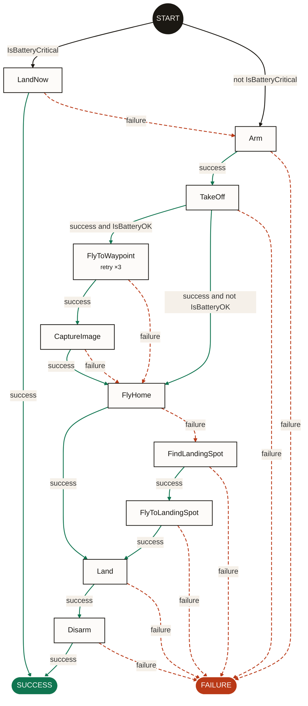

<p align="center">
  <picture>
    <source media="(prefers-color-scheme: dark)" srcset=".branding/logo/lockup-horizontal-dark.svg">
    
  </picture>
</p>

<p align="center">
  <b>The small branch that matters.</b><br>
  Beehave reads a robot behavior tree (BehaviorTree.CPP v3 or v4, or py_trees)
  and shows only the actions your robot can take, in order, with the
  conditions that lead to each one.
</p>

<p align="center">
  <a href="https://github.com/guilyx/beehave/actions/workflows/ci.yml"></a>
  <a href="https://guilyx.github.io/beehave/"></a>
  
  <a href="LICENSE"></a>
  
</p>

---

> **Not the Godot addon.** This Beehave is a static analysis tool for robot
> behavior trees written for [BehaviorTree.CPP](https://www.behaviortree.dev/)
> or [py_trees](https://github.com/splintered-reality/py_trees) (ROS 2, Nav2:
> drones, mobile robots, manipulators). It is unrelated to the Beehave addon
> for the Godot game engine.

## Why

A behavior tree decides what a robot does next, and the file that holds it is
written for the executor, not for people. What happens when a step fails is
spread over fallbacks, decorators, reactive nodes, subtrees in other files or
ROS packages, and blackboard remapping. To answer *"what does the robot do if
this step fails halfway through the task?"*, whether it flies, drives or
grasps, you tick the tree in your head. So does every reviewer, every time.

The tools around behavior trees answer other questions:

- editors and monitors (Groot, Groot2) show the tree as written, or as it runs
  on a robot;
- renderers (`py-trees-render`, Nav2's `bt2img.py`) draw the parent/child
  structure;
- model checkers (BehaVerify and others) need the tree rewritten in their own
  language first.

Beehave reads the file you ship, with nothing built and no robot running, and
answers three questions at a glance:

- **Which actions exist** in this tree?
- **What has to be true** for each one to run?
- **What runs next** on success, and what runs next on failure?

The [prior art survey](https://guilyx.github.io/beehave/research/prior-art/)
compares the existing tools in detail.

## What it does

A 22-node drone mission in, a 10-action graph out. Control nodes become
arrows, conditions become arrow labels, subtrees are inlined, retries become
notes.

```console
$ beehave graph examples/aerial/drone_mission.xml -f mermaid
```



"What if the emergency landing fails?" now takes one arrow to answer, and the
answer is a gap: `LandNow` fails over to `Arm`, so the drone would start the
mission again.

The same works for any robot. The [`examples/`](examples/) folder has three
generic trees:

| Example | Robot | Tree → graph |
| --- | --- | --- |
| [Drone survey mission](examples/aerial/drone_mission.xml) | Multirotor | 22 nodes → 10 actions |
| [Navigate to a goal, with recovery and docking](examples/mobile/navigate_to_goal.xml) | Mobile base | 23 nodes → 11 actions |
| [Pick and place](examples/manipulation/pick_and_place.xml) | Arm and gripper | 24 nodes → 13 actions |

Each one is also written in BehaviorTree.CPP v4 (`*_v4.xml`) and in py_trees
(`*.py`), and every version gives the same graph. The one exception is
instructive: py_trees has no `IfThenElse`, and the usual py_trees way to write
the mobile robot's "charge or navigate" lets a failed dock fall through to
navigation. Beehave shows it as three extra arrows.

## Where it helps

### Reviewing a change

An XML diff shows which tags moved, not what the robot now does. Removing the
`ForceSuccess` around the drone's survey is a two-line change that looks like
a clean-up:

```diff
         <TakeOff altitude="{cruise_altitude}"/>
-        <ForceSuccess>
           <Sequence name="survey">
             ...
           </Sequence>
-        </ForceSuccess>
         <SubTreePlus ID="ReturnToLaunch" __autoremap="true"/>
```

The graph diff shows what it changes:

```diff
-TakeOff --[success and not IsBatteryOK]--> FlyHome
+TakeOff --[success and not IsBatteryOK]--> FAILURE
-FlyToWaypoint --[failure]--> FlyHome
+FlyToWaypoint --[failure]--> FAILURE
-CaptureImage --[failure]--> FlyHome
+CaptureImage --[failure]--> FAILURE
```

When the battery is low after take-off, or the survey fails, the drone no
longer flies home: the tree ends in `FAILURE` with the drone in the air.
Commit the text graph next to the tree and this diff shows up in the pull
request, where reviewers already look.

### Safety and failure reviews

Every failure transition is listed, with the conditions that lead to it. A
hazard review (an FMEA, a test-flight briefing) can walk them one by one
instead of rebuilding them from the XML. That is how the `LandNow` gap above
shows up. Safety engineers, test pilots and operators can read the graph
without reading the XML.

### A CI check that needs no robot

No ROS install, no C++ build, no plugins. Beehave exits with an error when the
XML is malformed or a subtree cannot be found, across files, `<include>`s and
ROS packages. Committed graphs fail CI when the tree changes and the graph was
not updated ([how](https://guilyx.github.io/beehave/guide/cli/#use-in-ci)).

### Migrations

Moving from BT.CPP v3 to v4 (as Nav2 did between Humble and Jazzy), or porting
a tree between BT.CPP and py_trees: the same tree must give the same graph, so
comparing the two graphs checks the port. Beehave's own tests hold its
examples and public BT.CPP v3/v4 pairs to that rule.

### Diagrams that stay true

Mermaid output renders on GitHub, GitLab and most docs sites. Generate the
diagram from the tree and it cannot drift from what the robot runs.

### Input for other tools

`-f json` gives every action with its ports and source line, every transition
with a structured guard, and every warning. Build a test plan from it (one
simulation scenario per failure transition), check a naming rule, or feed an
operator UI.

## What it is not

- **Not an editor or a runtime monitor.** Groot2 does that.
- **Not a proof.** The graph shows what the tree can do; temporal-logic checks
  are an optional later phase.
- **Not exact everywhere yet.** Reactive nodes, loops and `Parallel` are
  approximated, and every approximation is printed as a warning.

## Install

```console
$ pip install beehave-bt                # or: uv tool install beehave-bt
$ pip install 'beehave-bt[py-trees]'    # to read py_trees trees too
```

The PyPI package is `beehave-bt`; the command and the module are `beehave`.
Python 3.10+ (ROS 2 Humble and newer). Under ROS 2, skip the extra and use the
py_trees of your distribution.

## Use

```console
$ beehave graph mission.xml                       # transitions as text
$ beehave graph mission.xml -f mermaid -o mission.mmd
$ beehave graph mission.xml -f dot | dot -Tsvg > mission.svg
$ beehave graph mission.xml -f json               # for other tools
$ beehave stats mission.xml                       # size, reduction, breakage
$ beehave trees mission.xml                       # list the trees
$ beehave graph behavior_trees/ -t NavigateToPose  # every tree in a folder
$ beehave graph --py-trees robot.trees:create_root  # a py_trees tree
```

BT.CPP v3 and v4 files are told apart automatically. Subtrees are inlined
wherever they live: in the same file, in an `<include>`, in a ROS package
(`ros_pkg`), or in a folder of trees registered from code. `--py-trees` imports
your module and calls the function, so it runs that code: only point it at
code you would run yourself.

```python
import beehave

result = beehave.analyze("mission.xml")
print(beehave.to_mermaid(result.graph))
print(result.stats.reduction)
```

Custom nodes are actions unless the XML or a small `beehave.yaml` says they
are conditions:

```yaml
conditions: [BatteryOK, IsEmergency]
```

## Status

Beehave moves along eight tracks, in six milestones
([roadmap](https://guilyx.github.io/beehave/design/roadmap/)).

**Phases** — what the graph says:

| Phase | What | Status |
| --- | --- | --- |
| 1. Action graph | Parse, flatten subtrees, walk, render | **done**, readability gate open |
| 2. Guards and metrics | Simplified guards, exact Reactive/Retry/Parallel, gap report | planned (M3) |
| 3. Operator view | Operator labels, phase view, JSON for ground-control UIs, live status | planned (M5) |
| 4a. Graph safety rules | Safety rules checked on the graph, with witness paths | planned (M4) |
| 4b. Model checking | Temporal-logic rules through BehaVerify | optional (M6) |

**Formats** — what Beehave reads:

| Format | Status |
| --- | --- |
| BehaviorTree.CPP v3 | **supported** |
| BehaviorTree.CPP v4 | **supported**, including `SKIPPED` and pre-conditions |
| py_trees (2.2 and newer) | **supported** |
| Nav2 presets, per ROS distro | planned (M1, M3) |
| Groot2 projects, AutoAPMS, BehaviorTree.ROS2 | planned (M1, M3) |
| State machines (YASMIN, SMACH…) | later (M6) |

**Checks against the graph** — six more tracks:

| Track | What it adds | Starts in |
| --- | --- | --- |
| Foundations | Runtime IDs that match BT.CPP's, a graph hash, a JSON Schema | M1 |
| Integrations | SARIF, GitHub annotations and Action, pre-commit, MCP server, `ros2 beehave` | M1 |
| Quality | `beehave lint`, a quality report, `beehave diff`, grading generated trees | M1 |
| Safety | An evidence manifest, graph safety rules, FMEA and assurance-case exports | M1 |
| Runs | Read BT.CPP logs and Nav2 bags: timelines, edge coverage, conformance | M2 |
| Tests | Coverage criteria, `beehave plan`, mock files for BT.CPP and py_trees | M2 |

Nodes Beehave cannot model exactly yet (reactive nodes, loops, Parallel,
unknown custom nodes) are approximated **and always reported**, never
silently. See the
[node support table](https://guilyx.github.io/beehave/design/phase-1/#node-support).

## Learn more

- 📖 [Documentation](https://guilyx.github.io/beehave/)
- 🧭 [Design: architecture, Phase 1 spec, ADRs](https://guilyx.github.io/beehave/design/)
- 🔬 [Research: BT.CPP semantics, prior art, literature](https://guilyx.github.io/beehave/research/)
- 🗺️ [Roadmap](https://guilyx.github.io/beehave/design/roadmap/)

## Contributing

Contributions are welcome: bug reports with a minimal tree, new node rules,
docs. We work test-first, and every walk rule is checked against a reference
interpreter with property-based tests. Start with
[CONTRIBUTING.md](CONTRIBUTING.md) and the
[good first issues](https://github.com/guilyx/beehave/labels/good%20first%20issue).

Please follow the [Code of Conduct](CODE_OF_CONDUCT.md). Report security
issues privately, as described in [SECURITY.md](SECURITY.md).

## License

[Apache-2.0](LICENSE). The brand (logo, palette, type, graph style) is
documented in [`.branding/`](.branding/README.md); its assets have their own
[license](.branding/LICENSE.md). If you use Beehave in research, see
[CITATION.cff](CITATION.cff).
