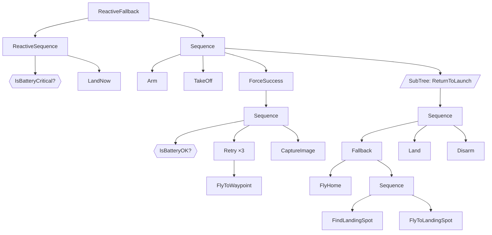
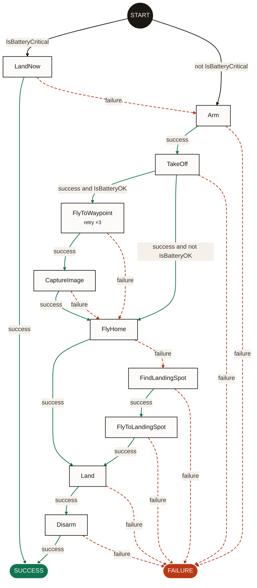

# Phase 1: the action graph

**Status:** in progress · **Format:** BehaviorTree.CPP v3 · **Output:** action graph

## Problem

Behavior trees grow fast. Subtrees, fallbacks, reactive sequences and
decorators stack up until nobody can say what the robot actually does if the
battery drops halfway through a mission without tracing the XML by hand.

Phase 1 answers three questions for any BT.CPP v3 tree, at a glance:

1. Which actions exist in this tree?
2. What has to be true for each one to run?
3. What runs next on success, and what runs next on failure?

## Scope

**In scope**

- Static analysis of BT.CPP v3 XML, including `<include>`,
  `<TreeNodesModel>`, `SubTree` and `SubTreePlus` with `__autoremap`.
- An action graph: one box per action, one arrow per transition, the raw
  guard on each arrow.
- Text, Mermaid, Graphviz DOT and JSON output.
- Works on any tree with no per-tree configuration. One optional project
  file lists custom nodes that are conditions.
- Pilot metrics: size, reduction, longest raw guard, breakage.

**Not in scope for Phase 1**

- Simplifying guards, merging edges (Phase 2).
- Exact rules for reactive nodes, loops and Parallel (Phase 2). Phase 1
  approximates them and says so.
- BT.CPP v4 (Phase 2). Phase 1 detects v4 and refuses it.
- Operator labels and the C2 view (Phase 3).
- Log replay, temporal logic, model checking (later, optional).
- Editing or generating trees.

## Before and after

The drone survey mission from [the examples](../guide/examples.md). The
mobile-robot and pick-and-place examples work the same way.

**Before:** 22 nodes in the flattened tree, 10 of them actions.



**After:** `beehave graph examples/aerial/drone_mission.xml -f mermaid`



What changed:

- **Control nodes are gone.** The Sequences, the Fallback, the
  ReactiveFallback and the ForceSuccess became arrows. ForceSuccess is why
  both outcomes of `CaptureImage` lead to `FlyHome`.
- **Conditions became arrow labels.** `IsBatteryOK` is a guard on the two
  success edges out of `TakeOff`.
- **Retry folded into the action.** It is a note on `FlyToWaypoint`.
- **Subtrees are inlined.** `ReturnToLaunch` is gone as a node; its actions
  joined the graph.
- **The gap is visible.** `LandNow` fails over to `Arm`: if the emergency
  landing fails, the fallback moves on to the mission and the drone would
  start again. In Phase 2 the gap report will flag paths like this
  automatically.

The reactive failsafe is walked like a plain Fallback in Phase 1, so the graph
shows `IsBatteryCritical` only at the start. Phase 2 adds a preemption edge
from every action to `LandNow`. Until then, `beehave` prints a warning for
each reactive node so the reader knows.

## The walk

The walk is a **continuation-passing compilation** of the tree.

Each node is compiled with two continuations:

- `s`: where execution goes when the node **succeeds**;
- `f`: where execution goes when the node **fails**.

Compiling a node returns its **entry**: what runs first when it is ticked. An
entry is an action, a terminal (`SUCCESS`, `FAILURE`), or a **branch point**
on a condition.

| Node | Rule |
| --- | --- |
| Action | Record edges `action → s` on success, `action → f` on failure. Entry is the action. |
| Condition | Entry is a branch: "if it holds → `s`, else → `f`". |
| `Sequence(c₁ … cₙ)` | Compile right to left: `cₙ` with `(s, f)`, then each `cᵢ` with `(entry(cᵢ₊₁), f)`. Entry is `entry(c₁)`. |
| `Fallback(c₁ … cₙ)` | Compile right to left: `cₙ` with `(s, f)`, then each `cᵢ` with `(s, entry(cᵢ₊₁))`. |
| `Inverter(c)` | Compile `c` with `(f, s)`. |
| `ForceSuccess(c)` | Compile `c` with `(s, s)`. |
| `ForceFailure(c)` | Compile `c` with `(f, f)`. |
| `IfThenElse(c, t, e)` | Compile `c` with `(entry(t), entry(e))`; without `e`, `(entry(t), f)`. |
| `Switch(v; k₁ … kₙ; c₁ … cₙ, d)` | A chain of branches on `v == kᵢ`, default `d`. |
| `BlackboardCheck(a, b)(c)` | A branch on `a == b`; mismatch goes to `s` or `f` per `return_on_mismatch`. |
| `AlwaysSuccess`, `SetBlackboard` | Entry is `s` (no box). |
| `AlwaysFailure` | Entry is `f` (no box). |
| Subtree | Compile its inlined body with `(s, f)`. |

The tree's root is compiled with `(SUCCESS, FAILURE)`. Its entry gives the
edges out of `START`.

Finally, each edge target is **expanded**: branch points are followed until a
real action or terminal is reached, and the conditions passed on the way
become the edge's guard. Two things keep guards honest:

- A path that requires a condition to hold and not hold is impossible, so it
  is dropped.
- A condition checked twice on one path appears once.

Both assume a condition gives the same answer when checked twice in the same
tick with no action in between. That is how conditions are meant to be
written in BT.CPP.

The expansion is capped (1024 transitions per action outcome by default). A
tree that hits the cap gets a `too-many-paths` diagnostic rather than an
endless run.

### Why this is correct

`tests/property/test_walk_matches_execution.py` generates random trees from
the node types above, random values for each condition, and random outcomes
for each action. A small reference interpreter runs the tree. Following the
graph with the same values must visit the same actions in the same order and
end with the same result, with **exactly one** matching edge at every step.
That one check proves the guards are complete and mutually exclusive.

## Node support

| Node (BT.CPP v3) | Phase 1 | Notes |
| --- | --- | --- |
| `Sequence`, `SequenceStar` | exact | Memory only matters when a loop re-enters the node; loops are reported on their own. |
| `Fallback` | exact | |
| `Inverter`, `ForceSuccess`, `ForceFailure` | exact | |
| `IfThenElse` | exact | 2 or 3 children; with 2, a failed condition fails the node. |
| `Switch2` … `Switch6` | exact | Guards like `mode == AUTO`; without `variable`, the default child runs. |
| `BlackboardCheckInt/Double/String/Bool` | exact | Guard `a == b`; `RUNNING` on mismatch is approximated. |
| `AlwaysSuccess`, `AlwaysFailure`, `SetBlackboard` | exact | Not shown as boxes. |
| `Delay` | exact | Transparent: it waits, then runs its child. |
| `SubTree`, `SubTreePlus` | exact | Inlined with remapping. |
| `ReactiveSequence`, `ReactiveFallback` | approximated | Walked like the plain version; no preemption edges yet. |
| `RetryUntilSuccessful`, `Repeat` | approximated | Loop folded into a note (`retry ×3`). |
| `KeepRunningUntilFailure` | approximated | Transparent; it never succeeds, which the graph does not show yet. |
| `Timeout` | approximated | Transparent; the extra failure when time runs out is not shown yet. |
| `WhileDoElse` | approximated | Exactly 3 children in v3.8. Walked like `IfThenElse`. |
| `Parallel` | approximated | Children shown as if run one after another. |
| `ManualSelector` | approximated | Walked like a `Fallback`. |
| Custom action / condition | exact | Action unless configured or declared as a condition. |
| Custom decorator | approximated | Treated as transparent. |
| Custom control | approximated | Walked like a `Sequence`. |

BT.CPP 3.8 has no built-in condition nodes. The exact semantics behind this
table, checked against the BT.CPP 3.8.8 source, are in
[the v3 XML reference](../research/btcpp-v3-xml.md). BT.CPP v4 and py_trees
nodes, which came after Phase 1 on the formats track, are covered in
[the formats guide](../guide/formats.md) and in the
[v4](../research/btcpp-v4-xml.md) and [py_trees](../research/py-trees.md)
references.

Every approximated node produces a diagnostic with its location. The
`approximated` line of `beehave stats` is the plan's **breakage** metric: what
Phase 2 has to fix.

## Loading rules

Beehave follows BT.CPP 3.8 where it matters, and warns where BT.CPP is silent:

- `<include>` paths are relative to the including file. Included files are
  loaded before the including file's own trees. `ros_pkg` includes are
  followed through the package's directory (see
  [Subtrees and includes](../guide/subtrees.md)).
- If two trees share an ID, the first one loaded wins (as in BT.CPP) and a
  `duplicate-tree` warning is printed.
- The main tree comes from `main_tree_to_execute` on the first given file
  that has one, or is the only tree.
- `SubTree` values are bare key names. `SubTree` with `"{key}"` points to a
  key literally named `{key}`; Beehave keeps that meaning and warns.
- `SubTreePlus` accepts `{key}` and `${key}`. A literal placed after
  `__autoremap` also overwrites the parent's key in BT.CPP 3.8.4+; Beehave
  warns.
- A compact subtree reference (`<Talk/>` for `<SubTree ID="Talk"/>`) is read
  as a subtree, with a warning, because BT.CPP 3.8 rejects it.

**Detecting v4.** v3.8 ignores `BTCPP_format`, and v4 files often omit it.
Beehave takes a file as v4 if it has `BTCPP_format="4"`, or if it uses a
v4-only node (`SequenceWithMemory`, `Script`, `Precondition`…), a v4-only
attribute (`_skipIf`, `_failureIf`, `_while`, `_autoremap`…), a v4 port value
(`{=}`, `{@key}`) or v4 `Parallel` ports. A node type declared in
`TreeNodesModel` or the config is never taken as evidence, so a v3 project can
still have its own `Sleep` action. Phase 1 refused such files; since the v4
parser landed they are read as v4 ([Formats](../guide/formats.md)).

## Configuration

Beehave works without configuration. A project can add a `beehave.yaml`:

```yaml
conditions:   # custom nodes that only check something
  - BatteryOK
  - IsEmergency
actions:      # force a node to be an action
  - Probe
```

The config is the strongest signal; it overrides `TreeNodesModel` and the
explicit XML form. It is how to fix "conditions in disguise".

## Pilot metrics

`beehave stats tree.xml` prints the Phase 1 numbers:

| Metric | Meaning |
| --- | --- |
| nodes | Nodes in the flattened tree, by kind. |
| actions | Actions shown in the graph. |
| reduction | `1 - actions / nodes`: how much smaller the view is. |
| transitions | Edges in the graph. |
| longest guard | Terms in the longest guard, before simplification. |
| approximated | Node types Phase 1 could not model exactly (breakage). |

For the drone mission: 22 nodes, 10 actions, 55% reduction, 23 transitions,
longest guard 1 term, 3 approximated nodes.

## Exit criteria

Phase 1 is done when:

- [x] The tool produces a graph for the example trees, with the metrics recorded.
- [x] It runs on a set of public trees (Nav2, BT.CPP examples) without manual
      edits, and the breakage list is recorded: see
      [Phase 1 results](phase-1-results.md).
- [ ] Someone who did not write a tree can answer "what happens if X fails?"
      from the graph alone.

When the last box is ticked, we decide whether to carry on to Phase 2 as
planned.
