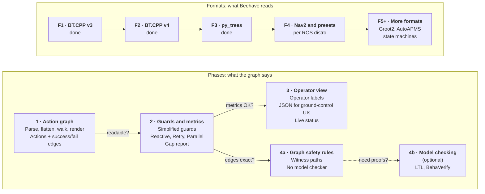
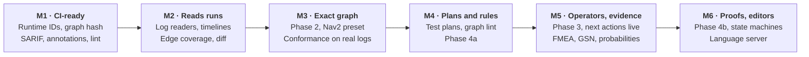

# Roadmap

Beehave moves along eight tracks. Two decide what Beehave is:

- **Phases** decide *what the graph says*: actions first, then simplified
  guards, then the operator view, then safety rules and, only if needed,
  formal proofs.
- **Formats** decide *which trees Beehave can read*. Every format feeds the
  same internal model ([ADR 0002](adr/0002-one-model-many-parsers.md)), so
  every phase works on every format as soon as it lands.

The six others use the action graph as a **reference model**: they check
something else against it (a recorded run, a test suite, another version of
the tree, a safety rule) or bring it to the tools people already use.

| Track | The question it answers | Items |
| --- | --- | --- |
| [Phases](#phases-track) | What does the graph say? | 1, 2, 3, 4a, 4b |
| [Formats](#formats-track) | Which trees can Beehave read? | F1 to F17 |
| [Foundations](#foundations-track) | Can another tool point at one box of the graph? | FD1 to FD6 |
| [Runs](#runs-track) | What did the robot actually do? | RT1 to RT10 |
| [Tests](#tests-track) | Which transitions do the tests reach? | TC1 to TC9 |
| [Quality](#quality-track) | Is the tree well built, and what changed? | QM1 to QM9 |
| [Safety](#safety-track) | Does the tree keep the safety rules? | SV1 to SV16 |
| [Integrations](#integrations-track) | Where do people see the results? | IN1 to IN20 |

Each arrow in the phases is a gate: we only move on when the question on it
gets a "yes". The formats share one gate: **the same tree must give the same
graph**, whatever format it is written in.

Effort is for one maintainer: **S** is up to about two weeks, **M** two to six
weeks, **L** more. These are estimates. Each item links the source that
motivates it.

## Milestones

The milestones order the work by what each item needs, not by value alone.
M1 and M2 need nothing from Phase 2, so they can ship while Phase 2 is being
designed. M3 is Phase 2 and the Nav2 presets, with a concrete exit test.

| Milestone | Items | Done when |
| --- | --- | --- |
| **M1** CI-ready and identifiable | FD1, FD2, FD3, FD6, IN1 to IN5, IN9, SV1, QM1, QM2 (without the async rule), QM7a, F4b, F5; decide D2, D3, D9 | The runtime IDs match BT.CPP's own UID example, and a SARIF upload shows Beehave alerts on a public repository. |
| **M2** Beehave reads runs and diffs | RT1 to RT5, TC1, QM4, FD4, IN6, IN7, IN8, F9; decide D1, D4, D8 | A Nav2 Jazzy bag gives an action timeline and an edge-coverage report, and a pull request shows a graph-diff comment. |
| **M3** Exact graph | Phase 2, FD5, F4a, F4c, F6, F7, RT6, QM2 async rule | The conformance check finds no unexplained step in runs of Nav2's default tree. |
| **M4** Plans, lint and graph rules | TC2 to TC6, QM3, QM5, Phase 4a (SV2), IN10 draft, IN11 to IN14; decide D7 | `beehave plan` covers Nav2's hand-written recovery scenarios, and the starter rule packs run in CI. |
| **M5** Operator view and evidence | Phase 3, IN17, RT7, RT8, RT9, SV3 to SV8, IN10; decide D5 | An operator sees the next actions and their guards live, and a GSN fragment renders. |
| **M6** Proofs, ecosystems, editors | Phase 4b, SV9 to SV12, RT10, F8, F10, F11, QM6, QM9, IN15, IN16, IN18; decide D6 | A BehaVerify counterexample on a Nav2 tree points back to file and line. |
| **On demand** | TC7 to TC9, F12 to F17, SV13 to SV16, QM7b, QM8, IN19, IN20 | A user, a certification or a paper needs it. |

The first items to start, by value for the effort: SARIF output and GitHub
annotations (IN3, IN2), the runtime IDs (FD1), the log readers and the drift
check (RT1, RT3), the graph diff (QM4), the MCP server (IN8), coverage
criteria leading to `beehave plan` (TC1, TC2), the Nav2 preset (F4a), graph
safety rules (SV2), grading generated trees (QM5) and edge coverage over runs
(RT5).

## Open decisions

These change the scope or freeze a public name, so each is settled with an
ADR before the items it blocks start.

| | Question | Proposed answer | Blocks |
| --- | --- | --- | --- |
| **D1** | Do test fixtures and mutants break "Beehave reads; it does not write"? | Beehave never edits a user's tree and never proposes an edit. It may write analysis files and throwaway fixtures to an output or temporary folder. | TC3, TC8, TC9, RT10, SV8 to SV16 |
| **D2** | Keep the name? The Godot addon [bitbrain/beehave](https://github.com/bitbrain/beehave) has over 3,000 stars, and rosdep keys, registries and marketplaces freeze a name for good. | Decide before the first registry entry; [ADR 0006](adr/0006-distribution-name.md) notes that renaming before 1.0 is cheap. If the name stays, Beehave never reads Godot trees. | IN8, IN11, IN13, IN16, F15 |
| **D3** | Where does live data come from? | [btview](https://pypi.org/project/btview/), a separate project, already connects to running trees (Groot2 ZMQ, v3 ZMQ, ROS 2) and records them. It carries, records and shows live data; Beehave reads its recordings and stream through a versioned trace line, and owns the mapping from runtime IDs to actions. Beehave does not ship its own ZMQ client. | RT1, RT7, RT8, Phase 3 |
| **D4** | Does replaying runs cross "Replacing Groot2: not planned"? | No. Replaying runs as actions and transitions is in scope; a node-level editor, monitoring UI and breakpoints are not. | RT1 to RT9 |
| **D5** | Which verifiers must work for commercial users? | Write text models only, call verifiers as optional subprocesses, never import GPL code into the core. nuXmv is [non-commercial](https://nuxmv.fbk.eu/license.html), UPPAAL is [free for academia only](https://uppaal.org/downloads), Storm's Python bindings are [GPL-3.0](https://pypi.org/project/stormpy/). | SV8, SV9, SV13, SV15 |
| **D6** | Read state machines too? | Build FD5 anyway, since Nav2 needs cycles. Add state-machine readers when users ask, YASMIN first. | F10 to F13 |
| **D7** | Split Phase 4? | Yes: 4a, graph rules, scheduled; 4b, model checking, still optional. Beehave is documented as a review aid and never claims to be certified. | SV2, SV9, SV12 |
| **D8** | How many optional dependencies? | New dependencies are extras only; the core stays the standard library plus PyYAML ([ADR 0005](adr/0005-python-minimal-dependencies.md)). The MCP extra needs Python 3.11 or newer. | RT2, QM9, IN8, IN15, RT10 |
| **D9** | Run the Phase 1 gate now? | Yes, as QM7a in M1: Phase 2 waits on it. | Phase 2 and what follows |

## Phases track

### Phase 1: action graph (current)

**Goal:** turn a BT.CPP v3 tree into a graph of actions with success and
failure edges, readable by someone who did not write the tree.

- [x] Parse BT.CPP v3 XML, with includes and `TreeNodesModel`
- [x] Detect v4 files and refuse them clearly (now read by F2)
- [x] Flatten `SubTree` and `SubTreePlus`, including `__autoremap`
- [x] Walk: actions, success and failure edges, raw guards
- [x] Render text, Mermaid, Graphviz DOT and JSON
- [x] Pilot metrics: size, reduction, longest raw guard, breakage
- [x] Property tests against a reference interpreter
- [x] Run on public example trees (Nav2, BT.CPP examples) and record the metrics
      ([results](phase-1-results.md))
- [ ] Gate: someone other than the tree's author answers "what happens if X
      fails?" from the graph alone (QM7a, in M1)

Details: [Phase 1 specification](phase-1.md).

### Phase 2: guards and metrics

- Guard formulas as boolean expressions, simplified (BDD or `sympy`).
- Merge edges that share endpoints.
- Exact rules for the hard cases: preemption edges for reactive nodes,
  self-loops for Retry and Repeat, grouped boxes for Parallel.
- A model with cycles and named outcomes (FD5), which Nav2's `RecoveryNode`
  and state machines need.
- Gap report: actions with no failure path, unreachable actions, loops with
  no exit.
- Run on many real trees and record the metrics: the corpus study (QM6) for
  breadth, and conformance on real Nav2 logs (RT6) as the regression test.
  Today, Nav2's default Jazzy tree (28 nodes, 16 actions) has 7 approximated
  nodes.

### Phase 3: operator view

- Operator labels from a config file (an ontology: action, condition,
  target, task phase), so `ComputePathToPose` reads "Planning a route" and
  `PlanGrasp` reads "Choosing how to hold the object".
- A collapsed phase view (Transit, Search, Return, Land).
- A JSON export a ground-control (C2) UI can draw once before the mission,
  with a JSON Schema and an embeddable viewer (IN17).
- Live status: only the active action and its status go over the link
  (RT7, RT8). The data travels through btview (D3).

### Phase 4a: graph safety rules

- Safety rules written in YAML and checked on the action graph itself:
  precedence ("never take off before armed"), absence after ("no motion after
  an emergency stop"), response to failure ("every failure in flight ends in
  a landing"). See SV2.
- Every verdict comes with a witness path to file and line, and says "holds
  under assumptions" where an approximated node is involved.
- No model checker needed. Scheduled in M4, after Phase 2 makes edges exact.

### Phase 4b: model checking (optional)

- Rules on data and timing, which the graph alone cannot decide, written in
  linear temporal logic.
- Export the abstracted tree to a model checker, through BehaVerify first
  (SV9); other back ends on demand (SV13 to SV15).
- Starts only if a customer or a certification needs proofs.

## Formats track

### F1: BehaviorTree.CPP v3 (done)

Parser, includes, `TreeNodesModel`, `SubTree` and `SubTreePlus` remapping, v4
detection. Tested on the BT.CPP 3.8 examples, the Groot test data and the Nav2
Humble trees.

### F2: BehaviorTree.CPP v4 (done)

- [x] One XML base shared by the v3 and v4 parsers; the version is detected
      from `BTCPP_format` or from v4-only constructs.
- [x] Every node v4 registers, mapped onto the shared model.
- [x] v4 `SubTree` remapping (`{key}`, literals, `{=}`, `{@key}`,
      `_autoremap`), keys inside scripts included.
- [x] Scripts as guards: `ScriptCondition`, `Precondition`, and the
      `_failureIf`, `_successIf`, `_skipIf` and `_while` pre-conditions,
      including the `SKIPPED` status ([ADR 0009](adr/0009-bt-cpp-v4-skipped.md)).
- [x] Tested on the Nav2 Jazzy trees, the BT.CPP 4 examples and tests, and
      other public v4 trees (39 snapshots).
- [x] Gate: the v3 and v4 versions of the same tree give the same graph: our
      examples, six BT.CPP pairs, the one Nav2 tree that is the same in Humble
      and Jazzy, and random trees. The other Nav2 pairs differ on purpose:
      Jazzy added selector actions and recovery guards.

Left for later: post-conditions are read but not drawn, `<TreeNodesModel>`
subtree port defaults are not applied (F4b), and scripts are compared as text,
not as expressions (`a > b` and `b < a` are two conditions).

### F3: py_trees (done)

- [x] An adapter from a live py_trees tree to the shared model
      (`beehave.from_py_trees(root)`), with py_trees as an optional extra
      ([ADR 0010](adr/0010-py-trees-live-trees.md)).
- [x] A CLI form that imports a factory function
      (`beehave graph --py-trees package.module:create_root`).
- [x] Composites, decorators and blackboard checks mapped; `memory=False`
      handled like BT.CPP's reactive nodes.
- [x] Tested on the py_trees demos, on py_trees 2.2.3 and 2.6.
- [x] Gate: the py_trees versions of our examples give the same graph as the
      XML versions, except where py_trees has no equivalent node: it has no
      `IfThenElse`, and the mobile example shows what that changes.

py_trees also opens the door to Phase 4b: BehaVerify, the model-checking tool
in our reading list, takes py_trees trees as input.

### F4: Nav2 and node presets

Nav2's custom nodes are the largest source of breakage on public trees today
([Phase 1 results](phase-1-results.md)), and their behaviour now depends on
the ROS distribution: Lyrical added three control nodes and changed
`RoundRobin`'s default
([migration guide](https://github.com/ros-navigation/docs.nav2.org/blob/rolling/docs/configuration_and_development/migration_guides/kilted/Kilted.md)).

| | Item | Effort | Needs | Milestone |
| --- | --- | --- | --- | --- |
| **F4a** | **Presets.** Let a project say a custom node "behaves like" a built-in one (`PipelineSequence: ReactiveSequence`), and ship a Nav2 preset per distro: `RecoveryNode` as a bounded loop, `RoundRobin` with its memory and `wrap_around`, `PipelineSequence`, `NonblockingSequence`, `PersistentSequence`, `PauseResumeController`, the rate, distance and speed controllers, `SingleTrigger`. ([Nav2 nodes](https://github.com/ros-navigation/docs.nav2.org/blob/rolling/docs/getting_started/nav2_behavior_trees/nav2_specific_nodes/nav2_specific_nodes.md)) | S–M | FD5, Phase 2 | M3 |
| **F4b** | **Node models.** Apply `<TreeNodesModel>` port defaults, such as `number_of_retries`, and find model files on their own: Groot2 projects, ROS packages, Nav2's [`nav2_tree_nodes.xml`](https://github.com/ros-navigation/navigation2/blob/main/nav2_behavior_tree/nav2_tree_nodes.xml) (82 nodes). | S | | M1 |
| **F4c** | **Nav2 parameters.** Read `bt_search_directories` and the default tree from the navigator's parameter file. Folders of trees are already accepted. | S | | M3 |

### F5 to F17: more formats

| | Format | Effort | Needs | Milestone |
| --- | --- | --- | --- | --- |
| **F5** | Groot2 `.btproj` projects: v4 XML with includes, as an entry point. | S | | M1 |
| **F6** | [AutoAPMS](https://github.com/AutoAPMS/auto-apms): `<include autoapms="pkg::file::Tree"/>`, which pulls in one tree and the subtrees it uses, and YAML node manifests as presets. | S | F4a | M3 |
| **F7** | [BehaviorTree.ROS2](https://github.com/BehaviorTree/BehaviorTree.ROS2): a preset so topic publishers count as actions (they are condition nodes in code), and the executor's `behavior_trees` parameter. | S | F4a | M3 |
| **F8** | [PlanSys2](https://github.com/PlanSys2/ros2_planning_system): a preset for its requirement checks and effects, then the plan-level tree rebuilt from its builder template. | S, then M | F4a | M6 |
| **F9** | An ecosystem gallery in the docs: MoveIt Pro objectives, Aerostack2, PlanSys2 action trees and py_trees_ros, which Beehave already reads. | S | | M2 |
| **F10** | [YASMIN](https://github.com/uleroboticsgroup/yasmin) state machines, from their XML (standard library only). | S | FD5, D6 | M6 |
| **F11** | [SMACH](https://github.com/ros/executive_smach) state machines, imported live like py_trees. | S–M | FD5, D6 | M6 |
| **F12** | [FlexBE](https://github.com/FlexBE/flexbe_behavior_engine) behaviors, from the Python it generates. | M | FD5, D6 | On demand |
| **F13** | [RAFCON](https://github.com/DLR-RM/RAFCON) state machines, from their JSON folders. | M | FD5, D6 | On demand |
| **F14** | [behavior3](https://github.com/behavior3/behavior3js) JSON trees. | S | | On demand |
| **F15** | Godot behavior tree scenes (`.tscn`, `.tres`). | M | D2 | On demand |
| **F16** | QGroundControl `.plan` missions, to compare a linear mission with its tree. | S–M | FD5 | On demand |
| **F17** | [Open-RMF](https://github.com/open-rmf/rmf_task) composed tasks. | S–M | FD5 | On demand |

Skipped on purpose: Unreal and Unity trees (binary or proprietary editor
assets), SMACC2 (its structure lives in C++ templates), MoveIt Task
Constructor (a planning search, not runtime control flow), SkiROS2 (mostly
ROS 1, built against a live world model), and CoSTAR, BTCompiler and
BehaviorTree.js (inactive or niche).

## Foundations track

Small items that let logs, tests, diffs and editors point at one box of the
graph. BT.CPP v4 numbers nodes per tree, depth first, from 1, with each
SubTree node numbered before its contents
([source](https://github.com/BehaviorTree/BehaviorTree.CPP/blob/03ec870a07b384f0766bbfe81f77c64a9f994a2b/src/bt_factory.cpp#L756)),
so Beehave can compute the same IDs from the XML. v3 numbers nodes per
process, so v3 logs must be read with the tree they embed.

| | Item | Effort | Needs | Milestone |
| --- | --- | --- | --- | --- |
| **FD1** | **Runtime IDs.** Every vertex records its BT.CPP v4 UID and path, or its py_trees path; `beehave ids tree.xml` prints them. Tested on BT.CPP's own [UID example](https://github.com/BehaviorTree/btcpp_website/blob/9cc7aadf176194aa19150d224f62368c9c7f81b0/docs/tutorial-basics/tutorial_10_observer.md). | S | | M1 |
| **FD2** | **Stable identity.** A key that survives edits, kept apart from the display IDs `a1`, `a2`…, so diffs, plans and hovers keep pointing at the same action. | S–M | FD1 | M1 |
| **FD3** | **Graph hash.** A hash of the action graph and of the inlined XML, in the JSON and with `--print-hash`, so a robot, a review and a log can name the tree they mean. | S | | M1 |
| **FD4** | **JSON Schema.** Published and versioned, with the source format, provenance per vertex, the guard language and approximation flags: an exchange format for analysis tools. | S–M | FD2, FD3 | M2 |
| **FD5** | **Cycles and named outcomes.** Edges with outcomes other than success and failure, loops that every algorithm and metric handles, parallel regions. | M | Phase 2 | M3 |
| **FD6** | **Rule registry.** A stable ID, a short and a long description and a help link for every diagnostic and lint rule, reused by SARIF, lint and assurance cases. | S | | M1 |

## Runs track

BT.CPP v4's file and SQLite loggers embed the running tree, with each node's
UID and path, then every status change
([FileLogger2](https://github.com/BehaviorTree/BehaviorTree.CPP/blob/03ec870a07b384f0766bbfe81f77c64a9f994a2b/src/loggers/bt_file_logger_v2.cpp#L62),
[SqliteLogger](https://github.com/BehaviorTree/BehaviorTree.CPP/blob/03ec870a07b384f0766bbfe81f77c64a9f994a2b/include/behaviortree_cpp/loggers/bt_sqlite_logger.h)).
Groot2 replays them node by node, and its free edition stops at 20 nodes
([pricing](https://github.com/BehaviorTree/btcpp_website/blob/9cc7aadf176194aa19150d224f62368c9c7f81b0/src/pages/groot.js));
Nav2's default tree has 28. No tool found replays a run as actions and
transitions, or checks a run against a model of its tree. Live transport and
recording belong to btview (D3).

| | Item | Effort | Needs | Milestone |
| --- | --- | --- | --- | --- |
| **RT1** | **Log readers.** BT.CPP v4 `.btlog` and `.db3` files (standard library only) and btview recordings, into one trace format; v3 `.fbl` later. Tested on real files from each BT.CPP release, since the formats are documented only in code. | S | FD1, D3 | M2 |
| **RT2** | **Bag readers.** Nav2's `behavior_tree_log` (UIDs from Jazzy on; names only on Humble, where ambiguity is reported) and py_trees_ros snapshots, from rosbag2 or MCAP files, without ROS installed ([rosbags](https://pypi.org/project/rosbags/)). | M | RT1, D8 | M2 |
| **RT3** | **Drift check.** The tree a log embeds is the tree that was reviewed: same nodes, same UIDs, same action graph. | S | FD1, RT1 | M2 |
| **RT4** | **Run timeline.** `START → Arm ✔ → TakeOff ✖ → FAILURE`, with guard values and durations, as text, highlighted Mermaid and JSON. | S–M | RT1 | M2 |
| **RT5** | **Many runs.** Counts, failure rates and durations per action and per edge, paths taken, edges never taken, a heat overlay, and a minimum-coverage gate for CI. Existing tools count nodes only ([bt_tools](https://github.com/boschresearch/bt_tools)). | M | RT4 | M2 |
| **RT6** | **Conformance.** Every step of a run must follow an edge of the graph. Each deviation is "known approximation", "different tree" or "unexplained". Also Phase 2's regression test on real data. | M | RT4; exact after Phase 2 and F4a | M3 |
| **RT7** | **Next actions, live.** Show the running action with its outgoing edges and guards ("on failure → `ReturnHome` if `battery_ok`"), from btview's stream or py_trees. | M | FD1, Phase 2, Phase 3, D3 | M5 |
| **RT8** | **Ground-link status.** Send the graph hash once, then a few bytes per change (action index and status), instead of a status byte per node on every poll ([Groot2 layout](https://github.com/BehaviorTree/BehaviorTree.CPP/blob/03ec870a07b384f0766bbfe81f77c64a9f994a2b/src/loggers/groot2_publisher.cpp#L136)). | M | FD3, Phase 3 | M5 |
| **RT9** | **Why a run failed.** The action that failed, the fallbacks tried, the guards that were false, with subtree and source line. | M | RT4, Phase 2, Phase 3 | M5 |
| **RT10** | **Runtime rules.** Check the safety rules (SV2) on recorded and live runs, and export them as monitor specifications ([RTAMT](https://pypi.org/project/rtamt/), BehaVerify). | L | SV2, RT4, RT7, D1 | M6 |

## Tests track

Forcing an outcome is solved: BT.CPP v4 substitution rules and test nodes
([tutorial](https://github.com/BehaviorTree/btcpp_website/blob/master/docs/tutorial-advanced/tutorial_15_replace_rules.md)),
py_trees' `StatusQueue`, Nav2's dummy servers. Choosing which outcomes to
force is not: Nav2's own system test writes its recovery scenarios by hand
([test](https://github.com/ros-navigation/navigation2/blob/main/nav2_system_tests/src/behavior_tree/test_behavior_tree_node.cpp)).
Coverage criteria from state-machine testing map directly onto the action
graph. Our mobile example has 25 edges, 10 of which end the tree, so taking
every edge needs at least 10 scenarios.

| | Item | Effort | Needs | Milestone |
| --- | --- | --- | --- | --- |
| **TC1** | **Coverage criteria.** Action, outcome, edge, guard (in the spirit of MC/DC), edge-pair and bounded path coverage, defined on the action graph ([state-based criteria](https://cs.gmu.edu/media/techreports/ISE-TR-99-01.pdf)); `beehave stats` reports the scenarios edge coverage needs. | S | | M2 |
| **TC2** | **`beehave plan`.** The smallest set of scenarios that takes every edge: the outcome of each action, the guards that hold, the expected path and end. As JSON and Markdown. It must cover Nav2's hand-written scenarios. | M | Phase 2, FD2 | M4 |
| **TC3** | **Mock files.** Each scenario as a py_trees pytest file, BT.CPP substitution rules (JSON) or Nav2 failure ranges. | S each | TC2, FD1, D1 | M4 |
| **TC4** | **`beehave faults`.** Single and double fault campaigns, one per action call, in the TC3 formats. | S | TC2, TC3 | M4 |
| **TC5** | **Trace oracle.** Check a test run's log against its scenario's expected path. | S–M | TC2, RT6 | M4 |
| **TC6** | **Coverage gate.** Fail a pull request that adds a failure edge no scenario and no logged run takes. | S | QM4, RT5, IN5 | M4 |
| **TC7** | **Scenario-to-edge matrix.** Map existing suites (scenario_execution, launch_testing, Nav2 tests) to the edges they take, to find redundant simulation runs. | M | RT5 | On demand |
| **TC8** | **Static mutation score.** Mutate the tree in memory (Sequence for Fallback, reordered or dropped children, an added Inverter, one retry more or less), drop mutants whose graph does not change, report the changed edges no test takes. | M | TC2 or RT5, D1 | On demand |
| **TC9** | **Dynamic mutation.** Write mutant XML to a temporary folder and run the project's tests against each one. | L | TC8, D1 | On demand |

## Quality track

Published behavior-tree metrics are descriptive: none has been checked
against how well people understand trees
([Iovino et al.](https://arxiv.org/abs/2405.16137)), so Beehave labels its
numbers that way. Known mistakes are scattered across BT.CPP issues, and no
maintained command-line linter was found. Papers that generate trees score
them by parsing, simulation or text similarity of the XML
([BTGenBot](https://arxiv.org/abs/2403.12761)); comparing action graphs
ignores how a tree is written, which is the rule Beehave already enforces
across formats.

| | Item | Effort | Needs | Milestone |
| --- | --- | --- | --- | --- |
| **QM1** | **Quality report** (`beehave stats --quality`): depth, branching, share of custom nodes, subtree reuse, elements per action, cyclomatic number, paths to `SUCCESS`, share of actions with failure handling. | S | | M1 |
| **QM2** | **`beehave lint`, tree rules.** Several async children in a `ReactiveSequence` ([#875](https://github.com/BehaviorTree/BehaviorTree.CPP/issues/875)), failure masked by `ForceSuccess` or `Inverter` over an action, dead alternatives, a blackboard key read before any write. Each rule can be turned off in `beehave.yaml`. | S–M | FD6; the async rule needs F4a | M1, async rule M3 |
| **QM3** | **Graph rules.** The Phase 2 gap report, plus: fall-through after a failed safety action, an unguarded way back to the mission start (`LandNow → Arm` in our drone example), guards that never hold or that overlap, conditions checked twice. | M | Phase 2; `safety:` tags in `beehave.yaml` | M4 |
| **QM4** | **`beehave diff old new`.** Actions and edges added and removed, changed guards, ends that became reachable or unreachable, and a score: transition precision, recall and F1. Markdown and JSON. | S–M | FD2 | M2 |
| **QM5** | **`beehave eval`.** Grade generated trees against a reference, in steps: it parses; it fits the node palette; nothing is approximated; it is lint-clean; its transitions match (F1). Reads BTGenBot's JSON too. | M | QM2, QM4, F4b | M4 |
| **QM6** | **Corpus study.** The XML trees of the [Ghzouli et al. dataset](https://github.com/RazanGhzouli/Behavior-Trees-in-Action) (fetched at pinned commits, not copied: each project keeps its licence), Nav2 across distros and the BT.CPP examples. Measures breakage, metrics and how often each lint rule fires; the breakage ranks the presets. | M–L | QM1, QM2, F4a | M6 |
| **QM7** | **Readability check.** (a) People who did not write the trees answer "what happens if X fails?" from the graphs, which closes the Phase 1 gate. (b) Later, a proper comprehension study. | S (a), L (b) | | M1 (a), on demand (b) |
| **QM8** | **Clone detector.** Repeated subgraphs that could be one subtree. | M | QM1 | On demand |
| **QM9** | **Behavioural comparison.** Graph edit distance (optional networkx, with a timeout) and equivalence checks once edges are exact. | M–L | Phase 2, FD5, D8 | M6 |

## Safety track

Beehave will not claim to be certified. Used as a review aid, a static
analyser falls in the lowest tool class of IEC 61508, ISO 26262 and DO-330
(according to vendor summaries; the standards themselves are paywalled), so
reproducible evidence makes it cheap to qualify. Most common robot safety
rules are reachability questions on the action graph and need no model
checker ([property patterns](https://people.cs.ksu.edu/~dwyer/SPAT/absence.html)).
No work was found that derives FMEA, fault trees or STPA tables from behavior
trees.

| | Item | Effort | Needs | Milestone |
| --- | --- | --- | --- | --- |
| **SV1** | **Evidence manifest.** Input hashes, Beehave version, config, every approximation, and the output: what a reviewer needs to reproduce a result. | S | FD3 | M1 |
| **SV2** | **Graph safety rules (Phase 4a).** Rules in YAML named after the Dwyer and [PsALM](https://orbilu.uni.lu/handle/10993/41561) patterns: precedence, absence after, response to failure, guarded entry, safe end. A witness path for each verdict. Starter packs for drones, mobile bases and arms. | M | Phase 2, Phase 3, F4a, D7 | M4 |
| **SV3** | **Traceability.** Hazard → action → file:line → guard → rule result. | S–M | Phase 2 | M5 |
| **SV4** | **FMEA worksheet.** One row per action failure, with its local and end effect and the fallbacks that catch it; severity, occurrence and detection are left to engineers. | S | | M5 |
| **SV5** | **Triggering conditions.** Condition → fallback → end, a start for SOTIF and UL 4600 hazard lists. | S | Phase 2, Phase 3 | M5 |
| **SV6** | **HAZOP aid.** For each action, what comes before, retries, preemptions and guards, laid out against the guide words. | S | Phase 2 | M5 |
| **SV7** | **Assurance cases.** GSN fragments for [gsn2x](https://github.com/jonasthewolf/gsn2x): a goal per rule, an assumption per approximation, the manifest as evidence. CI marks them stale when the graph hash changes. | S | SV1, SV2, SV3 | M5 |
| **SV8** | **Success probability.** From a probability per action, the chance of `SUCCESS` and of reaching a hazard, computed in Python ([stochastic BTs](https://www.csc.kth.se/~miccol/Michele_Colledanchise/Publications_files/ICRA14_cmo_final.pdf)); plus a PRISM export for Storm. | S–M | Phase 2, D5 | M5 |
| **SV9** | **BehaVerify export (Phase 4b).** The flattened tree as a [BehaVerify](https://github.com/verivital/behaverify) model, rules as LTL and CTL, counterexamples mapped back to file and line. | M | Phase 2, F4a, SV2, D5 | M6 |
| **SV10** | **Fault tree** for "the mission fails", with minimal cut sets: a Sequence is an OR gate, a Fallback an AND gate. | M | Phase 2 | M6 |
| **SV11** | **STPA skeleton.** Unsafe-control-action rows from actions and their guard contexts. | M | Phase 2, Phase 3, SV2 | M6 |
| **SV12** | **Qualification kit.** Tool requirements, known limits ([ADR 0004](adr/0004-approximate-and-report.md)), the reference-interpreter suite ([ADR 0007](adr/0007-test-driven-with-a-reference-interpreter.md)), and how they map to the tool classes. | M | SV1 | M6 |
| **SV13** | **SMV export** for NuSMV, whose licence allows commercial use. | M | SV2, D5 | On demand |
| **SV14** | **AS2FM input.** Flattened XML plus leaf stubs for [AS2FM](https://github.com/convince-project/AS2FM), which already checks BT.CPP trees statistically. | M | | On demand |
| **SV15** | **Timed export** to Fiacre and Tina. | L | Phase 2 | On demand |
| **SV16** | **SACM export** of the assurance-case fragments. | M | SV7 | On demand |

## Integrations track

The cheapest wide-reaching work is CI: Beehave's diagnostics already carry a
code, a severity and a file and line, which is what GitHub annotations and
[SARIF](https://github.com/github/docs/blob/main/content/code-security/reference/code-scanning/sarif-files/sarif-support.md)
need. No editor, ground station, fleet manager or Foxglove panel found shows
the action flow of a behavior tree, and the ROS MCP servers found work on
running systems only.

| | Item | Effort | Needs | Milestone |
| --- | --- | --- | --- | --- |
| **IN1** | `beehave graph --check`: exit 1 with a diff when a committed graph is out of date. | S | | M1 |
| **IN2** | `-f github`: workflow annotations on the right file and line, on by default under GitHub Actions. | S | FD6 | M1 |
| **IN3** | `-f sarif`: SARIF 2.1.0 for GitHub code scanning, the VS Code SARIF viewer and reviewdog. | S | FD6 | M1 |
| **IN4** | Pre-commit hooks (`.pre-commit-hooks.yaml`): `beehave-check` and `beehave-lint`. | S | IN1 | M1 |
| **IN5** | A GitHub Action: check, annotations, optional SARIF upload, and a Mermaid job summary. | S | IN1 to IN3 | M1 |
| **IN6** | `-f codeclimate` for GitLab merge requests. | S | FD6 | M2 |
| **IN7** | A pull-request comment with the graph diff and a Mermaid snippet. | S | QM4, IN5 | M2 |
| **IN8** | An MCP server (`beehave[mcp]`) with tools to analyse a tree, ask what runs after a failure, diff two trees and check them, so coding assistants can verify their edits. | S–M | QM4, D2, D8 | M2 |
| **IN9** | A short instructions file for coding assistants: run Beehave after editing a tree, and treat its errors as failures. | S | | M1 |
| **IN10** | `beehave explain` (`-f prose`): plain, deterministic sentences for every failure path. | S–M | Phase 3 | M4 draft, M5 |
| **IN11** | A `ros2 beehave` command, in a small separate ROS package. | S | D2 | M4 |
| **IN12** | A pytest helper and a CMake macro, so `colcon test` fails on broken or out-of-date trees. | S, M | IN1 | M4 |
| **IN13** | A rosdep key. | S | D2 | M4 |
| **IN14** | MkDocs and Sphinx plugins that draw a tree in the docs, falling back to SVG for large graphs. | S–M | | M4 |
| **IN15** | A language server: diagnostics on save, an "on failure → Y (guard)" hover, go to subtree. | M | Phase 2, FD2, D8 | M6 |
| **IN16** | A VS Code and Open VSX extension using it, with a live Mermaid preview. | S–M | IN15, D2 | M6 |
| **IN17** | The ground-control JSON, with a schema and an embeddable web viewer that takes status updates (Phase 3). | M | FD3, FD4, Phase 3 | M5 |
| **IN18** | A Foxglove panel around that viewer ([extensions](https://github.com/foxglove/create-foxglove-extension)). | M, L live | IN17, RT7 | M6 |
| **IN19** | A ROS release (`ros-<distro>-beehave`), with its upkeep per distro. | M | IN13 | On demand |
| **IN20** | Vendor surfaces: QGroundControl, Open-RMF web, rqt. | L each | IN17 | On demand |

## Not planned

- Editing a user's tree, or generating trees. Beehave reads; it does not
  write. D1 proposes one exception: analysis files and throwaway test
  fixtures, written to their own folder.
- Replacing Groot2. Groot2 edits and monitors trees; Beehave explains them.
  D4 proposes that replaying runs as actions is explaining, not monitoring.
- A ZMQ client or terminal UI of its own: btview does that (D3).
- Readers for Unreal, Unity and SMACC2, and RViz or PlotJuggler plugins.
- Claiming that Beehave, or anything checked with it, is certified.
