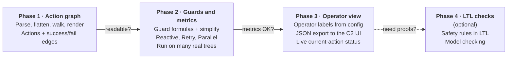

# Roadmap

Graph first, then the operator view. Formal proofs only if we need them.
Phases 1 to 3 deliver the operator view. Phase 4 is optional.

Each arrow is a gate. We only move on when the question on it gets a "yes".

## Phase 1: action graph (current)

**Goal:** turn a BT.CPP v3 tree into a graph of actions with success and
failure edges, readable by someone who did not write the tree.

- [x] Parse BT.CPP v3 XML, with includes and `TreeNodesModel`
- [x] Detect v4 files and refuse them clearly
- [x] Flatten `SubTree` and `SubTreePlus`, including `__autoremap`
- [x] Walk: actions, success and failure edges, raw guards
- [x] Render text, Mermaid, Graphviz DOT and JSON
- [x] Pilot metrics: size, reduction, longest raw guard, breakage
- [x] Property tests against a reference interpreter
- [ ] Run on public example trees (Nav2, BT.CPP examples) and record the metrics
- [ ] Gate: someone other than the tree's author answers "what happens if X
      fails?" from the graph alone

Details: [Phase 1 specification](phase-1.md).

## Phase 2: guards and metrics

- Guard formulas as boolean expressions, simplified (BDD or `sympy`).
- Merge edges that share endpoints.
- Exact rules for the hard cases: preemption edges for reactive nodes,
  self-loops for Retry and Repeat, grouped boxes for Parallel.
- Gap report: actions with no failure path, unreachable actions, loops with
  no exit.
- BT.CPP v4 parser.
- Run on many real trees and record the metrics.

## Phase 3: operator view

- Operator labels from a config file (an ontology: action, condition, zone,
  mission phase), so `ResolveClosestZone` reads "Finding nearest home zone".
- A collapsed phase view (Transit, Search, Return, Land).
- A JSON export a ground-control (C2) UI can draw once before the mission.
- Live status: only the active action and its status go over the link.

## Phase 4: LTL checks (optional)

- Safety rules written in linear temporal logic, such as "never take off
  before armed".
- Export the abstracted tree to a model checker (for example nuXmv), possibly
  through an adapter to BehaVerify.
- Starts only if a customer or a certification needs proofs.

## Not planned

- Editing or generating trees. Beehave reads; it does not write.
- Replacing Groot2. Groot2 edits and monitors trees; Beehave explains them.
