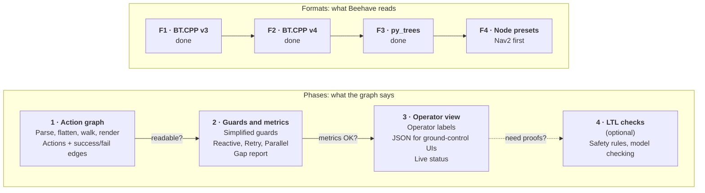

# Roadmap

Beehave moves along two tracks at the same time:

- **Phases** decide *what the graph says*: actions first, then simplified
  guards, then the operator view, then (only if needed) formal proofs.
- **Formats** decide *which trees Beehave can read*. Every format feeds the
  same internal model ([ADR 0002](adr/0002-one-model-many-parsers.md)), so
  every phase works on every format as soon as it lands.

Each arrow in the phases is a gate: we only move on when the question on it
gets a "yes". The formats share one gate: **the same tree must give the same
graph**, whatever format it is written in.

## Formats track

### F1: BehaviorTree.CPP v3 (done)

Parser, includes, `TreeNodesModel`, `SubTree` and `SubTreePlus` remapping, v4
detection. Tested on the BT.CPP 3.8 examples, the Groot test data and the Nav2
Humble trees.

### F2: BehaviorTree.CPP v4 (done)

- [x] One XML base shared by the v3 and v4 parsers; the version is detected
      from `BTCPP_format` or from v4-only constructs.
- [x] Every node v4 registers, mapped onto the shared model.
- [x] v4 `SubTree` remapping (`{key}`, literals, `{=}`, `{@key}`,
      `_autoremap`), keys inside scripts included.
- [x] Scripts as guards: `ScriptCondition`, `Precondition`, and the
      `_failureIf`, `_successIf`, `_skipIf` and `_while` pre-conditions,
      including the `SKIPPED` status ([ADR 0009](adr/0009-bt-cpp-v4-skipped.md)).
- [x] Tested on the Nav2 Jazzy trees, the BT.CPP 4 examples and tests, and
      other public v4 trees (39 snapshots).
- [x] Gate: the v3 and v4 versions of the same tree give the same graph: our
      examples, six BT.CPP pairs, the one Nav2 tree that is the same in Humble
      and Jazzy, and random trees. The other Nav2 pairs differ on purpose:
      Jazzy added selector actions and recovery guards.

Left for later: post-conditions are read but not drawn, `<TreeNodesModel>`
subtree port defaults are not applied, and scripts are compared as text, not
as expressions (`a > b` and `b < a` are two conditions).

### F3: py_trees (done)

- [x] An adapter from a live py_trees tree to the shared model
      (`beehave.from_py_trees(root)`), with py_trees as an optional extra
      ([ADR 0010](adr/0010-py-trees-live-trees.md)).
- [x] A CLI form that imports a factory function
      (`beehave graph --py-trees package.module:create_root`).
- [x] Composites, decorators and blackboard checks mapped; `memory=False`
      handled like BT.CPP's reactive nodes.
- [x] Tested on the py_trees demos, on py_trees 2.2.3 and 2.6.
- [x] Gate: the py_trees versions of our examples give the same graph as the
      XML versions, except where py_trees has no equivalent node: it has no
      `IfThenElse`, and the mobile example shows what that changes.

py_trees also opens the door to Phase 4: BehaVerify, the model-checking tool
in our reading list, takes py_trees trees as input.

### F4: node presets

- Let a project say a custom node "behaves like" a built-in one
  (`PipelineSequence: ReactiveSequence`), with a shipped preset for Nav2's
  `RecoveryNode`, `PipelineSequence`, `RoundRobin` and decorators. This is
  the largest source of breakage on public trees today
  ([Phase 1 results](phase-1-results.md)).

## Phases track

### Phase 1: action graph (current)

**Goal:** turn a BT.CPP v3 tree into a graph of actions with success and
failure edges, readable by someone who did not write the tree.

- [x] Parse BT.CPP v3 XML, with includes and `TreeNodesModel`
- [x] Detect v4 files and refuse them clearly (now read by F2)
- [x] Flatten `SubTree` and `SubTreePlus`, including `__autoremap`
- [x] Walk: actions, success and failure edges, raw guards
- [x] Render text, Mermaid, Graphviz DOT and JSON
- [x] Pilot metrics: size, reduction, longest raw guard, breakage
- [x] Property tests against a reference interpreter
- [x] Run on public example trees (Nav2, BT.CPP examples) and record the metrics
      ([results](phase-1-results.md))
- [ ] Gate: someone other than the tree's author answers "what happens if X
      fails?" from the graph alone

Details: [Phase 1 specification](phase-1.md).

### Phase 2: guards and metrics

- Guard formulas as boolean expressions, simplified (BDD or `sympy`).
- Merge edges that share endpoints.
- Exact rules for the hard cases: preemption edges for reactive nodes,
  self-loops for Retry and Repeat, grouped boxes for Parallel.
- Gap report: actions with no failure path, unreachable actions, loops with
  no exit.
- Run on many real trees and record the metrics.

### Phase 3: operator view

- Operator labels from a config file (an ontology: action, condition,
  target, task phase), so `ComputePathToPose` reads "Planning a route" and
  `PlanGrasp` reads "Choosing how to hold the object".
- A collapsed phase view (Transit, Search, Return, Land).
- A JSON export a ground-control (C2) UI can draw once before the mission.
- Live status: only the active action and its status go over the link.

### Phase 4: LTL checks (optional)

- Safety rules written in linear temporal logic, such as "never take off
  before armed".
- Export the abstracted tree to a model checker (for example nuXmv), possibly
  through an adapter to BehaVerify.
- Starts only if a customer or a certification needs proofs.

## Not planned

- Editing or generating trees. Beehave reads; it does not write.
- Replacing Groot2. Groot2 edits and monitors trees; Beehave explains them.
