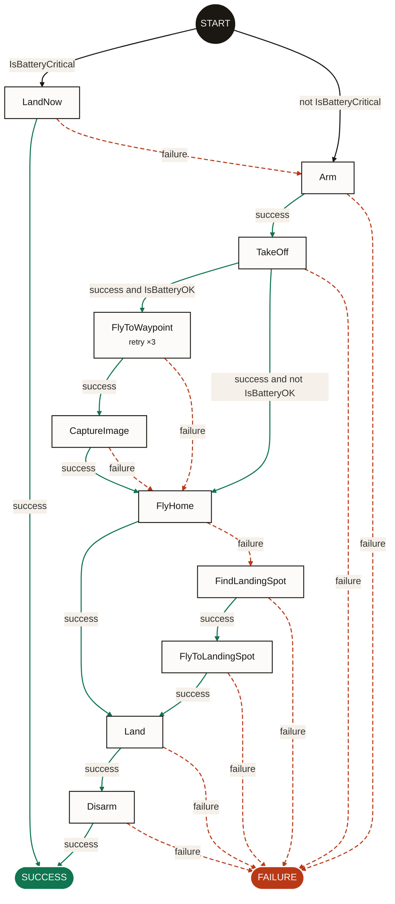
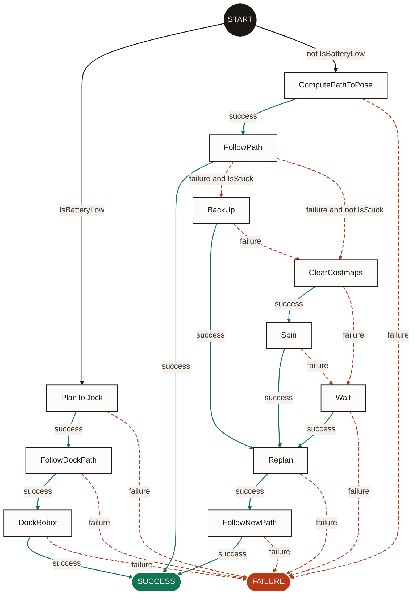
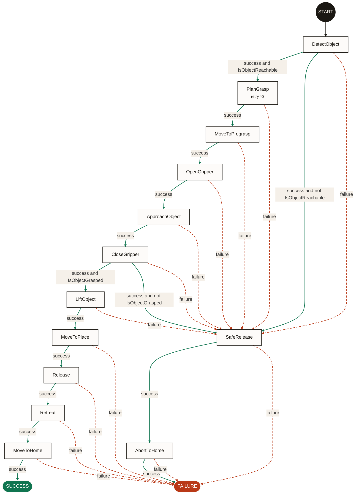

# Examples

The trees live in the [`examples/`](https://github.com/guilyx/beehave/tree/main/examples)
folder of the repository.

Three small trees, one per kind of robot. Each file is plain BehaviorTree.CPP v3
XML and declares its node kinds in `<TreeNodesModel>`, so Beehave needs no
configuration to read it. Each one also exists in BT.CPP v4 and in py_trees
([below](#every-example-in-three-formats)). The node names follow vocabulary that is common
across autopilots, navigation stacks and motion planners, not any one product.

| Example | Robot | Tree | Graph | What it shows |
| --- | --- | ---: | ---: | --- |
| [`aerial/drone_mission.xml`](https://github.com/guilyx/beehave/blob/main/examples/aerial/drone_mission.xml) | Multirotor | 22 nodes | 10 actions | A reactive failsafe, a retry, a subtree, and a gap |
| [`mobile/navigate_to_goal.xml`](https://github.com/guilyx/beehave/blob/main/examples/mobile/navigate_to_goal.xml) | Mobile base | 23 nodes | 11 actions | `IfThenElse`, recovery behaviours, two subtrees; no approximation |
| [`manipulation/pick_and_place.xml`](https://github.com/guilyx/beehave/blob/main/examples/manipulation/pick_and_place.xml) | Arm and gripper | 24 nodes | 13 actions | Two checks, a safe abort, and a missing failure path |

Try them:

```console
$ beehave graph examples/aerial/drone_mission.xml
$ beehave stats examples/mobile/navigate_to_goal.xml
$ beehave graph examples/manipulation/pick_and_place.xml -f mermaid
```

## Aerial: a drone survey mission

Arm, take off, fly to a waypoint and take a picture, then return to launch
whether or not the survey worked. A failsafe lands at once if the battery
becomes critical.

What to look for:

- `IsBatteryCritical` guards the first transition: the failsafe is checked
  before anything else.
- **A gap:** `LandNow` fails over to `Arm`. If the emergency landing fails,
  the fallback moves on to the mission and the drone would start again. The
  XML hides this; the graph shows it as one arrow.
- When `IsBatteryOK` does not hold, the drone skips the survey and flies home.
- The failsafe is reactive. Phase 1 walks it like a plain fallback and says
  so in a warning; preemption edges come in Phase 2.



## Mobile robot: navigate to a goal

If the battery is low, dock. Otherwise plan a path and follow it. If following
fails, recover (back up when stuck, else clear the costmaps and spin, else
wait), then plan again.

What to look for:

- `IsBatteryLow` splits the very first step between docking and navigating.
- The choice of recovery becomes guards on the failure edge of `FollowPath`.
- Every recovery ends in `Replan`.
- No warnings: every node in this tree is modelled exactly.



## Manipulator: pick and place

Detect the object, check it is reachable, plan a grasp (up to three tries),
approach, close the gripper and check the grasp before lifting. Then move to
the place pose, release and retreat.

What to look for:

- Two checks become guards: `IsObjectReachable` after detection and
  `IsObjectGrasped` after closing the gripper.
- Every failure during the pick funnels into `SafeRelease`, then
  `AbortToHome`, then `FAILURE`. The `AlwaysFailure` leaf that forces this is
  not drawn as a box.
- **A gap:** `MoveToPlace` fails straight to `FAILURE`, with the object still
  in the gripper. The pick has a safe abort; the place does not.



## Every example in three formats

Each example also exists as BehaviorTree.CPP v4 XML and as a py_trees script,
next to the v3 file:

| v3 | v4 | py_trees |
| --- | --- | --- |
| `aerial/drone_mission.xml` | `aerial/drone_mission_v4.xml` | `aerial/drone_mission.py` |
| `mobile/navigate_to_goal.xml` | `mobile/navigate_to_goal_v4.xml` | `mobile/navigate_to_goal.py` |
| `manipulation/pick_and_place.xml` | `manipulation/pick_and_place_v4.xml` | `manipulation/pick_and_place.py` |

```console
$ beehave graph examples/aerial/drone_mission_v4.xml
$ beehave graph --py-trees examples/aerial/drone_mission.py:create_root -c examples/beehave.yaml
```

The tests check that every version gives the same graph. py_trees has no list
of node kinds like `<TreeNodesModel>`, so
[`examples/beehave.yaml`](https://github.com/guilyx/beehave/blob/main/examples/beehave.yaml)
says that the behaviours derived from `Check` are conditions.

There is one exception, and it is worth a look. py_trees has no `IfThenElse`,
and the usual way to write "charge or navigate" in py_trees is a `Selector`
over `[Sequence(IsBatteryLow, dock), navigate]`. There, a failed dock falls
through to navigation, so a robot with a low battery that cannot dock drives
off to its goal. The py_trees graph of the mobile example shows it as three
arrows the XML graph does not have:

```text
PlanToDock --[failure]--> ComputePathToPose
FollowDockPath --[failure]--> ComputePathToPose
DockRobot --[failure]--> ComputePathToPose
```

## Adding an example

Good examples are small (under about 30 nodes), use names any robotics
engineer would recognise, and show one or two things worth noticing. Declare
every custom node in `<TreeNodesModel>`, write the v4 and py_trees versions
too, add the expected graph to `tests/unit/test_examples.py`, then refresh the
graphs in the docs:

```console
$ uv run python scripts/update_docs_graphs.py
```
