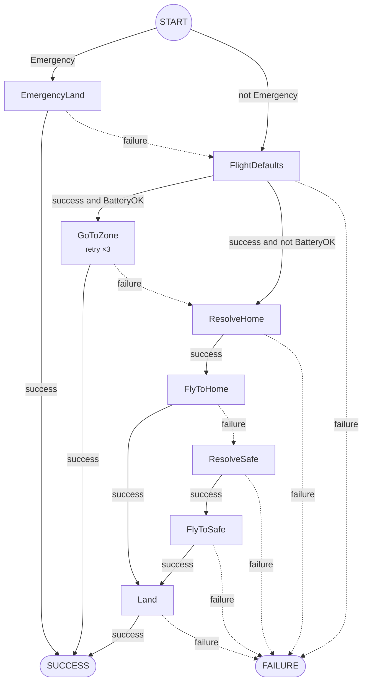

# The small branch that matters

Beehave reads a [BehaviorTree.CPP](https://www.behaviortree.dev/) tree and
shows only the actions your robot can take, in order, with the conditions that
lead to each one.

```console
$ pip install beehave-bt
$ beehave graph mission.xml -f mermaid
```

## Three questions, one glance

Behavior trees grow fast. Subtrees, fallbacks, reactive sequences and
decorators stack up until nobody can say what the robot does if the battery
drops halfway to the zone. Beehave answers:

1. **Which actions exist** in this tree?
2. **What has to be true** for each one to run?
3. **What runs next** on success, and what runs next on failure?

## Before and after

A 20-node landing tree becomes 8 actions. Control nodes become arrows,
conditions become arrow labels, subtrees are inlined, retries become notes.



"What if `GoToZone` fails?" takes one arrow to answer. The gap is visible too:
`FlyToSafe` has no failure path.

## Where to go next

<div class="grid cards" markdown>

- **[Getting started](guide/getting-started.md)**

    Install, run your first graph, read the output.

- **[Design](design/index.md)**

    The pipeline, the Phase 1 specification, the roadmap and every design
    decision.

- **[Research](research/index.md)**

    BehaviorTree.CPP semantics checked against the source, prior art and the
    literature.

- **[Phase 1 results](design/phase-1-results.md)**

    The metrics on public BT.CPP, Groot and Nav2 trees.

</div>

!!! note "Not the Godot addon"
    This Beehave is a static analysis tool for robot behavior trees
    (BehaviorTree.CPP, ROS 2, Nav2). It is unrelated to the Beehave behavior
    tree addon for the Godot game engine.
