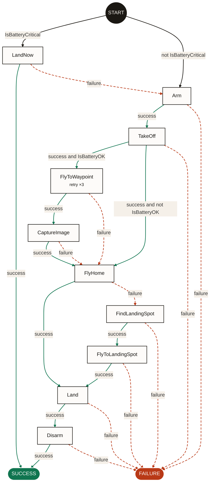

<div class="bh-hero" markdown>

<p class="bh-hero__plate bh-label"> <span>Beehave <span aria-hidden="true">&middot;</span> static analysis for robot behavior trees</span></p>

<p class="bh-hero__wordmark" aria-hidden="true">beehave</p>

<div class="bh-hero__text" markdown>

# The small branch that matters

Beehave reads a [BehaviorTree.CPP](https://www.behaviortree.dev/) tree (v3 or
v4) or a [py_trees](https://github.com/splintered-reality/py_trees) tree and
shows only the actions your robot can take, in order, with the conditions that
lead to each one.

<p class="bh-hero__io bh-label">Behavior tree XML in <span aria-hidden="true">&middot;</span> the small branch that matters out</p>

```console
$ pip install beehave-bt
$ beehave graph mission.xml -f mermaid
```

<p class="bh-hero__actions" markdown>[Get started](guide/getting-started.md){ .md-button .md-button--primary }
[GitHub](https://github.com/guilyx/beehave){ .md-button }</p>

</div>

--8<-- "overrides/partials/home-figure.html"

</div>

## Three questions, one glance

Behavior trees grow fast. Subtrees, fallbacks, reactive sequences and
decorators stack up until nobody can say what the robot does when a step fails
halfway through a task, whether it flies, drives or grasps. Beehave answers:

<div class="bh-questions" markdown>

1. **Which actions exist** in this tree?
2. **What has to be true** for each one to run?
3. **What runs next** on success, and what runs next on failure?

</div>

## Before and after

A 22-node drone mission becomes 10 actions. Control nodes become arrows,
conditions become arrow labels, subtrees are inlined, retries become notes.

<figure class="bh-figure" markdown>
<figcaption class="bh-label"><span>Fig. 2</span> A drone survey mission: 22 nodes in, 10 actions out</figcaption>



</figure>

"What if the emergency landing fails?" takes one arrow to answer, and it shows
a gap: `LandNow` fails over to `Arm`, so the drone would start the mission
again. The same works for [mobile robots and manipulators](guide/examples.md).

## Where to go next

<div class="grid cards" markdown>

- **[Getting started](guide/getting-started.md)**

    Install, run your first graph, read the output.

- **[Examples](guide/examples.md)**

    A drone mission, a mobile robot navigating with recovery, and a
    pick-and-place arm, each in BT.CPP v3, v4 and py_trees.

- **[Formats](guide/formats.md)**

    BehaviorTree.CPP v3 and v4, `SKIPPED` and scripts, and py_trees.

- **[Design](design/index.md)**

    The pipeline, the Phase 1 specification, the roadmap and every design
    decision.

- **[Research](research/index.md)**

    BehaviorTree.CPP semantics checked against the source, prior art and the
    literature.

- **[Phase 1 results](design/phase-1-results.md)**

    The metrics on public BT.CPP, Groot and Nav2 trees.

</div>

!!! note "Not the Godot addon"
    This Beehave is a static analysis tool for robot behavior trees
    (BehaviorTree.CPP, py_trees, ROS 2, Nav2). It is unrelated to the Beehave
    behavior tree addon for the Godot game engine.
