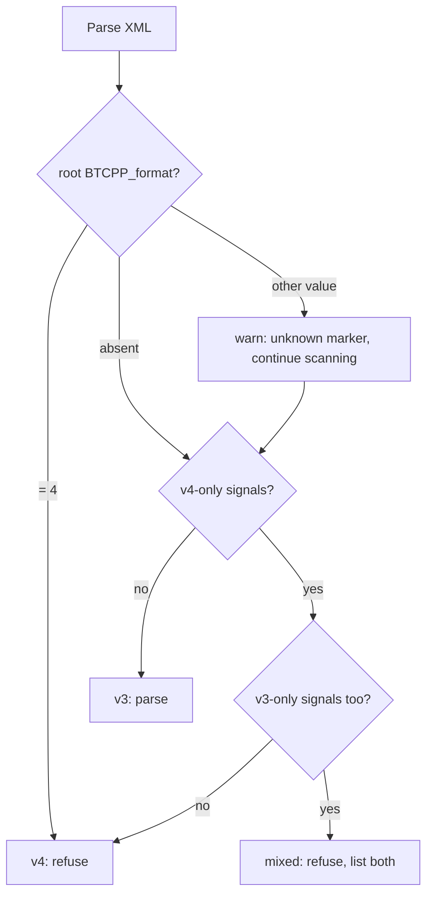

# BehaviorTree.CPP v3 vs v4: what a parser must know

Beehave Phase 1 parses BT.CPP v3 XML only. It must still **recognise v4 files and refuse them with a clear message**, and a later v4 parser will need the exact list of differences. This document checks the v3→v4 table from our design doc against the BT.CPP source code (tag `3.8.8`, the v4 tags `4.0.1` to `4.10.0`, and `master` at `03ec870`), the official [migration guide](https://www.behaviortree.dev/docs/migration) ([source](https://github.com/BehaviorTree/btcpp_website/blob/master/docs/migration.md)) and the upstream converter script [`convert_v3_to_v4.py`](https://github.com/BehaviorTree/BehaviorTree.CPP/blob/master/convert_v3_to_v4.py). It corrects three items, adds about a dozen parser-relevant differences that were missing, and ends with a version-detection recipe.

---

## 1. Design-doc table, checked

| Design-doc claim | Verdict | Details and evidence |
|---|---|---|
| v4 files carry `BTCPP_format="4"` on `<root>` | **Correct, but not reliable for detection** | The v4 parser only **prints a warning** when the attribute is missing and never checks its value ([`xml_parsing.cpp` master, `loadDocImpl`](https://github.com/BehaviorTree/BehaviorTree.CPP/blob/master/src/xml_parsing.cpp)). v3.8 never reads it. BT.CPP's own v4 example [`examples/test_files/Check.xml` on master](https://github.com/BehaviorTree/BehaviorTree.CPP/blob/master/examples/test_files/Check.xml) has **no marker** but uses `SequenceWithMemory`. That file is a fixture in `tests/fixtures/public/v4/btcpp/`. |
| `SubTreePlus` → `SubTree` | **Correct, and it is a semantic change** | The migration guide says: "`<SubTree>` Deprecated, `<SubTreePlus>` → `<SubTree>`". In v4, `<SubTree a="x"/>` passes the **literal** `"x"`. In v3, the same text remapped to the parent key `x`. A v3 classic `SubTree` read with v4 rules silently changes meaning. The converter wraps values in braces: `a="x"` becomes `a="{x}"`. |
| `SequenceStar` → `SequenceWithMemory` | **Correct** | In v4, `SequenceStar` is only registered when built with `USE_BTCPP3_OLD_NAMES` ([`bt_factory.cpp` master](https://github.com/BehaviorTree/BehaviorTree.CPP/blob/master/src/bt_factory.cpp)). The memory semantics are unchanged. |
| `SetBlackboard` / `BlackboardCheck*` → Script nodes | **Half correct** | `BlackboardCheckInt`/`Double`/`String`/`Bool` were **removed** in 4.0.1. **`SetBlackboard` still exists** as a built-in in every v4 release. The guide only *recommends* `Script`. Replacements: `Script` (`code`), `ScriptCondition` (`code`, since 4.3.1), the `Precondition` decorator (`if`, `else` with default FAILURE), or `_failureIf` and the other pre-conditions. |
| Pre-conditions `_failureIf`, `_successIf`, `_skipIf`, `_while` | **Correct, but incomplete** | There are also the **post-conditions** `_onSuccess`, `_onFailure`, `_post` and `_onHalted` ([`tree_node.h` master](https://github.com/BehaviorTree/BehaviorTree.CPP/blob/master/include/behaviortree_cpp/tree_node.h), [guide](https://www.behaviortree.dev/docs/guides/pre_post_conditions)). Order of evaluation: `_failureIf` → `_successIf` → `_skipIf` → `_while`. The first three are evaluated **only when the node is IDLE**, while `_while` is evaluated on every tick. They introduce a new status, **SKIPPED**, which every control node handles as "not executed, move on". |
| `AsyncSequence` / `AsyncFallback` | **Correct, but not in 4.0** | Added in **4.2.0** (2023-05-23). They are `SequenceNode` and `FallbackNode` with `make_async=true`, which return RUNNING after each child so the tree can be interrupted. Their success/failure edges are the same as `Sequence` and `Fallback`. |

---

## 2. Everything else a parser must know

### 2.1 Subtrees and remapping

| Topic | v3.8 | v4.x | Since |
|---|---|---|---|
| Subtree element | `SubTree` (classic) and `SubTreePlus` | `SubTree` only, with the old SubTreePlus semantics | 4.0.1 |
| Auto-remap attribute | `__autoremap` (two underscores, `SubTreePlus` only) | **`_autoremap`** (one underscore) | 4.0.1 |
| Shared blackboard | `__shared_blackboard="true"` on classic `SubTree` | **removed**. The converter replaces it with `_autoremap="1"` and warns "Some behavior may change!" | 4.0.1 |
| Remap value syntax | classic: plain key `a="x"`; Plus: `a="{x}"` | `a="{x}"`; any other value is a literal | 4.0.1 |
| Literal typing | stored as string | stored as int, int64 or double when the whole string parses as a number, otherwise as string (master) | 4.x |
| Literal and autoremap order | literal written to the **parent** if `__autoremap` came first (3.8.4+ quirk) | fixed: literals are always local | 4.x |
| `name` on a subtree | ignored (instance name = ID) | used to build the subtree path (`Parent/name`, or `ID::uid`) | 4.0.1 |
| Subtree port model | `<TreeNodesModel><SubTree ID>` is ignored by the runtime | **used**: missing mandatory ports throw, and defaults are applied (`loadSubtreeModel`) | 4.x (master) |
| "Same-name" shorthand | port value `=` | **`{=}`**, including for subtree attributes | 4.5.2 (2024-03-07) |
| Root blackboard | — | `{@key}` and `@key` in scripts address the root blackboard | 4.6.0 (2024-04-28) |

### 2.2 Renamed or changed ports and arities

| Node | v3.8 | v4.x | Since |
|---|---|---|---|
| `Parallel` | `success_threshold` (**required**), `failure_threshold` (default 1) | **`success_count`** (default **-1**, meaning all), **`failure_count`** (default 1) | 4.0.1 |
| `WhileDoElse` | exactly 3 children | 2 or 3 children | 4.3.5 (2023-08-14) |
| `ManualSelector` | ncurses builds only | **removed** | 4.1.1 |
| Reserved attribute names | `ID`, `name`, `_description` | `ID`, `name`, `_autoremap` + 4 pre- + 4 post-condition names | 4.0.1 |
| Name validation | none | forbidden characters in model and port names, and `Root` is reserved as a model name ([`docs/name_validation_rules.md`](https://github.com/BehaviorTree/BehaviorTree.CPP/blob/master/docs/name_validation_rules.md)) | 4.8.4 |

`convert_v3_to_v4.py` does **not** handle the `Parallel` port rename, the removal of `BlackboardCheck*`, or `ManualSelector`. It also has a bug for the explicit form `<Control ID="SequenceStar">`: it assigns the old name back instead of `SequenceWithMemory`. Do not rely on the script for equivalence tests.

### 2.3 Built-in nodes added in v4

Derived by diffing the registrations in `src/bt_factory.cpp` across all v4 tags.

| Version (date) | Added | Removed |
|---|---|---|
| 4.0.1 (2022-11-19) | `SequenceWithMemory`, `Script`, `Precondition` | `SubTreePlus`, `BlackboardCheckInt/Double/String/Bool`, `SequenceStar` (unless `USE_BTCPP3_OLD_NAMES`) |
| 4.1.1 (2023-03-29) | — | `ManualSelector` |
| 4.2.0 (2023-05-23) | `AsyncSequence`, `AsyncFallback`, `RunOnce`, `LoopDouble`, `LoopString` | — |
| 4.3.0 (2023-06-13) | `Sleep` | — |
| 4.3.1 (2023-06-21) | `ScriptCondition` | — |
| 4.3.2 (2023-06-28) | `ParallelAll` | — |
| 4.3.5 (2023-08-14) | `LoopInt`, `LoopBool` | — |
| 4.4.3 (2023-12-19) | `UnsetBlackboard` | — |
| 4.6.0 (2024-04-28) | `WasEntryUpdated`, `SkipUnlessUpdated`, `WaitValueUpdate` | — |
| 4.9.0 (2026-02-11) | `TryCatch` | — |

Unchanged names between 3.8 and v4: `Sequence`, `Fallback`, `ReactiveSequence`, `ReactiveFallback`, `Parallel` (with new port names), `IfThenElse`, `WhileDoElse`, `Switch2`–`Switch6`, `Inverter`, `ForceSuccess`, `ForceFailure`, `Repeat`, `RetryUntilSuccessful`, `KeepRunningUntilFailure`, `Timeout`, `Delay`, `AlwaysSuccess`, `AlwaysFailure`, `SetBlackboard` and `SubTree` (with new semantics).

### 2.4 Other differences

- **Scripting language.** `Script`, `ScriptCondition`, `Precondition` and all `_xxx` pre- and post-conditions contain expressions such as `a:=42; b!=c`, which can include enums registered in C++ ([scripting guide](https://www.behaviortree.dev/docs/guides/scripting)). A v4 static analyser needs an expression parser. This connects to Beehave's Phase 2 guard simplification.
- **Execution API.** `tickRoot()` was removed in favour of `tickOnce()`, `tickExactlyOnce()` and `tickWhileRunning()`. This does not affect XML, but tree-execution semantics for repeated ticks differ.
- **`main_tree_to_execute`.** Still supported in v4 ([`instantiateTree` on master](https://github.com/BehaviorTree/BehaviorTree.CPP/blob/master/src/xml_parsing.cpp)). v4 tutorials stopped using it ([commit `92564df`](https://github.com/BehaviorTree/BehaviorTree.CPP/commit/92564dfa)) and prefer `factory.createTree("MainTree")`. Many v4 files therefore have several trees and **no** main-tree attribute.
- **`TreeNodesModel`.** The same element names as v3 (`Action`, `Condition`, `Control`, `Decorator`, `SubTree`) and port elements. Files written by Groot2 add attributes such as `editable="true"` (see the fixture `v4/btcpp/examples/test_files/log_test.xml`). v4 can also generate an XSD for the registered nodes (`writeTreeXSD`, master).
- **Groot2 `.btproj`.** The v4 docs say models can be added "to your `.xml` or `.btproj` file" ([tutorial 11](https://www.behaviortree.dev/docs/tutorial-basics/tutorial_11_groot2), [source](https://github.com/BehaviorTree/btcpp_website/blob/master/docs/tutorial-basics/tutorial_11_groot2.md)). This implies that a `.btproj` is BT.CPP-style XML that can contain a `<TreeNodesModel>` and references to tree files. **No public specification or sample `.btproj` was found**, so its exact schema is unverified. Beehave should treat a `.btproj` as a v4 project file and refuse it in Phase 1.
- **Groot1 vs Groot2.** The Groot 1 README states that it is "compatible only with BehaviorTree.CPP 3.8.x". The Groot2 product page states "Compatible with both BT.CPP 3 and 4". Whether Groot2 writes a `BTCPP_format="3"` marker for 3.x files could not be verified. No such marker appears in any public file examined.

---

## 3. Version detection recipe for Beehave

**v4-only signals.** Any one of these is enough, unless the name is declared as a user node in `<TreeNodesModel>` or the config, because a v3 project could have its own custom `Sleep` action:

- Element names: `SequenceWithMemory`, `Script`, `ScriptCondition`, `Precondition`, `RunOnce`, `UnsetBlackboard`, `Sleep`, `ParallelAll`, `AsyncSequence`, `AsyncFallback`, `LoopInt`, `LoopBool`, `LoopDouble`, `LoopString`, `WasEntryUpdated`, `SkipUnlessUpdated`, `WaitValueUpdate`, `TryCatch`.
- Attributes on any node: `_skipIf`, `_failureIf`, `_successIf`, `_while`, `_onSuccess`, `_onFailure`, `_post`, `_onHalted`, `_autoremap`. On v3 built-ins these are already rejected by v3.8 as "Possible typo?".
- Attribute values `{=}` or `{@…}`.
- `Parallel` with `success_count` or `failure_count`.
- A `.btproj` file extension.

**v3-only signals:** `SubTreePlus`, `SequenceStar`, `BlackboardCheck*`, `ManualSelector`, `__autoremap`, `__shared_blackboard`, `Parallel` with `success_threshold` or `failure_threshold`, a port value equal to `=`, and a classic `SubTree` whose remap values have no braces.

If a file has no marker and no signal, Beehave should assume v3 and say so in the report. The paired fixtures `tests/fixtures/public/nav2/…/navigate_to_pose_w_replanning_and_recovery.xml` (humble, v3) and `tests/fixtures/public/v4/nav2-jazzy/…/navigate_to_pose_w_replanning_and_recovery.xml` (jazzy, v4) are the same tree in both formats and are good regression inputs.

---

## Sources

- BT.CPP source: tags [`3.8.8`](https://github.com/BehaviorTree/BehaviorTree.CPP/tree/3.8.8), [`4.0.1`](https://github.com/BehaviorTree/BehaviorTree.CPP/tree/4.0.1) and later 4.x tags, and [`master`](https://github.com/BehaviorTree/BehaviorTree.CPP) at commit `03ec870a07b384f0766bbfe81f77c64a9f994a2b` (2026-10-10). Files: `src/bt_factory.cpp`, `src/xml_parsing.cpp`, `src/basic_types.cpp`, `include/behaviortree_cpp/tree_node.h`, `include/behaviortree_cpp/controls/parallel_node.h`, `src/controls/while_do_else_node.cpp`, `docs/name_validation_rules.md`. Version boundaries were found with `git tag --contains` on the commits `74c7dd7` (WhileDoElse arity), `58326a8` (`{=}`), `1ef1c4d` (`@` root blackboard) and `8f86eb9` (name validation).
- Migration guide: <https://www.behaviortree.dev/docs/migration> (source: [btcpp_website `docs/migration.md`](https://github.com/BehaviorTree/btcpp_website/blob/master/docs/migration.md), commit `9cc7aad`).
- Pre- and post-conditions: <https://www.behaviortree.dev/docs/guides/pre_post_conditions> (source: [`docs/guides/pre_post_conditions.md`](https://github.com/BehaviorTree/btcpp_website/blob/master/docs/guides/pre_post_conditions.md)).
- Converter: [`convert_v3_to_v4.py`](https://github.com/BehaviorTree/BehaviorTree.CPP/blob/master/convert_v3_to_v4.py) (added 2022-11-19).
- Groot 1 README: <https://github.com/BehaviorTree/Groot>. Groot2 page source: [btcpp_website `src/pages/groot.js`](https://github.com/BehaviorTree/btcpp_website/blob/master/src/pages/groot.js). Groot2 changelog: <https://github.com/BehaviorTree/Groot2>.
