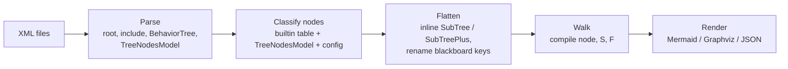
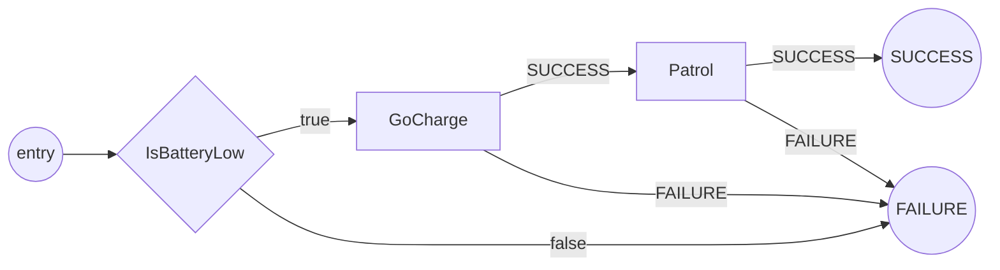
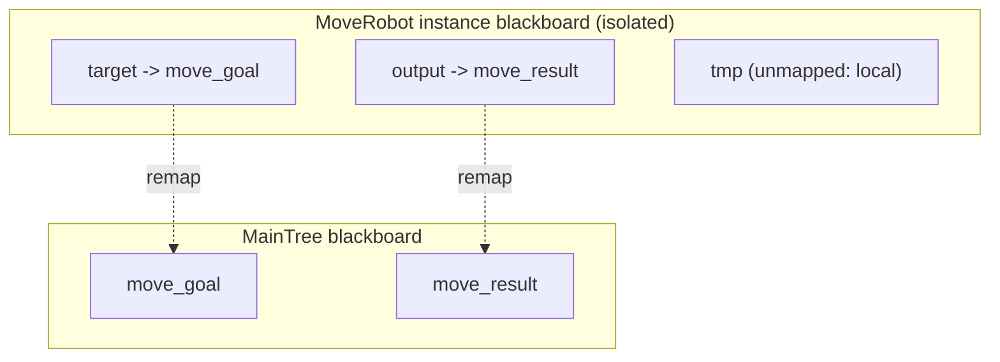

# BehaviorTree.CPP v3 XML reference for the Beehave parser

This document is the reference that Beehave's Phase 1 parser, flattener and walker are built against. It describes the XML format read by BehaviorTree.CPP (BT.CPP) **v3.8**, lists all built-in node types that `BehaviorTreeFactory` registers in that version, and gives the success/failure semantics of each one as a rule for our continuation-passing walk, `compile(node, on_success, on_failure) -> entry`. It also gives the exact subtree port-remapping semantics for `SubTree` and `SubTreePlus`. Everything here was checked against the C++ source of tag `3.8.8` (commit `9d624dc`, which is also the tip of the `v3.8` branch), not only against the documentation. Where the documentation and the code disagree, the code wins, and the disagreement is noted.

Notation used below: `S` and `F` are the success and failure continuations passed to `compile`. "Exact" means that the Phase 1 rule reproduces every success/failure path of one activation of the node. "Approximated" means that Phase 1 draws the single-pass edges only and reports the node as approximated.

---

## 1. Summary table

| XML name | Beehave kind | Children | Walk rule: `compile(n, S, F)` | Phase 1 | Notes |
|---|---|---|---|---|---|
| `Sequence` | control | ≥ 1 | `c1 -S-> c2 -S-> … cn -S-> S`, every `ci -F-> F` | exact | Restarts from `c1` after a failure. |
| `SequenceStar` | control | ≥ 1 | same as `Sequence` | approximated (memory) | Re-entry after a FAILURE resumes at the child that failed (§3.1). Renamed `SequenceWithMemory` in v4. |
| `ReactiveSequence` | control | ≥ 1 | same as `Sequence` | approximated (preemption) | While a child is RUNNING, all earlier children are ticked again on every tick, and the running child is halted if one of them fails (§3.1). |
| `Fallback` | control | ≥ 1 | `c1 -F-> c2 -F-> … cn -F-> F`, every `ci -S-> S` | exact | |
| `ReactiveFallback` | control | ≥ 1 | same as `Fallback` | approximated (preemption) | Mirror image of `ReactiveSequence`. |
| `Parallel` | control | ≥ thresholds | fork into all children; join on counts | approximated | `success_threshold` has **no default** (required). `failure_threshold` defaults to 1. |
| `IfThenElse` | control | 2 or 3 | `c1 -S-> c2`, `c1 -F-> c3` (3 children) or `c1 -F-> F` (2 children); `c2`, `c3` go to `S`/`F` | exact | `c1` can be any subtree, not only a condition. |
| `WhileDoElse` | control | **exactly 3** | same as 3-child `IfThenElse` | approximated (preemption) | `c1` is checked again on every tick. v4.3.5+ also accepts 2 children. v3.8 does not. |
| `Switch2` … `Switch6` | control | N+1 | multi-way branch on `variable == case_k` (first match wins), last child is the default | exact for one pass | String comparison. Choice is made again on every tick (§3.3). There is no plain `Switch`. |
| `ManualSelector` | control | any | nondeterministic: any child, or a direct SUCCESS/FAILURE | approximated | Registered only when BT.CPP is built with ncurses. Interactive. |
| `Inverter` | decorator | 1 | `compile(c, F, S)` | exact | |
| `ForceSuccess` | decorator | 1 | `compile(c, S, S)` | exact | |
| `ForceFailure` | decorator | 1 | `compile(c, F, F)` | exact | |
| `Repeat` | decorator | 1 | `compile(c, LOOP, F)` with `LOOP = [k < N] -> entry(c) else S` | exact (loop edge) | `num_cycles` required. `-1` means forever, and then `S` is unreachable. A child FAILURE exits at once. |
| `RetryUntilSuccessful` | decorator | 1 | `compile(c, S, RETRY)` with `RETRY = [k < N] -> entry(c) else F` | exact (loop edge) | `num_attempts` required. `-1` means forever, and then `F` is unreachable. |
| `KeepRunningUntilFailure` | decorator | 1 | `compile(c, entry(c), F)` | exact (loop edge) | **Never returns SUCCESS**, so the parent's `S` is unreachable from here. |
| `Timeout` | decorator | 1 | `compile(c, S, F)` plus "timeout" edges to `F` from actions that can be RUNNING inside `c` | approximated | `msec` required. |
| `Delay` | decorator | 1 | `compile(c, S, F)` | exact | `delay_msec` required. Waits, then ticks the child. |
| `BlackboardCheckInt` / `…Double` / `…String` / `…Bool` | decorator (guard) | 1 | branch `[value_A == value_B] -> compile(c, S, F)`, else go to `return_on_mismatch` (default `F`) | exact for one pass | Checked again on every tick while the child is RUNNING. |
| `AlwaysSuccess` | action (constant) | 0 | `entry = S` | exact | A no-op. Draw no box, or an optional box. |
| `AlwaysFailure` | action (constant) | 0 | `entry = F` | exact | |
| `SetBlackboard` | action | 0 | node with one edge `-S-> S` and no failure edge | exact | Always SUCCESS. Writes `output_key`. |
| `SubTree` | subtree | 0 | inline the body: `compile(body, S, F)` | exact | Classic v3 remapping (§5.1). |
| `SubTreePlus` | subtree | 0 | inline the body: `compile(body, S, F)` | exact | Remapping with `{key}`, literals and `__autoremap` (§5.2). |
| user node declared `Action` | action | 0 | graph node with `-S-> S` and `-F-> F` | exact | Default for unknown leaves. |
| user node declared `Condition` | condition | 0 | branch point: `[cond] -> S`, `[!cond] -> F` | exact | Must be declared in `<TreeNodesModel>` or the Beehave config. |
| user node declared `Control` / `Decorator` | control / decorator | ≥1 / 1 | unknown semantics | approximated | Needs a config rule (for example, the Nav2 `RecoveryNode`, `PipelineSequence`, `RoundRobin`, `RateController`). |

**v3.8 has no built-in condition nodes.** Every built-in leaf is an action. The only built-in "guards" are the `BlackboardCheck*` decorators and the first child of `IfThenElse` and `WhileDoElse`.

### Names that do NOT exist in v3.8

These names come up in older docs, in v4 or in forums. A v3.8 factory does not register them.

| Name | Status in v3.x | Where it lives |
|---|---|---|
| `SubTreeWrapper` | Registered **only in 3.3.0**. Replaced by `SubTreePlus` in 3.4.0. | `bt_factory.cpp` @ 3.3.0 |
| `RetryUntilSuccesful` (typo) | Registered 3.0.0 to 3.6.x. Commented out since 3.7.0. | `bt_factory.cpp` line 38 @ 3.8.8 |
| `ConsumeQueue`, `PopFromQueue`, `QueueSize` | Header-only templates since 3.7.0, **not registered**. Users must register them (see `examples/ex04_waypoints.cpp`). | `decorators/consume_queue.h`, `actions/pop_from_queue.hpp` |
| `Switch` (no number) | Never registered. Only `Switch2` … `Switch6`. | `bt_factory.cpp` |
| `SequenceWithMemory`, `Precondition`, `Script`, `ScriptCondition`, `RunOnce`, `UnsetBlackboard`, `Sleep`, `ParallelAll`, `AsyncSequence`, `AsyncFallback`, `LoopInt`/`LoopBool`/`LoopDouble`/`LoopString`, `WasEntryUpdated`, `SkipUnlessUpdated`, `WaitValueUpdate`, `TryCatch` | v4 only | see `btcpp-v3-vs-v4.md` |

> Documentation pitfall: the hosted 3.8 docs page "Sequences" talks about `SequenceWithMemory` ([website source](https://github.com/BehaviorTree/btcpp_website/blob/master/versioned_docs/version-3.8/nodes-library/SequenceNode.md)). The 3.8 code only knows `SequenceStar`.

### Pipeline overview



---

## 2. Document structure

Primary sources: [`src/xml_parsing.cpp` @ 3.8.8](https://github.com/BehaviorTree/BehaviorTree.CPP/blob/3.8.8/src/xml_parsing.cpp), the [v3.8 XML format docs](https://www.behaviortree.dev/docs/3.8/learn-the-basics/xml_format) ([source](https://github.com/BehaviorTree/btcpp_website/blob/master/versioned_docs/version-3.8/learn-the-basics/xml_format.md)), and [`docs/xml_format.md` on the `v3.8` branch](https://github.com/BehaviorTree/BehaviorTree.CPP/blob/v3.8/docs/xml_format.md).

### 2.1 `<root>`

- The document element **must** be called `root` (case-sensitive). Anything else fails with "The XML must have a root node called \<root\>" (`VerifyXML`, [L267-L270](https://github.com/BehaviorTree/BehaviorTree.CPP/blob/3.8.8/src/xml_parsing.cpp#L267-L270)).
- `main_tree_to_execute="ID"`: v3.8 reads it only from the **first document opened**, not from included files. Without it, the tree is used only if exactly one `<BehaviorTree>` was registered across all loaded files, including included ones. Otherwise loading throws "[main_tree_to_execute] was not specified correctly" ([L439-L463](https://github.com/BehaviorTree/BehaviorTree.CPP/blob/3.8.8/src/xml_parsing.cpp#L439-L463)). The caller can also override it in C++.
- `BTCPP_format`: **ignored by v3.8**, which never reads it. A v4 file with `BTCPP_format="4"` is therefore accepted by v3.8 up to the first unknown node or attribute. Beehave must do its own version detection (see `btcpp-v3-vs-v4.md`).
- The parser is tinyxml2. XML comments, including those before `<root>` (Nav2 files start with one), are skipped by element iteration. Groot 1 writes `<!-- ////////// -->` separators between top-level elements.

### 2.2 `<BehaviorTree ID="…">`

- Must have **exactly one child element** ([L392-L398](https://github.com/BehaviorTree/BehaviorTree.CPP/blob/3.8.8/src/xml_parsing.cpp#L392-L398)).
- `ID` is optional. A tree without one is registered as `BehaviorTree_<n>` ([L228](https://github.com/BehaviorTree/BehaviorTree.CPP/blob/3.8.8/src/xml_parsing.cpp#L228)).
- Duplicate IDs: trees are stored in a `std::map` with `insert`, so **the first registration wins** silently ([L231](https://github.com/BehaviorTree/BehaviorTree.CPP/blob/3.8.8/src/xml_parsing.cpp#L231)). Includes are processed **before** the including file's own trees, so an included definition shadows a local one with the same ID. Beehave should warn about duplicates.
- Legacy: very old Groot files wrap the tree body in `<Root>` (see the BTCompiler `groot/*.xml` examples). v3.8 rejects `<Root>` as "Node not recognized".

### 2.3 `<include path="…" [ros_pkg="…"]/>`

- Only direct children of `<root>` are considered. They are processed before the `<BehaviorTree>` elements of the same file ([L143-L201](https://github.com/BehaviorTree/BehaviorTree.CPP/blob/3.8.8/src/xml_parsing.cpp#L143-L201)).
- A relative `path` is resolved against the **directory of the including file**. That directory becomes the current one while the included file's own includes are processed. Fixture: `tests/fixtures/public/btcpp-v3/tests/trees/parent_include_child_include_parent.xml` includes `child/…`, which includes `../parent_no_include.xml`.
- `ros_pkg` prefixes the package share directory, but only in ROS 1 or ROS 2 builds. Otherwise it throws. If `path` is absolute, `ros_pkg` is ignored with a warning.
- There is **no cycle detection** and no de-duplication. Beehave must detect include cycles itself.
- A missing `path` attribute is not checked by v3.8, and would crash it.

### 2.4 `<TreeNodesModel>`

- At most one per file, else "Only a single node \<TreeNodesModel\> is supported" ([L272-L281](https://github.com/BehaviorTree/BehaviorTree.CPP/blob/3.8.8/src/xml_parsing.cpp#L272-L281)).
- **The v3.8 runtime ignores its content.** It exists for Groot. Its intended `ID`-is-mandatory check is buggy: it iterates over the children of `<root>` instead of the children of `<TreeNodesModel>` ([L285](https://github.com/BehaviorTree/BehaviorTree.CPP/blob/3.8.8/src/xml_parsing.cpp#L285)).
- Content as written by `writeTreeNodesModelXML` ([L797-L894](https://github.com/BehaviorTree/BehaviorTree.CPP/blob/3.8.8/src/xml_parsing.cpp#L797-L894)) and read by Groot 1 ([`XML_utilities.cpp`](https://github.com/BehaviorTree/Groot/blob/master/bt_editor/XML_utilities.cpp)):

  ```xml
  <TreeNodesModel>
    <Action ID="SaySomething">
      <input_port name="message" type="std::string" default="hi">description text</input_port>
    </Action>
    <Condition ID="IsDoorOpen"/>
    <Control   ID="RecoveryNode"><input_port name="number_of_retries"/></Control>
    <Decorator ID="RateController"><input_port name="hz"/></Decorator>
    <SubTree   ID="MySubtree"><input_port name="message"/></SubTree>
  </TreeNodesModel>
  ```

  The element name is the node kind: `Action`, `Condition`, `Control`, `Decorator` or `SubTree`. `convertFromString<NodeType>` also accepts `SubTreePlus` as a subtree kind. Port elements are `input_port`, `output_port` and `inout_port`, with the attributes `name`, `type` and `default`, and the description as text. Writers also emit `description="…"` on the node element.
- For Beehave, this is the primary source of **node kinds** for user nodes, together with the config file. Models can be incomplete or stale. Nav2's `nav2_tree_nodes.xml` (humble) does not declare the `is_recovery` port of `Spin`, which `odometry_calibration.xml` uses. Port checks against models must therefore be warnings, not errors.
- A file can contain **only** a `<TreeNodesModel>` (Nav2's `nav2_behavior_tree/nav2_tree_nodes.xml`). Beehave should accept "models-only" files as an input next to the tree files.
- The v3.8 docs spell it `<TreeNodeModel>` (singular) in one example. The code only knows `TreeNodesModel`.

### 2.5 Node elements: explicit vs compact syntax

- **Compact:** `<SaySomething name="hello" message="Hi"/>`. The tag name is the registration ID.
- **Explicit:** `<Action ID="SaySomething" …/>`, `<Condition ID=…>`, `<Control ID=…>`, `<Decorator ID=…>`. The ID comes from the attribute ([L494-L503](https://github.com/BehaviorTree/BehaviorTree.CPP/blob/3.8.8/src/xml_parsing.cpp#L494-L503)). **The explicit tag is not checked against the registered kind.** `<Action ID="X">` for a node registered as a condition still instantiates the condition. For Beehave, the explicit tag is a good kind hint when no model exists.
- Subtrees: `<SubTree ID="T" …/>` and `<SubTreePlus ID="T" …/>`. The element name selects the subtree flavour and `ID` names the tree.
- **Compact subtree references (`<T/>` where `T` is a tree ID) are rejected by v3.8.** `VerifyXML` only knows factory-registered names, so they fail with "Node not recognized". `createNodeFromXML` contains a code path for them ([L639-L642](https://github.com/BehaviorTree/BehaviorTree.CPP/blob/3.8.8/src/xml_parsing.cpp#L639-L642)), but it cannot be reached. BT.CPP's own `examples/test_files/subtree_test.xml` still uses this form (fixture `btcpp-v3/examples/test_files/subtree_test.xml`). Beehave can accept it with a warning.
- Groot 1 writes built-in nodes in compact form and user nodes in explicit form ([`RecursivelyCreateXml`](https://github.com/BehaviorTree/Groot/blob/master/bt_editor/XML_utilities.cpp)).

**Structural checks performed by `VerifyXML`** ([L235-L437](https://github.com/BehaviorTree/BehaviorTree.CPP/blob/3.8.8/src/xml_parsing.cpp#L235-L437)):

| Element | Rule |
|---|---|
| `<Decorator ID>` | exactly 1 child |
| `<Action ID>`, `<Condition ID>` | 0 children |
| `<Control ID>` | ≥ 1 child |
| `Sequence`, `SequenceStar`, `Fallback` | ≥ 1 child |
| `<SubTree>` | no children; a `<remap>` child fails with "\<remap\> was deprecated" (pre-3.0 syntax) |
| any other tag | must be a registered ID; registered decorators need exactly 1 child |

Not checked statically by v3.8: the arity of `IfThenElse` (2 or 3), `WhileDoElse` (3), `SwitchN` (N+1), `Parallel` (≥ thresholds), children under compact-form actions or conditions, and whether a referenced subtree ID exists. These fail at tick time or at tree instantiation. **Beehave should check all of them statically.**

### 2.6 The `name` attribute

- `name` is the instance name. It defaults to the ID. It is not unique, and Nav2 trees reuse names freely, sometimes equal to another node's ID (`<RecoveryNode name="ComputePathToPose">`). Beehave must key nodes by **path in the flattened tree**, never by name.
- **For `SubTree` and `SubTreePlus`, `name` is ignored.** The instance name is forced to the tree `ID` ([L516-L519](https://github.com/BehaviorTree/BehaviorTree.CPP/blob/3.8.8/src/xml_parsing.cpp#L516-L519)). v4 does use `name` for subtrees.
- Reserved attribute names that are never ports: `ID`, `name`, `_description` ([`IsReservedPortname`, basic_types.h L219](https://github.com/BehaviorTree/BehaviorTree.CPP/blob/3.8.8/include/behaviortree_cpp_v3/basic_types.h#L219)).

### 2.7 Port values and blackboard references

All other attributes of a non-subtree node are **port assignments**. For a registered node, an attribute that is not in its manifest is a hard error: "Possible typo? … the manifest of this node does not contain a port with this name" ([L543-L553](https://github.com/BehaviorTree/BehaviorTree.CPP/blob/3.8.8/src/xml_parsing.cpp#L543-L553)).

| Value form | Meaning | Source |
|---|---|---|
| `{key}` | blackboard entry `key` | `TreeNode::isBlackboardPointer` ([tree_node.cpp L145](https://github.com/BehaviorTree/BehaviorTree.CPP/blob/3.8.8/src/tree_node.cpp#L145)) |
| `${key}` | same as `{key}` (alternative syntax) | same |
| `=` | blackboard entry with the **same name as the port**. Became `{=}` in v4.5.2. | `getRemappedKey` (L179) |
| anything else | literal string, converted with `convertFromString<T>` at tick time | `TreeNode::getInput` |
| (attribute absent) | the manifest default value for input ports, if any. Otherwise `getInput` fails at runtime. | [L622-L635](https://github.com/BehaviorTree/BehaviorTree.CPP/blob/3.8.8/src/xml_parsing.cpp#L622-L635) |

Booleans (`__shared_blackboard`, `__autoremap`, `repeat_last_selection`) accept exactly `0`, `1`, `true`, `TRUE`, `True`, `false`, `FALSE` and `False`. Anything else throws. `NodeStatus` values (`return_on_mismatch`) accept `IDLE`, `RUNNING`, `SUCCESS` and `FAILURE`.

For guards, Beehave Phase 1 shows the **raw** text: condition ID plus port assignments, for example `IsPathValid(path={path})`, or `BlackboardCheckInt({a} == {b})`.

---

## 3. Built-in nodes in v3.8: full list and semantics

Registration list: [`BehaviorTreeFactory::BehaviorTreeFactory()`, bt_factory.cpp L25-L72 @ 3.8.8](https://github.com/BehaviorTree/BehaviorTree.CPP/blob/3.8.8/src/bt_factory.cpp#L25-L72). The list is identical from 3.7.0 through 3.8.8.

General facts for all nodes:

- A child must never return IDLE. Every node sets RUNNING before ticking its children.
- `ControlNode::resetChildren()` and `DecoratorNode::resetChild()` call `halt()` **only on a child that is RUNNING**. A child that already finished just has its status reset to IDLE. This matters for `SequenceStar` (§3.1).
- RUNNING is only relevant to the static walk where it changes which child runs next. Those cases are flagged.

### 3.1 Sequences and fallbacks

Sources: [`sequence_node.cpp`](https://github.com/BehaviorTree/BehaviorTree.CPP/blob/3.8.8/src/controls/sequence_node.cpp), [`sequence_star_node.cpp`](https://github.com/BehaviorTree/BehaviorTree.CPP/blob/3.8.8/src/controls/sequence_star_node.cpp), [`reactive_sequence.cpp`](https://github.com/BehaviorTree/BehaviorTree.CPP/blob/3.8.8/src/controls/reactive_sequence.cpp), [`fallback_node.cpp`](https://github.com/BehaviorTree/BehaviorTree.CPP/blob/3.8.8/src/controls/fallback_node.cpp), [`reactive_fallback.cpp`](https://github.com/BehaviorTree/BehaviorTree.CPP/blob/3.8.8/src/controls/reactive_fallback.cpp). No ports.

| Node | On child SUCCESS | On child FAILURE | On child RUNNING | Next activation after FAILURE |
|---|---|---|---|---|
| `Sequence` | tick next child in the same tick; after the last, SUCCESS | reset, FAILURE | return RUNNING; resume **at the same child** | starts at `c1` |
| `SequenceStar` | same | halt children `i..n`, FAILURE, **index kept** | same | starts at the **failed child `ci`** |
| `ReactiveSequence` | count; SUCCESS when all succeed in **one** tick | reset, FAILURE | halt all other children, return RUNNING; next tick **restarts at `c1`** | starts at `c1` |
| `Fallback` | reset, SUCCESS | tick next child; after the last, FAILURE | resume at the same child | starts at `c1` |
| `ReactiveFallback` | reset, SUCCESS | count; FAILURE when all fail in one tick | halt others, RUNNING; next tick restarts at `c1` | starts at `c1` |

**Static-walk consequences:**

1. Within one activation where every child completes, `Sequence`, `SequenceStar` and `ReactiveSequence` produce the **same** success/failure edges. So do `Fallback` and `ReactiveFallback`.
2. **`SequenceStar` (memory).** On FAILURE at child `i`, the index is not reset, and halting does not reset it either, because the child is no longer RUNNING. The next time the node is ticked, from anywhere, it starts at `ci`. This happens under `RetryUntilSuccessful`, `Repeat`, `KeepRunningUntilFailure`, a `RecoveryNode`-like custom control, or when the application re-ticks the root after FAILURE. In CPS terms, the loop's back-edge into a `SequenceStar` should target `entry(ci)` for the `ci` that failed, not `entry(c1)`. Phase 1 can draw the `c1` back-edge and flag the node, or compile one resume entry per child. Only a `halt()` while RUNNING, or a SUCCESS, resets the index.
3. **Reactive preemption.** If child `i` of a `ReactiveSequence` returns RUNNING, every following tick re-ticks `c1 … c(i-1)` **including actions among them**. If one of them fails, `ci` is halted and the node fails. Phase 2 should add an "abort" edge from each RUNNING-capable action under child `i` to `F`, guarded by `¬guard(cj)` for `j < i`. `ReactiveFallback` is the dual: an earlier child that **succeeds** aborts the running one, and the edge goes to `S`. In v3.8 several children may be RUNNING unless `ReactiveSequence::EnableException(true)` is set.

### 3.2 `Parallel`

Source: [`parallel_node.cpp`](https://github.com/BehaviorTree/BehaviorTree.CPP/blob/3.8.8/src/controls/parallel_node.cpp), [`parallel_node.h` L46-L53](https://github.com/BehaviorTree/BehaviorTree.CPP/blob/3.8.8/include/behaviortree_cpp_v3/controls/parallel_node.h#L46-L53).

- Ports: `success_threshold` (int, **no default, required**) and `failure_threshold` (int, default `1`). A negative value `M` means `N + M + 1`, so `-1` means "all".
- Each tick, the node ticks every child that has not finished yet. Finished children go into a skip list.
- SUCCESS as soon as `#success == success_threshold`. FAILURE as soon as `#failure == failure_threshold` **or** `#failure > N − success_threshold`, that is, success has become impossible. Otherwise RUNNING.
- Throws at tick time if `N < success_threshold` or `N < failure_threshold`.
- Port names changed in v4 to `success_count` and `failure_count`.
- **Phase 1:** a fork node that enters every child. Each child's outcome goes to a join node that is labelled with the thresholds. Mark as approximated.

### 3.3 Conditional controls

**`IfThenElse`** ([`if_then_else_node.cpp`](https://github.com/BehaviorTree/BehaviorTree.CPP/blob/3.8.8/src/controls/if_then_else_node.cpp)), no ports, 2 or 3 children (checked at tick time):

- Child 1 is ticked until it completes. It can be **any subtree**, so its actions are real actions in the graph, and RUNNING just waits.
- SUCCESS → tick child 2 and return its status.
- FAILURE → with 3 children, tick child 3 and return its status. **With 2 children, return FAILURE.**
- Not reactive: once a branch is chosen, child 1 is not re-evaluated until the node completes.
- CPS: `compile(c1, compile(c2, S, F), n == 3 ? compile(c3, S, F) : F)`. Exact.

**`WhileDoElse`** ([`while_do_else_node.cpp`](https://github.com/BehaviorTree/BehaviorTree.CPP/blob/3.8.8/src/controls/while_do_else_node.cpp)), no ports, **exactly 3 children in v3.8**:

- Child 1 is ticked on **every** tick. On SUCCESS, halt child 3 and tick child 2. On FAILURE, halt child 2 and tick child 3. Returns that child's status.
- Single pass: same as the 3-child `IfThenElse`. Reactive part: a flip of child 1 while a branch is RUNNING switches branch. Phase 2 can add cross edges.

**`Switch2` … `Switch6`** ([`switch_node.h`](https://github.com/BehaviorTree/BehaviorTree.CPP/blob/3.8.8/include/behaviortree_cpp_v3/controls/switch_node.h)):

- Ports: `variable` and `case_1` … `case_N`, all strings with no defaults. Exactly **N+1 children**. The last child is the default.
- On every tick: read `variable`. If it is missing, use the default. Otherwise compare it **as a string** with each `case_k` in order and pick the **first** equal one. A missing `case_k` never matches. Then tick that child and return its status. If the match changes while a child is RUNNING, that child is halted.
- CPS: branch node. Edge `k` has the guard `variable == case_k ∧ ¬(earlier matches)`, the default edge has the guard "no match", and each edge leads to `compile(child_k, S, F)`. Port values can themselves be `{key}` references, so they go into the guard label raw.

**`ManualSelector`** ([`manual_node.cpp`](https://github.com/BehaviorTree/BehaviorTree.CPP/blob/3.8.8/src/controls/manual_node.cpp)): only registered when BT.CPP is built with ncurses (`#ifdef NCURSES_FOUND`). A human picks a child, or a status to return, at runtime. Port `repeat_last_selection` (bool, default false). Phase 1: nondeterministic branch to every child plus direct `S` and `F` edges. Approximated.

### 3.4 Decorators

| Node | Ports (default) | Semantics | Source |
|---|---|---|---|
| `Inverter` | none | SUCCESS↔FAILURE; RUNNING passes through | [`inverter_node.cpp`](https://github.com/BehaviorTree/BehaviorTree.CPP/blob/3.8.8/src/decorators/inverter_node.cpp) |
| `ForceSuccess` | none | completed → SUCCESS | [`force_success_node.h`](https://github.com/BehaviorTree/BehaviorTree.CPP/blob/3.8.8/include/behaviortree_cpp_v3/decorators/force_success_node.h) |
| `ForceFailure` | none | completed → FAILURE | [`force_failure_node.h`](https://github.com/BehaviorTree/BehaviorTree.CPP/blob/3.8.8/include/behaviortree_cpp_v3/decorators/force_failure_node.h) |
| `Repeat` | `num_cycles` (int, **required**; `-1` means forever) | child SUCCESS → count it and tick the child again **in the same tick**; after N successes, SUCCESS. Child FAILURE → reset the count and return **FAILURE immediately**. | [`repeat_node.cpp`](https://github.com/BehaviorTree/BehaviorTree.CPP/blob/3.8.8/src/decorators/repeat_node.cpp) |
| `RetryUntilSuccessful` | `num_attempts` (int, **required**; `-1` means forever) | child SUCCESS → **SUCCESS immediately**. Child FAILURE → try again; after N failures, FAILURE. | [`retry_node.cpp`](https://github.com/BehaviorTree/BehaviorTree.CPP/blob/3.8.8/src/decorators/retry_node.cpp) |
| `KeepRunningUntilFailure` | none | child SUCCESS → reset the child and return **RUNNING**, so it runs again next tick. Child FAILURE → FAILURE. **Never SUCCESS.** | [`keep_running_until_failure_node.h`](https://github.com/BehaviorTree/BehaviorTree.CPP/blob/3.8.8/include/behaviortree_cpp_v3/decorators/keep_running_until_failure_node.h) |
| `Timeout` | `msec` (unsigned, required) | returns the child's status. If the child is still RUNNING after `msec`, it is halted and the node returns FAILURE. | [`timeout_node.h`](https://github.com/BehaviorTree/BehaviorTree.CPP/blob/3.8.8/include/behaviortree_cpp_v3/decorators/timeout_node.h) |
| `Delay` | `delay_msec` (unsigned, required) | RUNNING until the timer fires, then ticks the child and returns its status. The FAILURE branch (`delay_aborted_`) is never set in 3.8 and is unreachable. | [`delay_node.cpp`](https://github.com/BehaviorTree/BehaviorTree.CPP/blob/3.8.8/src/decorators/delay_node.cpp) |
| `BlackboardCheckInt` / `Double` / `String` / `Bool` | `value_A`, `value_B` (no defaults), `return_on_mismatch` (NodeStatus, falls back to FAILURE) | if both inputs can be read and are equal (doubles within float epsilon), tick the child and return its status. Otherwise halt a running child and return `return_on_mismatch`. Checked on **every** tick. | [`blackboard_precondition.h`](https://github.com/BehaviorTree/BehaviorTree.CPP/blob/3.8.8/include/behaviortree_cpp_v3/decorators/blackboard_precondition.h) |

CPS rules (Phase 1):

```text
Inverter(c)               = compile(c, F, S)
ForceSuccess(c)           = compile(c, S, S)
ForceFailure(c)           = compile(c, F, F)
Repeat[N](c)              = e  where e = compile(c, LOOP, F),   LOOP = branch[k<N] -> e | S    (N=-1: LOOP = e)
RetryUntilSuccessful[N](c)= e  where e = compile(c, S, RETRY),  RETRY = branch[k<N] -> e | F  (N=-1: RETRY = e)
KeepRunningUntilFailure(c)= e  where e = compile(c, e, F)       (S unreachable)
Timeout(c)                = compile(c, S, F)   (+ timeout edges -> F, approximated)
Delay(c)                  = compile(c, S, F)
BlackboardCheckT(c)       = branch[value_A == value_B] -> compile(c, S, F) | MISMATCH
                            MISMATCH = F (default) | S if return_on_mismatch="SUCCESS"
                                       | "stuck/RUNNING" sink if "RUNNING"
```

`Repeat` with `num_cycles="1"` and `RetryUntilSuccessful` with `num_attempts="1"` behave exactly like their child. Both appear in public trees (Groot `show_all.xml`, the Nav2 goal-patience tree), so Phase 1 should simplify them. A cycle needs a counter-carrying back-edge. Because the CPS compile is recursive, `entry(c)` must be created as a placeholder before `c` is compiled, so the loop can point to it.

### 3.5 Built-in actions

| Node | Ports | Returns | Walk |
|---|---|---|---|
| `AlwaysSuccess` | none | SUCCESS | `entry = S` |
| `AlwaysFailure` | none | FAILURE | `entry = F` |
| `SetBlackboard` | `value` (input), `output_key` (bidirectional; a **plain key name**, as in `output_key="myParam"`) | SUCCESS | action box with a single `S` edge. If `value` is `{other}`, the entry is copied. |

Source: [`always_success_node.h`](https://github.com/BehaviorTree/BehaviorTree.CPP/blob/3.8.8/include/behaviortree_cpp_v3/actions/always_success_node.h), [`always_failure_node.h`](https://github.com/BehaviorTree/BehaviorTree.CPP/blob/3.8.8/include/behaviortree_cpp_v3/actions/always_failure_node.h), [`set_blackboard_node.h`](https://github.com/BehaviorTree/BehaviorTree.CPP/blob/3.8.8/include/behaviortree_cpp_v3/actions/set_blackboard_node.h).

### 3.6 `SubTree` and `SubTreePlus` nodes

At runtime both are decorators of type `SUBTREE` that tick the root of the referenced tree and return its status ([`subtree_node.cpp`](https://github.com/BehaviorTree/BehaviorTree.CPP/blob/3.8.8/src/decorators/subtree_node.cpp)). Control flow is fully transparent, so Beehave inlines them. Their only effect is on **blackboard scoping** (§5). Ports declared in the manifests are `__shared_blackboard` (bool, default false) for `SubTree` and `__autoremap` (bool, default false) for `SubTreePlus` ([`subtree_node.h`](https://github.com/BehaviorTree/BehaviorTree.CPP/blob/3.8.8/include/behaviortree_cpp_v3/decorators/subtree_node.h)).

Self-referencing or mutually recursive trees recurse forever in v3.8, with no check. Beehave's flattener must detect cycles. Groot2 1.8.0 added such a check ([Groot2 changelog](https://github.com/BehaviorTree/Groot2/blob/main/README.md)).

---

## 4. Worked example: compiling `IfThenElse` with two children

```xml
<Sequence>
  <IfThenElse>
    <IsBatteryLow/>          <!-- condition (declared in TreeNodesModel) -->
    <GoCharge/>              <!-- action -->
  </IfThenElse>
  <Patrol/>
</Sequence>
```



With two children, a false condition makes the whole `IfThenElse` fail, so `Patrol` is skipped. This is the main way `IfThenElse` differs from "if-then" in ordinary languages.

---

## 5. Subtree remapping semantics (exact)

Sources: `recursivelyCreateTree` ([xml_parsing.cpp L662-L772 @ 3.8.8](https://github.com/BehaviorTree/BehaviorTree.CPP/blob/3.8.8/src/xml_parsing.cpp#L662-L772)), [`blackboard.cpp` @ 3.8.8](https://github.com/BehaviorTree/BehaviorTree.CPP/blob/3.8.8/src/blackboard.cpp), the [v3.8 tutorial "Remapping ports between Trees and SubTrees"](https://www.behaviortree.dev/docs/3.8/tutorial-basics/tutorial_06_subtree_ports), and the tests `tests/gtest_subtree.cpp` and `tests/gtest_factory.cpp` (`SubTreeWithRemapping`).

Blackboards form a chain. Each isolated subtree instance gets `Blackboard::create(parent)`. A key that is not stored locally is looked up as follows ([`getAny`](https://github.com/BehaviorTree/BehaviorTree.CPP/blob/3.8.8/src/blackboard.cpp#L10-L37), [`createEntryImpl`](https://github.com/BehaviorTree/BehaviorTree.CPP/blob/3.8.8/src/blackboard.cpp#L96-L145)):

1. If the key has an explicit remapping `internal → external`, look up `external` in the **parent**. This step is recursive, so the parent applies its own remapping.
2. Else, if auto-remapping is enabled on this blackboard, look up the **same key** in the parent.
3. Else, the key is **local** to this subtree instance. It is created on first write and invisible to the parent and to sibling instances.

### 5.1 `<SubTree ID="T" …/>` (classic v3 subtree)

| Attribute | Effect |
|---|---|
| `__shared_blackboard="true"` | **No new blackboard.** The subtree uses the parent's blackboard directly. All keys are shared, and any other attributes are **ignored**. |
| `__shared_blackboard` absent or false (the default) | New isolated blackboard. Every other attribute `a="v"` (except `ID`, `name`, `_description`) adds the remapping `a → v`. |
| `a="outer_key"` | Internal key `a` is an alias of the **parent key named literally `outer_key`**. **No braces:** `target="move_goal"`, not `target="{move_goal}"`. |
| `a="{outer_key}"` | **Not stripped.** It maps to a parent key literally named `{outer_key}`. This is almost always a bug, and Beehave should warn. |
| literal values | **Not supported.** `a="hello"` maps `a` to a parent key named `hello`. |
| `__shared_blackboard="false"` itself | Also added as a harmless remapping entry `__shared_blackboard → false`. |

Unmapped keys used inside the subtree are **local to that instance**. Two instances of the same subtree do not share them.

Example from the official tests:

```xml
<SubTree ID="TalkToMe" hello_msg="talk_hello" bye_msg="talk_bye" output="talk_out"/>
<!-- inside TalkToMe: <SaySomething message="{hello_msg}"/> reads parent key talk_hello -->
```

### 5.2 `<SubTreePlus ID="T" …/>`

Always creates a new isolated blackboard. Attributes are processed **in document order**:

| Attribute | Effect |
|---|---|
| `__autoremap="true"` / `"1"` | Enables auto-remapping: any key that is neither explicitly remapped nor local falls through to the **same key in the parent**. |
| `a="{outer}"` or `a="${outer}"` | Remapping `a → outer` (braces stripped). |
| `a="literal"` (not a blackboard pointer) | The subtree blackboard key `a` is **set to the constant string** `"literal"`. Inside, `{a}` reads `"literal"`. |
| `a="="` | Treated as the literal string `"="`. The `=` shorthand only applies to node ports, not to subtree attributes. |

Unmapped keys: with `__autoremap` true they resolve to the same name in the parent, and recursively further up if the parent is itself auto-remapped. With `__autoremap` false they are local to the instance.

**Version caveats inside 3.8.x** (verified by diffing tags):

- **≤ 3.8.3:** `__autoremap` was implemented statically. The parser scanned the subtree's XML (`getPortsRecursively`) for `{key}` values and added an identity remapping `key → key` for each one that was not explicitly mapped. Only keys that appeared literally in the subtree XML were forwarded.
- **≥ 3.8.4** (released 2023-06-28; commits for issues #563 and #545): auto-remapping became **dynamic**. Any key that is not found locally is forwarded to the parent, including keys that only C++ code accesses. A related report: [BehaviorTree.CPP issue #563](https://github.com/BehaviorTree/BehaviorTree.CPP/issues/563).
- **Quirk in ≥ 3.8.4, attribute order:** if `__autoremap="1"` comes **before** a literal attribute such as `x="5"`, the literal is created **in the parent blackboard**, because `set()` goes through auto-remapping. This overwrites a parent key `x`. If `__autoremap` comes after, the literal stays local. v4 fixed this by disabling auto-remapping while it sets literals. Beehave should warn when a literal follows `__autoremap` in a `SubTreePlus`.

There is no `__shared_blackboard` for `SubTreePlus` (requested in [issue #235](https://github.com/BehaviorTree/BehaviorTree.CPP/issues/235)).

### 5.3 Flattening rule for Beehave

When inlining a subtree instance at path `P`, Beehave can rewrite every blackboard key `k` used inside it with this function:

```text
resolve(k, scope):
  if scope.shared:                       return resolve(k, scope.parent)       # SubTree __shared_blackboard=true
  if k in scope.literals:                return Literal(scope.literals[k])     # SubTreePlus a="lit"
  if k in scope.remap:                   return resolve(scope.remap[k], scope.parent)
  if scope.autoremap:                    return resolve(k, scope.parent)       # SubTreePlus __autoremap
  return Key(scope.path + "/" + k)                                             # local to this instance
root scope: resolve(k) = Key(k)
```

Use the 3.8.4+ (dynamic) semantics by default, with an option to emulate ≤ 3.8.3. Rendered guard labels then show outer names, for example `IsPathValid(path={path})` instead of `{target}`.



### 5.4 How Groot represents subtrees

- **Groot 1** ([repo](https://github.com/BehaviorTree/Groot), "compatible only with BehaviorTree.CPP 3.8.x" per its README) writes subtree calls as `<SubTree ID="T" port="value" …/>`. It writes the subtree's ports in the model as `<SubTree ID="T"><input_port name="…"/></SubTree>` inside `<TreeNodesModel>`. When the user creates a `SubTree` model, its dialog adds the port `__shared_blackboard` (default `false`) ([`custom_node_dialog.cpp`](https://github.com/BehaviorTree/Groot/blob/master/bt_editor/custom_node_dialog.cpp)). Each subtree node has an **Expand/Collapse** button that inlines the body visually ([`SubtreeNodeModel.cpp`](https://github.com/BehaviorTree/Groot/blob/master/bt_editor/models/SubtreeNodeModel.cpp)).
- Groot 1 has no separate `SubTreePlus` model. On load, a `<SubTreePlus>` element becomes a `SUBTREE`-type model, because `convertFromString<NodeType>` maps it. On save, every subtree is written as `<SubTree …>` (`toStr(NodeType::SUBTREE) == "SubTree"`). **From the source, a load/save round trip in Groot 1 appears to turn `SubTreePlus` into `SubTree`, which changes remapping semantics.** This was inferred from reading the code and has not been tested.
- **Groot2** is closed-source. Its product page says it is "Compatible with both BT.CPP 3 and 4" ([page source](https://github.com/BehaviorTree/btcpp_website/blob/master/src/pages/groot.js)). The exact XML it writes for 3.x subtrees could not be checked.

---

## 6. Checklist for the Phase 1 parser

1. Reject a non-`<root>` document element. Accept leading comments.
2. Detect v4 (see `btcpp-v3-vs-v4.md`) and refuse with a clear message.
3. Resolve `<include>` recursively, relative to the including file. Detect cycles. Keep the first definition of duplicate tree IDs and warn about the others.
4. Load `<TreeNodesModel>` from every file, including models-only files, plus the config. Explicit tags (`<Condition ID>`) are kind hints.
5. Classify every element with the built-in table (§1), then models, then config, and default to **action**. Report every user `Control` or `Decorator` that has no config rule as approximated.
6. Check arities statically (§2.5).
7. Pick the main tree: `main_tree_to_execute` of the first file, else the only tree, else an error or CLI flag.
8. Flatten subtrees with §5.3. Detect recursion. Warn about `{…}` values in classic `SubTree` and about literals after `__autoremap`.
9. Walk with the CPS rules in §1 and §3. Create loop entries before compiling the body. Mark approximated nodes.

---

## Sources

- BehaviorTree.CPP tag 3.8.8 (commit `9d624dc7797b4752e5f8616793ffcee4b540a185`, tip of [`v3.8`](https://github.com/BehaviorTree/BehaviorTree.CPP/tree/v3.8)): [`src/bt_factory.cpp`](https://github.com/BehaviorTree/BehaviorTree.CPP/blob/3.8.8/src/bt_factory.cpp), [`src/xml_parsing.cpp`](https://github.com/BehaviorTree/BehaviorTree.CPP/blob/3.8.8/src/xml_parsing.cpp), [`src/blackboard.cpp`](https://github.com/BehaviorTree/BehaviorTree.CPP/blob/3.8.8/src/blackboard.cpp), [`src/controls/`](https://github.com/BehaviorTree/BehaviorTree.CPP/tree/3.8.8/src/controls), [`src/decorators/`](https://github.com/BehaviorTree/BehaviorTree.CPP/tree/3.8.8/src/decorators), [`include/behaviortree_cpp_v3/`](https://github.com/BehaviorTree/BehaviorTree.CPP/tree/3.8.8/include/behaviortree_cpp_v3), [`tests/gtest_subtree.cpp`](https://github.com/BehaviorTree/BehaviorTree.CPP/blob/3.8.8/tests/gtest_subtree.cpp), [`tests/gtest_factory.cpp`](https://github.com/BehaviorTree/BehaviorTree.CPP/blob/3.8.8/tests/gtest_factory.cpp).
- Historical registrations: `src/bt_factory.cpp` at tags 3.0.0, 3.3.0, 3.4.0, 3.5.6, 3.6.0, 3.7.0. Blackboard history: tags 3.8.3 and 3.8.4.
- v3.8 docs: [XML format](https://www.behaviortree.dev/docs/3.8/learn-the-basics/xml_format), [Subtree port remapping](https://www.behaviortree.dev/docs/3.8/tutorial-basics/tutorial_06_subtree_ports), [Sequences](https://www.behaviortree.dev/docs/3.8/nodes-library/SequenceNode). Read from the site's source in [BehaviorTree/btcpp_website `versioned_docs/version-3.8`](https://github.com/BehaviorTree/btcpp_website/tree/master/versioned_docs/version-3.8), because behaviortree.dev itself was not reachable from the research environment.
- Groot 1: [BehaviorTree/Groot](https://github.com/BehaviorTree/Groot) at commit `70973d0`.
