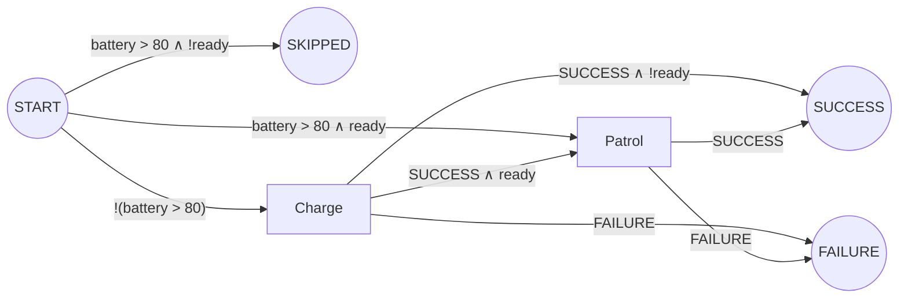

# BehaviorTree.CPP v4 XML reference for the Beehave parser

This document is the reference for Beehave's BT.CPP **v4** parser, flattener and walker. It plays the same role for v4 that [`btcpp-v3-xml.md`](btcpp-v3-xml.md) plays for v3, and it assumes you have read that document and [`btcpp-v3-vs-v4.md`](btcpp-v3-vs-v4.md). It lists every node type that `BehaviorTreeFactory` registers in the latest release, gives each one a walk rule with a third, "skipped", continuation, and specifies pre- and post-conditions, the scripting language, v4 subtree remapping and the document structure.

**Versions checked.** Everything here was read from the C++ source of tag **`4.10.0`** (commit `879522c`, 2026-07-24, the latest 4.x release) and of **`master`** at commit `03ec870` (2026-10-10). The node registrations are identical in both ([`bt_factory.cpp` L118-L173][factory]). The differences between the two that matter to a parser are noted where they occur. Behaviour that changed during 4.x carries the first release that has it, found with `git tag --contains`. Where the documentation and the code disagree, the code wins and the disagreement is noted. Lines marked **(run)** were also confirmed by running small trees on a local build of `4.10.0`, not only by reading the source.

**Notation.**

- `S`, `F` and `K` are the **success**, **failure** and **skipped** continuations passed to `compile(n, S, F, K)`. `K` is where execution goes when `n` returns SKIPPED.
- `Branch(c, A, B)` is a guard: go to `A` if `c` holds, else to `B` (the walk's `_Branch`).
- `ERR` means BT.CPP throws at runtime. Beehave should report a diagnostic and draw no edge.
- `WAIT(c)` means the node returns RUNNING and checks `c` again on the next tick. A single pass draws only the edge taken once `c` holds.
- "Exact" means the rule reproduces every success, failure and skipped path of one activation of the node. "Approximated" means Beehave draws the single-pass edges and reports the node as approximated.

---

## 1. Summary table

Every row also accepts the pre- and post-condition attributes of §3, which wrap the rule given here. "Since" is given for nodes added after 4.0.1 (see [`btcpp-v3-vs-v4.md` §2.3](btcpp-v3-vs-v4.md#23-built-in-nodes-added-in-v4)).

| XML name | Beehave kind | Children | Walk rule: `compile(n, S, F, K)` | Single pass | Notes |
|---|---|---|---|---|---|
| `Sequence` | control | ≥ 1 | two-track chain (§2.3): `ci -S-> c(i+1)`, `ci -F-> F`, `ci -K-> c(i+1)`; after `cn`: `S`, or `K` if **every** child was skipped | exact | Restarts at `c1` after a failure. |
| `SequenceWithMemory` | control | ≥ 1 | same as `Sequence` | approximated (memory) | v3 `SequenceStar`. After a FAILURE it resumes at the failed child. |
| `AsyncSequence` (4.2.0) | control | ≥ 1 | same as `Sequence` | exact | Returns RUNNING after each successful child so the tree can be interrupted. Same edges. |
| `ReactiveSequence` | control | ≥ 1 | same as `Sequence` | approximated (preemption) | Re-ticks earlier children every tick. When one child is RUNNING, all others are halted. |
| `Fallback` | control | ≥ 1 | mirror chain: `ci -F-> c(i+1)`, `ci -S-> S`, `ci -K-> c(i+1)`; after `cn`: `F`, or `K` if every child was skipped | exact | |
| `AsyncFallback` (4.2.0) | control | ≥ 1 | same as `Fallback` | exact | Yields after each failed child. |
| `ReactiveFallback` | control | ≥ 1 | same as `Fallback` | approximated (preemption) | |
| `Parallel` | control | ≥ 1 | fork into every child, join on counts (§2.3) | approximated | `success_count` (default **-1** = all), `failure_count` (default **1**). Negative `M` means `max(N+M+1, 0)`. Skipped children count as successes only when `success_count < 0`. |
| `ParallelAll` (4.3.2) | control | ≥ 1 | fork, join when every child has finished or skipped: `F` if failures ≥ `max_failures`, else `S`; `K` if all skipped | approximated | `max_failures` (default 1, negative as above). The port description says "exceeds", the code uses `≥`. |
| `IfThenElse` | control | 2 or 3 | `compile(c1, compile(c2,S,F,K), n=3 ? compile(c3,S,F,K) : F, ERR)` | exact | A skipped `c1` throws "Something unexpected happened" **(run)**. |
| `WhileDoElse` | control | 2 or 3 (2 since 4.3.5) | same as `IfThenElse` | approximated (re-check) | `c1` is ticked on every tick. A skipped `c1` makes the node return IDLE, which throws **(run)**. |
| `TryCatch` (4.9.0) | control | ≥ 2 | try block `c1..c(n-1)` as a `Sequence` with exits `S`/`K`; every try child `-F-> C`, where `C = compile(cn, F, F, F)` | exact | The catch child's result is ignored: the node returns FAILURE, also when `cn` is skipped **(run)**. `catch_on_halt` (bool, default false) runs `cn` on halt. |
| `Switch2` … `Switch6` | control | N+1 | `Branch(variable == case_1, compile(c1,S,F,K), Branch(variable == case_2, …, compile(default,S,F,K)))` | exact for one pass | Missing `variable`: default child. A selected child that skips makes the node SKIPPED **(run)**. |
| `Inverter` | decorator | 1 | `compile(c, F, S, K)` | exact | |
| `ForceSuccess` | decorator | 1 | `compile(c, S, S, K)` | exact | SKIPPED passes through **(run)**. |
| `ForceFailure` | decorator | 1 | `compile(c, F, F, K)` | exact | SKIPPED passes through **(run)**. |
| `Repeat` | decorator | 1 | `e = compile(c, LOOP, F, K)`, `LOOP = Branch([k<N], e, S)`; `N=-1`: `LOOP = e`; `N=0`: entry is `S` | exact (loop edge) | `num_cycles` required. A skipped child makes the node SKIPPED even after earlier cycles ran **(run)**. |
| `RetryUntilSuccessful` | decorator | 1 | `e = compile(c, S, RETRY, K)`, `RETRY = Branch([k<N], e, F)`; `N=-1`: `RETRY = e`; `N=0`: entry is `F` | exact (loop edge) | `num_attempts` required, read again after each failure. SKIPPED after a failed attempt also gives `K` **(run)**. |
| `KeepRunningUntilFailure` | decorator | 1 | `e = compile(c, e, F, e)` | exact (loop edge) | Never SUCCESS, never SKIPPED. A skipped child keeps it RUNNING **(run)**. |
| `Timeout` | decorator | 1 | `compile(c, S, F, K)` plus timeout edges to `F` from RUNNING-capable actions | approximated | `msec` required (`0` disables the timer). |
| `Delay` | decorator | 1 | `compile(c, S, F, K)` | exact | `delay_msec` required. Waits first, then ticks the child. |
| `RunOnce` (4.2.0) | decorator | 1 | `Branch(first activation, compile(c,S,F,K), LATER)`; `LATER = K` | approximated (state across activations) | `then_skip` (default true). With `then_skip="false"`, later activations return the first result without ticking. |
| `Precondition` | decorator | 1 | `Branch(if, compile(c,S,F,K), ELSE)`; `ELSE` is `F` (default), `S`, `K`, or `WAIT(if)` for `else="RUNNING"` | exact for one pass | Since 4.7.0 checked once per activation (§2.4). |
| `LoopInt`, `LoopBool`, `LoopDouble`, `LoopString` (4.2.0, 4.3.5) | decorator | 1 | `e = Branch([queue not empty], compile(c, e, F, e), EMPTY)`; `EMPTY` is `S`, `F` or `K` from `if_empty` | exact (loop edge) | Pops one element into `value` per tick. `if_empty` default SUCCESS. A skipped child continues the loop **(run)**. |
| `SkipUnlessUpdated` (4.6.0) | decorator | 1 | `Branch(updated(entry), compile(c,S,F,K), K)` | exact for one pass | Stateful guard (§2.4). A missing entry counts as "not updated" **(run)**. |
| `WaitValueUpdate` (4.6.0) | decorator | 1 | `WAIT(updated(entry))`, then `compile(c, S, F, K)` | exact for one pass | Same class as `SkipUnlessUpdated`, with RUNNING instead of SKIPPED. |
| `SubTree` | subtree | 0 | inline the body: `compile(body, S, F, K)` | exact | Remapping in §5. Pre-conditions on the `<SubTree>` element read the **parent** blackboard. |
| `AlwaysSuccess` | action (constant) | 0 | `S` | exact | |
| `AlwaysFailure` | action (constant) | 0 | `F` | exact | |
| `Script` | action (effect) | 0 | `S`, carrying the script as an effect | exact | `code` required. Always SUCCESS. A failing script throws. |
| `ScriptCondition` (4.3.1) | condition | 0 | `Branch(code, S, F)` | exact | A pure expression is a guard label (§4.5). |
| `SetBlackboard` | action (effect) | 0 | `S` | exact for literal values | `value`, `output_key`. Since 4.7.0 it returns FAILURE when `value="{k}"` names an entry that holds no value. |
| `UnsetBlackboard` (4.4.3) | action (effect) | 0 | `S` | exact | `key`. |
| `Sleep` (4.3.0) | action | 0 | an action vertex with a single `-S-> S` edge | exact | `msec`. Never fails. |
| `WasEntryUpdated` (4.6.0) | **condition** (registered as an action) | 0 | `Branch(updated(entry), S, F)` | exact for one pass | Stateful: each node instance remembers the last version it saw. |
| `SequenceStar` | control | ≥ 1 | as `SequenceWithMemory` | approximated | Registered **only** when BT.CPP is built with `USE_BTCPP3_OLD_NAMES`. Warn. |
| user `Action` / `Condition` | action / condition | 0 | as v3: vertex with `S`/`F` edges, or `Branch(cond, S, F)` | exact | Assumed never to return SKIPPED, although BT.CPP allows it. |
| user `Control` / `Decorator` | control / decorator | ≥ 1 / 1 | unknown | approximated | As in v3 (Nav2 `RecoveryNode`, `PipelineSequence`, `RoundRobin`, `RateController`, …). |

The C++ class behind `WasEntryUpdated` is `EntryUpdatedAction`. `SkipUnlessUpdated` and `WaitValueUpdate` are both `EntryUpdatedDecorator`, registered with `NodeStatus::SKIPPED` and `NodeStatus::RUNNING` as the "not updated" status ([`bt_factory.cpp` L171-L173][factory]). The XML only ever uses the registration names.

### Classes that exist but are not registered

| Name | Status in v4 | Where |
|---|---|---|
| `ManualSelector` | class `ManualSelectorNode` still exists, **not registered** since 4.1.1 | `controls/manual_node.h` |
| `ConsumeQueue`, `PopFromQueue`, `QueueSize` | header-only templates, never registered | `decorators/consume_queue.h`, `actions/pop_from_queue.hpp` |
| `TestNode` | used by substitution rules for mocking, not registered | `actions/test_node.h` |
| `SubTreePlus`, `BlackboardCheckInt/Double/String/Bool`, `Switch`, `Loop` | do not exist in v4 | — |

A v4 file that uses any of these names refers to a user-registered node, or is invalid.

---

## 2. The SKIPPED status

### 2.1 Where SKIPPED comes from

A node returns SKIPPED in exactly these cases:

1. A pre-condition fires: `_skipIf` is true, or `_while` is false (§3).
2. `Precondition` with `else="SKIPPED"` and a false `if`.
3. `SkipUnlessUpdated` with an entry that has not changed.
4. `RunOnce` (`then_skip="true"`) on every activation after the first.
5. A `Loop*` decorator with an empty queue and `if_empty="SKIPPED"`.
6. A control node whose children were **all** skipped (§2.3), or a decorator whose child was skipped (§2.4).
7. A user node whose `tick()` returns SKIPPED. Nothing in BT.CPP forbids this ([`action_node.cpp`][action]). Beehave assumes that user nodes never do it, unless the config says otherwise.

**SKIPPED is never stored.** Since 4.3.4, `executeTick` returns SKIPPED to the parent but does not store it as the node's status ([`tree_node.cpp` L151-L156][executeTick]). A node skipped by a pre-condition stays IDLE, so it evaluates its pre-conditions again the next time it is ticked. In 4.0.1 to 4.3.3 the SKIPPED status was stored.

### 2.2 `may_skip`: when `K` matters

Most nodes can never return SKIPPED. For them `K` is irrelevant and the walk can pass `None`. Compute this bottom-up:

```text
may_skip(n) =
  true                                   if n has _skipIf or _while
  true                                   for SkipUnlessUpdated, RunOnce (then_skip true),
                                         Precondition else="SKIPPED", Loop* if_empty="SKIPPED"
  all(may_skip(c) for c in children)     for Sequence, SequenceWithMemory, AsyncSequence,
                                         ReactiveSequence, Fallback, AsyncFallback,
                                         ReactiveFallback, ParallelAll, and the try block of TryCatch
  success_count > 0 and all(may_skip)    for Parallel (the literal port value; the default -1 never skips)
  may_skip(c2) or may_skip(c3)           for IfThenElse, WhileDoElse (a skipped c1 is ERR, report it)
  any(may_skip(c) for c in children)     for Switch2..Switch6
  may_skip(child)                        for Inverter, ForceSuccess, ForceFailure, Repeat,
                                         RetryUntilSuccessful, Timeout, Delay, Precondition,
                                         WaitValueUpdate, SubTree (its body)
  false                                  for KeepRunningUntilFailure, Loop* (unless if_empty),
                                         every leaf, and user nodes
```

The root of the tree is compiled with `K = SKIPPED`, a new terminal vertex that is drawn only when it is reachable. `tickOnce()` on a tree whose root skipped returns SKIPPED.

### 2.3 Control nodes

Every control node treats a skipped child as "not executed, move on". The node itself returns SKIPPED only when **every child it ticked in this activation** was skipped.

| Node | Child returns SKIPPED | Node result when every child is skipped | Source |
|---|---|---|---|
| `Sequence`, `AsyncSequence` | move to the next child, count it | SKIPPED; otherwise SUCCESS **(run)** | [`sequence_node.cpp` L81-L103][seq] |
| `SequenceWithMemory` | move on, count it | SKIPPED **(run)** | [`sequence_with_memory_node.cpp` L68-L90][seqmem] |
| `ReactiveSequence` | halt (reset) that child, move on | SKIPPED **(run)**. Counted per tick. | [`reactive_sequence.cpp` L75-L90][rseq] |
| `Fallback`, `AsyncFallback` | move to the next child, like a failure | SKIPPED; otherwise FAILURE. `Fallback(fail, skip)` is FAILURE **(run)** | [`fallback_node.cpp` L71-L93][fb] |
| `ReactiveFallback` | reset that child, move on | SKIPPED; otherwise FAILURE **(run)** | [`reactive_fallback.cpp` L75-L90][rfb] |
| `Parallel` | count it for this tick. It is **not** marked completed, so it is ticked again next tick. | `success_count < 0` (default): **SUCCESS**, because skipped children count toward success **(run)**. `success_count > 0`: SKIPPED **(run)**. `success_count="0"` succeeds after the first child. | [`parallel_node.cpp` L69-L131][par] |
| `ParallelAll` | counts as finished | SKIPPED **(run)** | [`parallel_all_node.cpp` L75-L99][parall] |
| `IfThenElse` | `c1`: throws. `c2`/`c3`: the node returns SKIPPED **(run)** | — | [`if_then_else_node.cpp` L40-L77][ite] |
| `WhileDoElse` | `c1`: returns IDLE, which throws. `c2`/`c3`: SKIPPED **(run)** | — | [`while_do_else_node.cpp` L39-L74][wde] |
| `SwitchN` | the node returns SKIPPED. The source comment says "jump to default"; the code does not. | — | [`switch_node.h` L148-L166][switch] |
| `TryCatch` | try child: move on, count it. Catch child: the node returns FAILURE **(run)** | SKIPPED when every try child skipped **(run)** | [`try_catch_node.cpp` L74-L131][trycatch] |

**The two-track chain.** "SKIPPED only if all skipped" needs one bit of state: "has some child returned a non-skipped status yet?". In continuation-passing style, a `Sequence` with children `c1 … cn` compiles two entries per child:

```text
T(n+1) = S          # some earlier child succeeded: the remaining skips lead to SUCCESS
U(n+1) = K          # every earlier child skipped: if the rest skip too, the Sequence skips
T(i) = compile(ci, S = T(i+1), F = F, K = T(i+1))
U(i) = compile(ci, S = T(i+1), F = F, K = U(i+1))
entry = U(1)
```

`Fallback` is the mirror image (`T(n+1) = F`, `U(n+1) = K`, children's `F` go to `T(i+1)`, their `S` to `S`). For a child with `may_skip(ci) = false`, `U(i)` and `T(i)` are identical, so only the leading run of skippable children needs two versions. If no child may skip, the chain is the v3 chain.

The two versions of a child differ only in their `K`. When `K` is reached only through branch points at the child's entry (the common case: `_skipIf` on a leaf), the action vertices inside are the same in both tracks and the walk can share them. `K` can also be reached **after an action has run**: through a `Repeat` or `RetryUntilSuccessful` loop over a skippable body (the second cycle skips), and through a `_while` that turns false while an action is RUNNING. In those cases the same action needs different edges in the two tracks. The walk must then either duplicate the action vertices, or keep the `T` track only and report the node as approximated ("SKIPPED after a child ran is drawn as SUCCESS/FAILURE").

**`Parallel` in detail** ([`parallel_node.cpp` L40-L131][par], [`parallel_node.h` L48-L56][parh]). With `N` children, `required = success_count < 0 ? max(N + success_count + 1, 0) : success_count`, and the same for `failure_count`. After **each** child it checks: SUCCESS if `successes ≥ required`, or if `success_count < 0` and `successes + skipped ≥ required`. FAILURE if `N − failures < required` or `failures == failure_threshold`. If the loop ends without a decision, the result is SKIPPED when every child skipped in this tick, else RUNNING. It throws when `N` is below either threshold. Consequences: `failure_count="0"` fails after the first child. With a positive `success_count`, a child that keeps skipping can leave the node RUNNING forever, which BT.CPP itself shows **(run)**, so Beehave should warn.

### 2.4 Decorators

| Decorator | Child returns SKIPPED | `K` wiring |
|---|---|---|
| `Inverter`, `ForceSuccess`, `ForceFailure` | returns SKIPPED **(run)** | child `K` = `K` |
| `Repeat`, `RetryUntilSuccessful` | resets the child and returns SKIPPED, keeping the cycle counter **(run)** | child `K` = `K`, also from the loop's later cycles |
| `KeepRunningUntilFailure` | returns RUNNING, ticks the child again next tick **(run)** | child `K` = entry of the child (loop) |
| `Timeout` | returns SKIPPED | child `K` = `K` |
| `Delay` | returns SKIPPED after the delay **(run)** | child `K` = `K` |
| `RunOnce` | returns SKIPPED and does not mark itself as run | child `K` = `K` |
| `Precondition` | returns SKIPPED **(run)**. Quirk: the "child running" flag is not cleared, so on the **next** activation the child is ticked without checking `if` **(run)**. | child `K` = `K` |
| `Loop*` | returns RUNNING and pops the next element, as after a success **(run)** | child `K` = loop entry |
| `SkipUnlessUpdated`, `WaitValueUpdate` | returns SKIPPED | child `K` = `K` |
| `SubTree` | returns SKIPPED **(run)** | body `K` = `K` |

The `Precondition` quirk affects later activations only, so a single static pass is not affected. It is worth a lint warning for a `Precondition` over a skippable child.

`Precondition` changed in 4.7.0 ([commit `5f3f675`][precond-fix]). Before 4.7.0, `if` was evaluated on **every** tick, and a false value while the child was RUNNING returned `else` without halting the child. Since 4.7.0 it is evaluated once per activation ([`script_precondition.h` L63-L90][precond]). With `else="RUNNING"` and a false `if`, the node keeps returning RUNNING and re-checks `if` on each tick until it holds **(run)**. `else="IDLE"` makes the node return IDLE, which throws. The website's [pre/post-conditions guide][guide-prepost] still says that `else="RUNNING"` re-evaluates "on every tick" while the child runs. The code, and BT.CPP's own [`docs/pre_postconditions.md`][docs-prepost] on master, say it does not.

`SkipUnlessUpdated`, `WaitValueUpdate` and `WasEntryUpdated` compare the entry's `sequence_id` (incremented on every write) with the value the node instance saw last, then store the new value ([`updated_decorator.cpp` L42-L72][upddec], [`updated_action.cpp` L40-L68][updact]). The first check of an entry that has been written is "updated". The guard is therefore **stateful**: two different nodes watching the same key are independent conditions. Key them by node path, not by their text.

---

## 3. Pre-conditions and post-conditions

Sources: [`TreeNode::executeTick` L71-L157][executeTick], [`checkPreConditions` L204-L259][precheck], [`checkPostConditions` L261-L281][postcheck], [`haltNode` L159-L169][haltnode], the enums in [`tree_node.h` L47-L94][treenodeh], and their attachment to every node in [`createNodeFromXML` L885-L902][addcond] and [`instantiateTreeNode` L404-L419][assigncond].

- Any node can carry them: leaves, controls, decorators, and `<SubTree>` elements **(run)**.
- They are XML attributes, not ports. Their names are reserved, so they are never checked against the node's port list.
- The scripts are parsed when the tree is created. A syntax error makes the whole tree fail to load.
- They are evaluated in the blackboard of the node that carries them. For a `<SubTree>` element that is the **parent's** blackboard, because the SubTree node is created before its child scope.

### 3.1 Pre-conditions

Evaluated in this fixed order, and the first that fires wins **(run)**:

| Order | Attribute | Evaluated when | Fires if | Result | `tick()` called? |
|---|---|---|---|---|---|
| 1 | `_failureIf` | node is IDLE | script is true | FAILURE | no |
| 2 | `_successIf` | node is IDLE | script is true | SUCCESS | no |
| 3 | `_skipIf` | node is IDLE | script is true | SKIPPED | no |
| 4 | `_while` | node is IDLE | script is **false** | SKIPPED | no |
| 4 | `_while` | node is RUNNING | script is **false** | halts the node (runs `_onHalted`), then SKIPPED | no |

"IDLE" is "IDLE or SKIPPED" in the code. Since SKIPPED is not stored (§2.1), this means "the node is starting a new activation". `_failureIf`, `_successIf` and `_skipIf` are **not** checked again while the node is RUNNING. `_while` is the only pre-condition checked on every tick. When none fires, `tick()` runs and its result is the node's result.

**Walk rule.** Absent attributes drop their level:

```text
compile(n, S, F, K) =
  Branch(failureIf, F,
    Branch(successIf, S,
      Branch(skipIf, K,
        Branch(while, body(n, S, F, K), K))))
```

`body` is the rule of §1. This is **exact** for a single pass. `_while` also needs "interrupt" edges from each RUNNING-capable action inside `n` to `K`, guarded by `!(while)` and carrying the `_onHalted` effect. That part is approximated, like reactive preemption, and should be reported.

### 3.2 Post-conditions

| Attribute | Runs when | Changes the status? |
|---|---|---|
| `_onSuccess` | the node returned SUCCESS | no |
| `_onFailure` | the node returned FAILURE | no |
| `_post` | the node returned SUCCESS or FAILURE, after `_onSuccess` / `_onFailure` | no |
| `_onHalted` | a RUNNING node was halted, by its parent or by its own `_while` | no |

- They also run when the status came from `_successIf` or `_failureIf`. `<AlwaysFailure _successIf="true" _onSuccess="a := 1" _post="b := 2"/>` returns SUCCESS and sets both keys **(run)**.
- They do **not** run on SKIPPED **(run)** or on RUNNING.
- Before 4.5.2, `checkPostConditions` ran after **every** tick, so `_post` also ran on RUNNING and SKIPPED.

**Walk rule.** Post-conditions never change control flow. They are **effects** attached to the edges that leave `n`: `_onSuccess; _post` on every edge into `S`, `_onFailure; _post` on every edge into `F`, `_onHalted` on interrupt edges. For an action they are its outgoing edges. For a control node they are the edges from its inner actions that leave the node. Phase 1 can show them as edge notes or ignore them. Phase 2 needs them, because an assignment changes what later guards mean (§7.3).

### 3.3 Worked example

```xml
<Sequence>
  <Charge _skipIf="battery &gt; 80"/>
  <Patrol _skipIf="!ready"/>
</Sequence>
```

Both children may skip, so the two-track chain is needed: `U2 = Branch(!ready, K, Patrol)`, `T2 = Branch(!ready, S, Patrol)`, and `entry = Branch(battery > 80, U2, Charge)` with `Charge -S-> T2`.



When both are skipped the Sequence returns SKIPPED, not SUCCESS. A parent `Fallback` would then move on to its next child instead of stopping.

---

## 4. The scripting language

Used by `Script` (`code`), `ScriptCondition` (`code`), `Precondition` (`if`) and all eight pre- and post-condition attributes. Since **4.9.0** the parser is hand-written: a tokenizer ([`script_tokenizer.cpp`][tokenizer]) and a Pratt parser ([`script_parser.cpp`][parser]), [commit `d198332`][pratt]. Up to 4.8.x it was a [lexy](https://github.com/foonathan/lexy) grammar in `scripting/operators.hpp`. The differences are listed in §4.3. Evaluation is in [`scripting/operators.hpp`][operators].

### 4.1 Lexical structure (4.9.0+)

| Token | Form |
|---|---|
| identifier | `[A-Za-z_@][A-Za-z0-9_]*`. A leading `@` names the **root** blackboard (4.6.0+). No `{}` braces: in scripts a blackboard key is a bare name. Keys containing `.`, `/` or `-` cannot be written. |
| integer | decimal `42`, or hex `0x7F`. Stored as int64. Out of range is an error (master). |
| real | `3.14`, `1e3`, `2.5E-2` |
| string | `'single quoted'`, no escapes. **Double quotes are an error** **(run)**. |
| boolean | `true`, `false` (lower case only), stored as `1.0` and `0.0` |
| statement separator | `;`. Optional: `p := 1 q := 2` is two statements **(run)**. Newlines are whitespace. |

In XML attributes, `<`, `>` and `&` are written `&lt;`, `&gt;` and `&amp;`. The XML parser decodes them before the script parser sees the text.

### 4.2 Grammar and precedence (4.9.0+)

From loosest to tightest binding ([`leftBP`, `script_parser.cpp` L104-L160][parser-bp]):

| Level | Operators | Associativity | AST node |
|---|---|---|---|
| 1 | `:=` `=` `+=` `-=` `*=` `/=` | right; the left side must be an identifier | `ExprAssignment` |
| 2 | `c ? a : b` | right (a ternary may follow `:`) | `ExprIf` |
| 3 | <code>&#124;&#124;</code> | left | `ExprBinaryArithmetic` |
| 4 | `&&` | left | `ExprBinaryArithmetic` |
| 5 | `==` `!=` `<` `>` `<=` `>=` | **chainable**: `0 < x <= 4` means `0 < x && x <= 4` **(run)** | `ExprComparison` |
| 6 | <code>&#124;</code> `^` | left | bitwise |
| 7 | `&` | left | bitwise |
| 8 | `+` `-` `..` | left | `..` concatenates strings |
| 9 | `*` `/` | left | |
| 10 | prefix `-` `~` `!` | prefix, binds tighter than every infix operator | `ExprUnaryArithmetic` |
| atoms | literals, identifiers, `( expr )` | | |

```text
script     := statement ( ';'* statement )* ';'*
statement  := expr
expr       := name ASSIGN_OP expr | ternary
ternary    := or ( '?' expr ':' ternary )?
or         := and ( '||' and )*
and        := cmp ( '&&' cmp )*
cmp        := bitor ( CMP_OP bitor )*
bitor      := bitand ( ('|' | '^') bitand )*
bitand     := sum ( '&' sum )*
sum        := product ( ('+' | '-' | '..') product )*
product    := unary ( ('*' | '/') unary )*
unary      := ('-' | '~' | '!') unary | atom
atom       := INTEGER | REAL | STRING | BOOLEAN | IDENT | '(' expr ')'
```

The value of a multi-statement script is the value of its **last** statement. `ScriptCondition code="false; true"` succeeds **(run)**.

### 4.3 Differences up to 4.8.x (lexy grammar)

Files written for 4.0 to 4.8 can parse differently:

- **`&&` and `||` had the same precedence**, left-associative: `a || b && c` meant `(a || b) && c`. Since 4.9.0 it means `a || (b && c)` **(run)**. Beehave should parse with the 4.9+ rules, warn when an expression mixes `&&` and `||` without parentheses, and show such guards with explicit parentheses.
- Strings could be single- or double-quoted.
- Identifiers could contain Unicode letters.
- Arithmetic, bitwise and string operators could not be mixed without parentheses (`dsl::groups`). Prefix `-`, `!` and `~` applied to an atom only.

### 4.4 Evaluation

- **Names.** Identifiers are looked up first in the **enums** registered in C++ (`registerScriptingEnum`, `registerScriptingEnums<E>()`), then in the blackboard. An enum shadows a key with the same name. A missing variable throws "Variable not found" ([`ExprName` L80-L106][op-name]). Beehave cannot see C++ enums, so the config should be able to declare them. Unknown identifiers default to blackboard keys.
- **Numbers.** Every arithmetic result is a `double`. Booleans are `1.0` and `0.0`.
- **`&&` and `||` do not short-circuit.** Both sides are always evaluated: `false && (x := 5) > 0` sets `x` **(run)** ([L214-L230][op-bin]).
- **Comparisons.** Number with number. String with string (lexicographic). String with number: the string is converted, and enums are accepted. Anything else throws. `==` and `!=` on doubles use a tolerance of the `float` epsilon. `<`, `<=`, `>`, `>=` are exact ([`IsSame` L315-L326][op-same]).
- **Assignment.** `:=` creates the entry if needed. `=` (and `+=`, …) **throw** if the entry does not exist **(run)**. An assignment increments the entry's `sequence_id`, which `WasEntryUpdated` and friends observe.
- **Unary `!` on a string** accepts `"true"`/`"false"`/`"1"`/`"0"` on master only (after 4.10.0).

### 4.5 Which expressions are side-effect free

A script is **pure** if no statement contains an assignment operator (`:=`, `=`, `+=`, `-=`, `*=`, `/=`) anywhere, including inside parentheses and ternary branches. Decide this on the token stream (`=` vs `==`, `<=` vs `<`), never with a regular expression. A pure script reads the blackboard only, so its value can be a guard label.

| Use | Pure script | Impure script |
|---|---|---|
| `ScriptCondition`, `Precondition if`, `_failureIf`, `_successIf`, `_skipIf`, `_while` | guard on the expression | still a branch, on the value of the **last** statement. Report "guard with side effects" and record the assignments as an effect on both branches (they run either way). |
| `Script`, `_onSuccess`, `_onFailure`, `_post`, `_onHalted` | a no-op (allowed) | effect on the edge (§3.2) |

Evaluation can also **throw**: a missing variable, `=` on a missing key, or a type mix. A static walk ignores these runtime errors. A lint pass can flag reads of keys that no earlier node writes.

### 4.6 Displaying guards and their negation

- **Label** = the script text with whitespace collapsed and XML entities already decoded, for example `battery < 20`. **Condition key** = a canonical print of the AST plus the blackboard scope it is evaluated in (§5.2). Then `a>b` and `a > b` in the same scope are the same condition, but the same text inside two subtree instances is not.
- **Negated label**, used on the false edge:
  1. `x` where `x` is a single name or literal: `!x`. And `!x` negated is `x`. Remove double negation.
  2. Anything else: **`!(expr)`**, for example `!(battery < 20)`. Never write `!expr` without parentheses. `!` binds tighter than every binary operator, so `!battery < 20` would mean `(!battery) < 20`.
  3. Optional simplification, for Phase 2: one non-chained comparison may be flipped (`==`↔`!=`, `<`↔`>=`, `>`↔`<=`). This is exact in BT.CPP, apart from NaN, because `==` and `!=` share the same tolerance and the ordering operators are exact complements. Do not apply De Morgan in Phase 1.
- When the 4.8.x and 4.9.x parses differ (§4.3), print explicit parentheses.

---

## 5. SubTree in v4

Sources: [`recursivelyCreateSubtree` L1062-L1271][subtree] (the remapping loop is L1100-L1229), [`Blackboard::getEntry` L146-L177][bb-get], [`createEntryImpl` L394-L460][bb-create], [`loadSubtreeModel` L316-L334][loadmodel], [`subtree_node.h`][subtreeh].

`<SubTree ID="T" …/>` always creates a new blackboard, child of the caller's. Attributes are read **in document order**:

| Attribute | Effect | Since |
|---|---|---|
| `a="{k}"` | remap: inside key `a` is an alias of parent key `k`. Spaces around the braces are trimmed. | 4.0.1 |
| `a="{@k}"` | remap to the **root** blackboard's `k`, from any depth | 4.6.0 |
| `a="{=}"` | shorthand for `a="{a}"` | 4.6.0 for subtree attributes (4.5.2 for node ports) |
| `a="literal"` | sets local key `a` to the literal. Since **4.9.1** it is stored as `int` (or `int64`) when the whole string is an integer, as `double` when it parses as a real, else as a string **(run)**. Before that, always a string. | 4.0.1 |
| `a="${k}"` | a **literal** string since 4.3.4. Before that, same as `{k}`. | — |
| `a="="` | the literal string `=`. `=` is the same-name shorthand only for node ports. | — |
| `_autoremap="true"` | any key that is neither local nor remapped falls through to the **same key in the parent**, except **private keys** that start with `_` (4.4.3+) **(run)**. Literals are always written locally, whatever the attribute order (the 3.8.4 quirk is gone). | 4.0.1 |
| `name="x"` | the instance path becomes `parent/x`, else `T::<uid>`. Two SubTrees with the same `name` in one tree are an error (4.8.4) **(run)**. | 4.0.1 |
| pre- and post-conditions, `_description`, other `_…` attributes | not remappings. Conditions apply to the SubTree node and read the **parent** blackboard. | — |

**Subtree port models** (4.4.0+). If `<TreeNodesModel>` has `<SubTree ID="T">` with ports, then for each declared port not given in the XML, and only **when `_autoremap` is off**: a `default` is used as if it had been written (`{x}` → remap, otherwise a literal) **(run)**, and a port with no default makes loading fail with "mandatory port … but you are not remapping it" **(run)**. With `_autoremap` on, the model is not consulted. A model port whose name is not an allowed port name (for example `_myPort`) and that is used in the XML is an error on master.

**Recursion.** A tree that includes itself, directly or indirectly, is rejected at creation since 4.9.0 **(run)**. Earlier releases had no such check.

### 5.1 Differences from v3 `SubTreePlus`

| Topic | v3.8 `SubTreePlus` | v4 `SubTree` |
|---|---|---|
| auto-remap attribute | `__autoremap` (two underscores) | `_autoremap` |
| private `_keys` under auto-remap | forwarded | **local** (4.4.3+) |
| literal after auto-remap | written to the parent (3.8.4+ quirk) | always local |
| literal type | string | int, int64 or double when numeric (4.9.1+) |
| `${k}` | remap | literal (4.3.4+) |
| `{=}` | literal `{=}` | same-name remap (4.6.0+) |
| `{@k}` | key literally named `@k` | root blackboard |
| `TreeNodesModel` subtree ports | ignored | defaults applied, mandatory ports checked |
| `name` | ignored | used for the path, must be unique |
| `__shared_blackboard` | on classic `SubTree` | removed |

### 5.2 Flattening rule for v4

The v3 rule ([`btcpp-v3-xml.md` §5.3](btcpp-v3-xml.md#53-flattening-rule-for-beehave)) becomes:

```text
resolve(k, scope):
  if k starts with "@":                         return Key(k[1:])                      # root blackboard
  if k in scope.literals:                       return Literal(scope.literals[k])     # typed (4.9.1+)
  if k in scope.remap:                          return resolve(scope.remap[k], scope.parent)
  if scope.autoremap and not k.startswith("_"): return resolve(k, scope.parent)
  return Key(scope.path + "/" + k)                                                     # local to the instance
root scope: resolve(k) = Key(k)

scope.remap and scope.literals come from the <SubTree> attributes in document order,
after rewriting {=} to {a} and, when _autoremap is off, adding the model defaults.
```

Apply `resolve` to every `{key}` port value inside the subtree **and to every identifier in its scripts**. A script identifier is a key, unless it is a declared enum.

---

## 6. Document structure

Primary sources: [`xml_parsing.cpp`][xml] (`loadDocImpl` L336-L469, `VerifyXML` L471-L698, `instantiateTree` L700-L736, `createNodeFromXML` L740-L1060), [`bt_factory.cpp` `createTreeFromText`/`createTreeFromFile` L440-L486][createtree], [`basic_types.cpp` L547-L614][names], and BT.CPP's [`docs/name_validation_rules.md`][namerules].

### 6.1 `<root>`

- The document element must be `root`.
- `BTCPP_format`: when it is **missing**, v4 prints a warning to stdout and carries on. Its **value is never checked** ([L352-L359][fmt]). Version detection stays Beehave's job ([`btcpp-v3-vs-v4.md` §3](btcpp-v3-vs-v4.md#3-version-detection-recipe-for-beehave)). Two v4 fixtures have no marker: `v4/btcpp/examples/test_files/Check.xml` and `v4/nav2-jazzy/nav2_docking/…/application_example.xml`.
- `main_tree_to_execute`: `createTreeFromText` and `createTreeFromFile` resolve the tree to run in this order: (1) `main_tree_to_execute` of that document; (2) the only `<BehaviorTree>` with an `ID` in that document, ignoring included files; (3) the only tree newly registered by loading it; (4) the parser default: `main_tree_to_execute` of the **first** document ever loaded, else the only registered tree, else the error "[main_tree_to_execute] was not specified correctly" **(run)**. `factory.createTree("ID")` names the tree explicitly, which is what most v4 code does.

### 6.2 `<BehaviorTree ID="…">`

- Exactly one child element.
- `ID` may be omitted only when `<root>` has **exactly one child element of any kind**: a `<TreeNodesModel>` or `<include>` next to it makes the missing `ID` an error **(run)**. An ID-less tree is registered as `BehaviorTree_<n>`.
- `ID` must not be the name of a registered node (4.6.2), and must pass the model-name rules (§6.6, 4.8.4).
- **Duplicate IDs: the last definition wins** (`tree_roots[name] = …`), the **opposite of v3** **(run)**. Includes are loaded before the including file's own trees, so a local tree overrides an included one with the same ID. Later files loaded into the same factory override earlier ones. Beehave should warn, and the v4 parser must keep the last definition, not the first.

### 6.3 `<include path="…" [ros_pkg="…"]/>`

- `path` is mandatory: a missing one is an error ("Invalid \<include\> tag"). In v3 it crashed.
- A relative path is resolved against the directory of the including file, which becomes the current directory for nested includes. Same as v3. Fixture: `v4/btcpp/tests/trees/` (sibling, child and parent includes).
- `ros_pkg` resolves through `ament_index` in ROS 2 builds only. Otherwise it throws. With an absolute `path`, `ros_pkg` is ignored with a warning.
- There is **no include-cycle detection** and no de-duplication. Beehave must detect cycles itself.
- Third-party loaders add their own include attributes (AutoAPMS uses `<include autoapms="…"/>`, see `v4/auto-apms/…/include_e2e.xml`). Report unknown include attributes as unresolved, as for `ros_pkg`.

### 6.4 `<TreeNodesModel>`

- At most one per file. The check that every model has an `ID` iterates over the children of `<root>` instead of the model's children, the same bug as in v3 ([L501-L534][verify]).
- Elements `Action`, `Condition`, `Control`, `Decorator` and `SubTree` with `ID`. Ports are `input_port`, `output_port` and `inout_port` with `name`, `type` and `default`, and the description as text. `writeTreeNodesModelXML` can add `<MetadataFields><Metadata key="value"/></MetadataFields>` ([L1306-L1360][writemodel]). Groot2 adds attributes such as `editable="true"`. An empty `<TreeNodesModel/>` is common (`v4/auto-apms/…/my_behavior_tree.xml`).
- **The runtime reads only the `<SubTree>` models** (§5, since 4.4.0). The other entries are for Groot2, and for Beehave they are the main source of node kinds, as in v3.
- Models-only files (`<root BTCPP_format="4"><TreeNodesModel>…`), like Nav2's `nav2_tree_nodes.xml`, are valid inputs.
- v4 can also write an XSD of the registered nodes (`writeTreeXSD`). It supports only the compact form.

### 6.5 Node elements

- **Compact** `<Name …/>` or **explicit** `<Action|Condition|Control|Decorator ID="Name" …/>`, as in v3. The explicit tag is **not checked** against the registered kind: `<Action ID="Sequence">` with a child works **(run)**. Use it only as a hint.
- `ID` on a compact element is an error ("Attribute [ID] is not allowed") **(run)**.
- **Compact subtree references `<T/>` are rejected** ("Node not recognized") **(run)**. They were rejected in v3 too. BT.CPP's own `examples/test_files/subtree_test.xml` still uses them (fixture `v4/btcpp/examples/test_files/subtree_test.xml`). No code loads that file any more, so Beehave can keep its "accept with a warning" behaviour.
- `VerifyXML` arity checks: a decorator has exactly 1 child, a control ≥ 1 (`TryCatch` ≥ 2, 4.9.0), an action or condition 0, a `<SubTree>` 0. A `ReactiveSequence` may not have more than one `AsyncSequence` child. A `<BehaviorTree>` or `<SubTree>` ID must not be a registered node name. Not checked statically: `IfThenElse`/`WhileDoElse` arity (2 or 3) and `SwitchN` (N+1), which throw at the first tick, and `Parallel` thresholds. Beehave should check all of them.
- **Upstream bug (4.7.0+):** the `ReactiveSequence` check above looks up each child's **element name**, so a child written in explicit form (`<Action ID="…">`, `<Condition ID="…">`) fails to load with "Unknown node type: Action" **(run)**. The same child under a `Sequence` loads. Beehave should accept such trees and warn.
- Nesting deeper than 256 levels is rejected (both in `VerifyXML` and at creation).

### 6.6 Attributes, ports and names

| Rule | Detail |
|---|---|
| Reserved attributes (never ports) | `ID`, `name`, `_autoremap`, `_failureIf`, `_successIf`, `_skipIf`, `_while`, `_onSuccess`, `_onFailure`, `_post`, `_onHalted` ([`IsReservedAttribute` L567-L584][names]) |
| Other `_…` attributes | **silently ignored** (`_description`, `_uid`, …) **(run)**. Anything that is not an allowed port name goes to `other_attributes`. |
| Allowed port name | starts with a letter, contains no forbidden character, is not reserved |
| Unknown port on a registered node | error: "a port with name [x] is found in the XML … but not in the providedPorts()" **(run)**. For example a v3 `Parallel success_threshold` is a hard error in v4. |
| Literal for a strongly typed port | converted when the tree is created. A failing conversion is a load error. |
| Forbidden characters in model and port names (4.8.4) | space, tab, CR, LF, `<` `>` `&` `"` `'` `/` `\` `:` `*` `?` <code>&#124;</code> `.`, ASCII 0-31 and 127. UTF-8 is allowed. |
| Model names | non-empty, not `Root` or `root`. On master also checked for the explicit `ID` form. |
| Port names | also must not start with a digit |
| Instance names (`name`) | anything except control characters |

Port values on ordinary nodes:

| Value | Meaning |
|---|---|
| `{key}` (spaces around trimmed) | blackboard entry `key` |
| `{@key}` | entry `key` of the root blackboard (4.6.0) |
| `{=}` or `=` | entry with the same name as the port (`{=}` 4.5.2+, `=` kept from v3) |
| `${key}` | literal string (since 4.3.4) |
| anything else | literal |
| absent | the manifest default for input ports, else `getInput` fails at runtime |

### 6.7 Checklist for the v4 parser

1. Accept `<root>`, with or without `BTCPP_format`. Warn about a missing marker or a value other than `4`.
2. Resolve `<include>` relative to the including file and detect cycles. **Keep the last** definition of a duplicate tree ID and warn.
3. Load every `<TreeNodesModel>`, including models-only files and the config. Read `<SubTree>` port models for §5.
4. Classify with the table of §1: the built-ins, then models, then config, then shape. `WasEntryUpdated` and `ScriptCondition` are conditions.
5. Separate the reserved condition attributes from ports. Ignore other `_…` attributes. Reject or warn on unknown ports of built-ins.
6. Parse every script with the §4 grammar. Classify each as pure or impure.
7. Check arities statically, including `IfThenElse`, `WhileDoElse`, `SwitchN`, `TryCatch` and `Parallel` thresholds.
8. Pick the main tree with the order of §6.1, or a CLI flag.
9. Flatten with §5.2. Detect recursion. Warn about duplicate SubTree `name`s and mandatory model ports that are not remapped.
10. Walk with `compile(n, S, F, K)`: §1 for the node, §3.1 around it, `may_skip` (§2.2) to skip the unneeded `K` work, and report every approximated construct.

---

## 7. Mapping onto Beehave's model

### 7.1 Node types and `Semantics`

| v4 XML name | `Semantics` | Status | Single pass |
|---|---|---|---|
| `Sequence`, `AsyncSequence` | `SEQUENCE` | existing (the async yield does not change the edges) | exact |
| `SequenceWithMemory` (and `SequenceStar`) | `SEQUENCE_WITH_MEMORY` | existing | approximated |
| `ReactiveSequence` | `REACTIVE_SEQUENCE` | existing | approximated |
| `Fallback`, `AsyncFallback` | `FALLBACK` | existing | exact |
| `ReactiveFallback` | `REACTIVE_FALLBACK` | existing | approximated |
| `Parallel` | `PARALLEL` | existing; new port names and skip rule | approximated |
| `ParallelAll` | **`PARALLEL_ALL`** | new | approximated |
| `IfThenElse` | `IF_THEN_ELSE` | existing | exact |
| `WhileDoElse` | `WHILE_DO_ELSE` | existing; arity 2..3 | approximated |
| `TryCatch` | **`TRY_CATCH`** | new | exact |
| `Switch2`..`Switch6` | `SWITCH` | existing; numeric and enum equality | exact |
| `Inverter`, `ForceSuccess`, `ForceFailure` | existing members | existing | exact |
| `Repeat`, `RetryUntilSuccessful`, `KeepRunningUntilFailure` | `REPEAT`, `RETRY`, `KEEP_RUNNING_UNTIL_FAILURE` | existing | exact with loop edges (approximated today) |
| `Timeout`, `Delay` | `TIMEOUT`, `DELAY` | existing | approximated / exact |
| `RunOnce` | **`RUN_ONCE`** | new | approximated |
| `Precondition` | **`PRECONDITION`** | new (guard decorator with `else`) | exact |
| `LoopInt`, `LoopBool`, `LoopDouble`, `LoopString` | **`LOOP_QUEUE`** | new | exact with a loop edge |
| `SkipUnlessUpdated` | **`SKIP_UNLESS_UPDATED`** | new | exact |
| `WaitValueUpdate` | **`WAIT_VALUE_UPDATE`** | new | exact (waits) |
| `WasEntryUpdated` | **`WAS_ENTRY_UPDATED`** | new; `NodeKind.CONDITION` | exact |
| `AlwaysSuccess`, `AlwaysFailure` | existing | existing | exact |
| `SetBlackboard` | `SET_BLACKBOARD` | existing | exact |
| `UnsetBlackboard` | **`UNSET_BLACKBOARD`** | new (or a shared "blackboard write") | exact |
| `Script` | **`SCRIPT`** | new; entry `S` plus an effect | exact |
| `ScriptCondition` | **`SCRIPT_CONDITION`** | new; `NodeKind.CONDITION` | exact |
| `Sleep` | **`SLEEP`** | new; action vertex with only a success edge | exact |
| `SubTree` | **`SUBTREE_V4`** | new: v4 remapping (§5.2) differs from both `SUBTREE` and `SUBTREE_PLUS` | exact |

`BLACKBOARD_CHECK`, `MANUAL_SELECTOR` and `SUBTREE_PLUS` are never produced by the v4 parser.

### 7.2 Model changes the v4 walk needs

- **A third continuation.** `compile(node, path, s, f, k, subtrees)`, with `k = None` when `may_skip` is false, and a `SKIPPED` terminal vertex next to `SUCCESS` and `FAILURE` for the root.
- **Conditions as attributes.** `Node.ports` today holds every attribute except `ID` and `name`. The four pre-conditions and four post-conditions should go into a separate mapping (for example `Node.conditions`), so they are not treated as ports and so the v3 parser can keep rejecting them.
- **Script conditions.** `Condition(key, label, negated_label)` with the key built from the canonical AST and the scope (§4.6). Stateful guards (`WasEntryUpdated`, `SkipUnlessUpdated`, `RunOnce`'s "first activation") are keyed by node path.
- **Effects on edges.** `_onSuccess`, `_onFailure`, `_post`, `_onHalted` and `Script` give edges an optional list of assignments. Phase 1 can show them as notes.
- **Error sinks.** A skippable first child of `IfThenElse` or `WhileDoElse` and `else="IDLE"` produce a diagnostic, not an edge.

### 7.3 What is exact in a single static pass

**Exact:** `Sequence`, `AsyncSequence`, `Fallback`, `AsyncFallback`, `IfThenElse`, `TryCatch`, `SwitchN`, `Inverter`, `ForceSuccess`, `ForceFailure`, `Delay`, `Precondition`, `SkipUnlessUpdated`, `WaitValueUpdate`, `WasEntryUpdated`, `Script`, `ScriptCondition`, `SetBlackboard`, `UnsetBlackboard`, `Sleep`, `SubTree`, and `_failureIf`, `_successIf`, `_skipIf` and `_while` at activation. `Repeat`, `RetryUntilSuccessful`, `KeepRunningUntilFailure` and `Loop*` are exact once loop edges exist.

**Approximated:** `SequenceWithMemory` (resume point), `ReactiveSequence` and `ReactiveFallback` (preemption), `Parallel` and `ParallelAll` (concurrency), `WhileDoElse` (re-check), `Timeout` (time), `RunOnce` (history across activations), `_while` while RUNNING (interrupt edges), a skipped child after an action has run (§2.3), user controls and decorators.

**A caveat for guard reasoning.** `_expand` in `walk.py` drops contradictory paths and merges a condition seen twice on one path. That assumes a condition keeps its value along a path. In v4 a `Script`, a post-condition, `SetBlackboard`, `UnsetBlackboard` or an output port can write a key **between** two evaluations of a guard that reads it. The walk should forget the literals over a key once a write to that key lies on the path, or at least not merge across such a write.

---

## Sources

- BehaviorTree.CPP tag [`4.10.0`](https://github.com/BehaviorTree/BehaviorTree.CPP/tree/4.10.0) (commit `879522c75cce5e67f3dd7b5591bcb96eb3557a42`) and [`master`][master] at commit `03ec870a07b384f0766bbfe81f77c64a9f994a2b` (2026-10-10). Line numbers below are for `master`. Version boundaries were found with `git tag --contains` on the commits that introduced each behaviour. Behaviour marked **(run)** was checked with a small C++ program linked against a local `4.10.0` build.
- Website: [pre- and post-conditions guide][guide-prepost], [scripting guide](https://github.com/BehaviorTree/btcpp_website/blob/master/docs/guides/scripting.md) (btcpp_website commit `9cc7aad`).
- Independent check: the [LiteBT](https://github.com/dongnh/LiteBT) differential corpus, whose trees run on BT.CPP 4.10.0 and are fixtures in `tests/fixtures/public/v4/litebt/`. Its `a7-precond-order.xml`, `f1-ifthenelse-stale.xml` and `f2-whiledoelse-strand.xml` agree with §2 and §3.

[master]: https://github.com/BehaviorTree/BehaviorTree.CPP/tree/03ec870a07b384f0766bbfe81f77c64a9f994a2b
[factory]: https://github.com/BehaviorTree/BehaviorTree.CPP/blob/03ec870a07b384f0766bbfe81f77c64a9f994a2b/src/bt_factory.cpp#L118-L173
[createtree]: https://github.com/BehaviorTree/BehaviorTree.CPP/blob/03ec870a07b384f0766bbfe81f77c64a9f994a2b/src/bt_factory.cpp#L440-L486
[assigncond]: https://github.com/BehaviorTree/BehaviorTree.CPP/blob/03ec870a07b384f0766bbfe81f77c64a9f994a2b/src/bt_factory.cpp#L404-L419
[action]: https://github.com/BehaviorTree/BehaviorTree.CPP/blob/03ec870a07b384f0766bbfe81f77c64a9f994a2b/src/action_node.cpp
[executeTick]: https://github.com/BehaviorTree/BehaviorTree.CPP/blob/03ec870a07b384f0766bbfe81f77c64a9f994a2b/src/tree_node.cpp#L71-L157
[haltnode]: https://github.com/BehaviorTree/BehaviorTree.CPP/blob/03ec870a07b384f0766bbfe81f77c64a9f994a2b/src/tree_node.cpp#L159-L169
[precheck]: https://github.com/BehaviorTree/BehaviorTree.CPP/blob/03ec870a07b384f0766bbfe81f77c64a9f994a2b/src/tree_node.cpp#L204-L259
[postcheck]: https://github.com/BehaviorTree/BehaviorTree.CPP/blob/03ec870a07b384f0766bbfe81f77c64a9f994a2b/src/tree_node.cpp#L261-L281
[treenodeh]: https://github.com/BehaviorTree/BehaviorTree.CPP/blob/03ec870a07b384f0766bbfe81f77c64a9f994a2b/include/behaviortree_cpp/tree_node.h#L47-L94
[seq]: https://github.com/BehaviorTree/BehaviorTree.CPP/blob/03ec870a07b384f0766bbfe81f77c64a9f994a2b/src/controls/sequence_node.cpp#L39-L104
[seqmem]: https://github.com/BehaviorTree/BehaviorTree.CPP/blob/03ec870a07b384f0766bbfe81f77c64a9f994a2b/src/controls/sequence_with_memory_node.cpp#L24-L91
[rseq]: https://github.com/BehaviorTree/BehaviorTree.CPP/blob/03ec870a07b384f0766bbfe81f77c64a9f994a2b/src/controls/reactive_sequence.cpp#L25-L91
[fb]: https://github.com/BehaviorTree/BehaviorTree.CPP/blob/03ec870a07b384f0766bbfe81f77c64a9f994a2b/src/controls/fallback_node.cpp#L31-L94
[rfb]: https://github.com/BehaviorTree/BehaviorTree.CPP/blob/03ec870a07b384f0766bbfe81f77c64a9f994a2b/src/controls/reactive_fallback.cpp#L25-L91
[par]: https://github.com/BehaviorTree/BehaviorTree.CPP/blob/03ec870a07b384f0766bbfe81f77c64a9f994a2b/src/controls/parallel_node.cpp#L40-L169
[parh]: https://github.com/BehaviorTree/BehaviorTree.CPP/blob/03ec870a07b384f0766bbfe81f77c64a9f994a2b/include/behaviortree_cpp/controls/parallel_node.h#L48-L56
[parall]: https://github.com/BehaviorTree/BehaviorTree.CPP/blob/03ec870a07b384f0766bbfe81f77c64a9f994a2b/src/controls/parallel_all_node.cpp#L25-L127
[ite]: https://github.com/BehaviorTree/BehaviorTree.CPP/blob/03ec870a07b384f0766bbfe81f77c64a9f994a2b/src/controls/if_then_else_node.cpp#L29-L78
[wde]: https://github.com/BehaviorTree/BehaviorTree.CPP/blob/03ec870a07b384f0766bbfe81f77c64a9f994a2b/src/controls/while_do_else_node.cpp#L28-L75
[switch]: https://github.com/BehaviorTree/BehaviorTree.CPP/blob/03ec870a07b384f0766bbfe81f77c64a9f994a2b/include/behaviortree_cpp/controls/switch_node.h#L111-L167
[trycatch]: https://github.com/BehaviorTree/BehaviorTree.CPP/blob/03ec870a07b384f0766bbfe81f77c64a9f994a2b/src/controls/try_catch_node.cpp#L23-L132
[precond]: https://github.com/BehaviorTree/BehaviorTree.CPP/blob/03ec870a07b384f0766bbfe81f77c64a9f994a2b/include/behaviortree_cpp/decorators/script_precondition.h#L54-L118
[precond-fix]: https://github.com/BehaviorTree/BehaviorTree.CPP/commit/5f3f6756
[upddec]: https://github.com/BehaviorTree/BehaviorTree.CPP/blob/03ec870a07b384f0766bbfe81f77c64a9f994a2b/src/decorators/updated_decorator.cpp#L42-L72
[updact]: https://github.com/BehaviorTree/BehaviorTree.CPP/blob/03ec870a07b384f0766bbfe81f77c64a9f994a2b/src/actions/updated_action.cpp#L40-L68
[subtreeh]: https://github.com/BehaviorTree/BehaviorTree.CPP/blob/03ec870a07b384f0766bbfe81f77c64a9f994a2b/include/behaviortree_cpp/decorators/subtree_node.h
[subtree]: https://github.com/BehaviorTree/BehaviorTree.CPP/blob/03ec870a07b384f0766bbfe81f77c64a9f994a2b/src/xml_parsing.cpp#L1062-L1271
[loadmodel]: https://github.com/BehaviorTree/BehaviorTree.CPP/blob/03ec870a07b384f0766bbfe81f77c64a9f994a2b/src/xml_parsing.cpp#L316-L334
[fmt]: https://github.com/BehaviorTree/BehaviorTree.CPP/blob/03ec870a07b384f0766bbfe81f77c64a9f994a2b/src/xml_parsing.cpp#L352-L359
[verify]: https://github.com/BehaviorTree/BehaviorTree.CPP/blob/03ec870a07b384f0766bbfe81f77c64a9f994a2b/src/xml_parsing.cpp#L471-L698
[addcond]: https://github.com/BehaviorTree/BehaviorTree.CPP/blob/03ec870a07b384f0766bbfe81f77c64a9f994a2b/src/xml_parsing.cpp#L885-L902
[writemodel]: https://github.com/BehaviorTree/BehaviorTree.CPP/blob/03ec870a07b384f0766bbfe81f77c64a9f994a2b/src/xml_parsing.cpp#L1306-L1360
[xml]: https://github.com/BehaviorTree/BehaviorTree.CPP/blob/03ec870a07b384f0766bbfe81f77c64a9f994a2b/src/xml_parsing.cpp
[bb-get]: https://github.com/BehaviorTree/BehaviorTree.CPP/blob/03ec870a07b384f0766bbfe81f77c64a9f994a2b/src/blackboard.cpp#L146-L177
[bb-create]: https://github.com/BehaviorTree/BehaviorTree.CPP/blob/03ec870a07b384f0766bbfe81f77c64a9f994a2b/src/blackboard.cpp#L394-L460
[names]: https://github.com/BehaviorTree/BehaviorTree.CPP/blob/03ec870a07b384f0766bbfe81f77c64a9f994a2b/src/basic_types.cpp#L547-L614
[namerules]: https://github.com/BehaviorTree/BehaviorTree.CPP/blob/03ec870a07b384f0766bbfe81f77c64a9f994a2b/docs/name_validation_rules.md
[docs-prepost]: https://github.com/BehaviorTree/BehaviorTree.CPP/blob/03ec870a07b384f0766bbfe81f77c64a9f994a2b/docs/pre_postconditions.md
[tokenizer]: https://github.com/BehaviorTree/BehaviorTree.CPP/blob/03ec870a07b384f0766bbfe81f77c64a9f994a2b/src/script_tokenizer.cpp
[parser]: https://github.com/BehaviorTree/BehaviorTree.CPP/blob/03ec870a07b384f0766bbfe81f77c64a9f994a2b/src/script_parser.cpp
[parser-bp]: https://github.com/BehaviorTree/BehaviorTree.CPP/blob/03ec870a07b384f0766bbfe81f77c64a9f994a2b/src/script_parser.cpp#L104-L160
[pratt]: https://github.com/BehaviorTree/BehaviorTree.CPP/commit/d1983321
[operators]: https://github.com/BehaviorTree/BehaviorTree.CPP/blob/03ec870a07b384f0766bbfe81f77c64a9f994a2b/include/behaviortree_cpp/scripting/operators.hpp
[op-name]: https://github.com/BehaviorTree/BehaviorTree.CPP/blob/03ec870a07b384f0766bbfe81f77c64a9f994a2b/include/behaviortree_cpp/scripting/operators.hpp#L80-L106
[op-bin]: https://github.com/BehaviorTree/BehaviorTree.CPP/blob/03ec870a07b384f0766bbfe81f77c64a9f994a2b/include/behaviortree_cpp/scripting/operators.hpp#L214-L230
[op-same]: https://github.com/BehaviorTree/BehaviorTree.CPP/blob/03ec870a07b384f0766bbfe81f77c64a9f994a2b/include/behaviortree_cpp/scripting/operators.hpp#L315-L326
[guide-prepost]: https://github.com/BehaviorTree/btcpp_website/blob/master/docs/guides/pre_post_conditions.md
