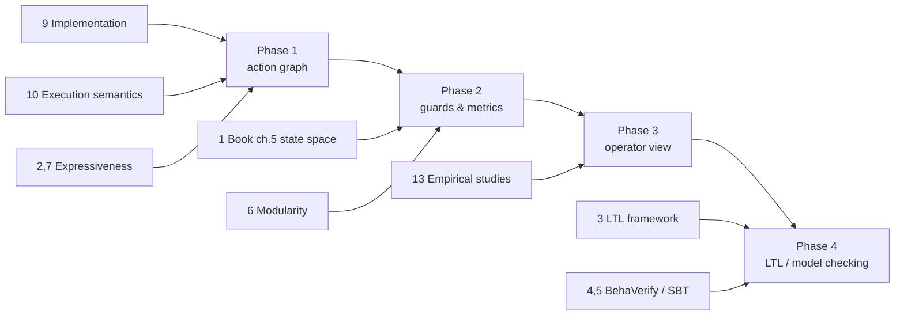

# Annotated reading list

This is an annotated reading list on behaviour-tree (BT) semantics, analysis and verification, chosen for what each work contributes to Beehave. Each entry gives a bibliographic reference that was checked against at least one independent index (publisher, arXiv, DBLP, institutional repository or the authors' tool README), says which Beehave phase it matters for, and explains why in a few sentences. The phases are: **Phase 1**, action graph (parse, flatten, walk, render); **Phase 2**, guards and metrics (guard simplification, exact Reactive/Retry/Parallel handling, coverage and complexity metrics); **Phase 3**, operator view; **Phase 4**, LTL and model checking. One correction to the original list: *A Framework for Formal Verification of Behavior Trees With Linear Temporal Logic* (RA-L 2020) is by **Biggar and Zamani only**. Shames is not a co-author of that paper, although he co-authored the related papers listed below.

| # | Work | Phase(s) |
|---|---|---|
| 1 | Colledanchise & Ögren, *Behavior Trees in Robotics and AI* (book) | 1, 2 |
| 2 | Biggar, Zamani & Shames, *An expressiveness hierarchy…* (RA-L 2021) | 1, 2 |
| 3 | Biggar & Zamani, *A Framework for Formal Verification of BTs With LTL* (RA-L 2020) | 4 |
| 4 | Serbinowska & Johnson, *BehaVerify* (SEFM 2022) | 4 |
| 5 | Serbinowska, Robinette, Karsai & Johnson, *Formalizing Stateful BTs* (FMAS 2024) | 2, 4 |
| 6 | Biggar, Zamani & Shames, *On Modularity in Reactive Control Architectures…* (ACM TCPS 2022) | 2, 4 |
| 7 | Biggar, Zamani & Shames, *A principled analysis of BTs and their generalisations* (arXiv 2020) | 1, 2 |
| 8 | Colledanchise & Ögren, *How BTs Modularize Hybrid Control Systems…* (IEEE T-RO 2017) | 1, 3 |
| 9 | Colledanchise & Natale, *On the Implementation of BTs in Robotics* (RA-L 2021) | 1, 2 |
| 10 | Ghiorzi et al., *Execution Semantics of BTs in Robotic Applications* (arXiv 2024/2025) | 1, 2 |
| 11 | Colledanchise & Natale, *Handling Concurrency in BTs* (arXiv 2021) | 2 |
| 12 | Colledanchise et al., *Formalizing the Execution Context of BTs for Runtime Verification…* (IROS 2021) | 4 |
| 13 | Ghzouli et al., *Behavior Trees in Action* (SLE 2020) and *BTs and State Machines in Robotics Applications* (IEEE TSE 2023) | 1, 3 |
| 14 | Iovino et al., *Comparison between BTs and FSMs* (arXiv 2024) | 3 |
| 15 | Ögren & Sprague, *Behavior Trees in Robot Control Systems* (Annu. Rev. 2022) | 2 |
| 16 | Iovino et al., *A survey of BTs in robotics and AI* (RAS 2022) | background |
| 17 | Wang et al., *Enabling BT Verification via a Translation to BIP* (FACS 2024) | 4 |
| 18 | Ingrand, *A formal implementation of BTs to act in robotics* (arXiv 2025) | 4 |
| 19 | Tadiello & Troubitsyna, *Verifying Safety of Behaviour Trees in Event-B* (arXiv 2022) | 4 |
| 20 | Serbinowska et al., *Verification of BTs with Contingency Monitors* (FMAS 2024) | 4 |
| 21 | Ögren, *Increasing Modularity of UAV Control Systems using Computer Game BTs* (2012) | 3 (motivation) |
| 22 | Ghzouli et al., *BTs for Robotic Systems: An Empirical Study on Practices and Experiences* (arXiv 2026) | 3 |

Suggested reading order for a new contributor: 1 (chapters 1–3 and 5), 9, 10, then 2 and 7, then 3, 4 and 5.

---

## Core list (requested)

### 1. Colledanchise & Ögren — *Behavior Trees in Robotics and AI: An Introduction*

Michele Colledanchise and Petter Ögren. *Behavior Trees in Robotics and AI: An Introduction.* CRC Press (Chapman & Hall/CRC), 2018. Preprint: [arXiv:1709.00084](https://arxiv.org/abs/1709.00084) (v1 31 Aug 2017, v6 25 Oct 2022). Publisher page: <https://www.taylorfrancis.com/books/9780429950902>.

**Phases 1 and 2.** This is the standard textbook, and its definitions of Sequence, Fallback, Parallel and Decorator are what BT.CPP implements. In the published edition, **Chapter 5, "Analysis of Efficiency, Safety, and Robustness"**, opens with **§5.1 "State-Space Formulation of BTs"** (spelled "Statespace Formulation" in the arXiv table of contents). There, a BT is modelled as a function on a continuous state space together with a return-status function, and the space is partitioned into the regions where a tree returns Running, Success and Failure. These regions are the semantic counterpart of Beehave's **guards**: the guard Beehave collects on the way to an action is a syntactic description of the region where that action is executed. Chapter 6, "Formal Analysis of How Behavior Trees Generalize Earlier Ideas", relates BTs to FSMs, subsumption and decision trees. That relation is the basis for presenting an action graph as an FSM-like view. Use Chapter 5's robustness, safety and efficiency notions as the vocabulary for Phase 2 metrics.

### 2. Biggar, Zamani & Shames — *An expressiveness hierarchy of Behavior Trees and related architectures*

Oliver Biggar, Mohammad Zamani, Iman Shames. "An Expressiveness Hierarchy of Behavior Trees and Related Architectures." *IEEE Robotics and Automation Letters* 6(3):5397–5404, 2021. DOI [10.1109/LRA.2021.3074337](https://doi.org/10.1109/LRA.2021.3074337). Preprint [arXiv:2104.07919](https://arxiv.org/abs/2104.07919).

**Phases 1 and 2.** The paper borrows from structured-programming theory to define what it means for one action-selection architecture to be more expressive than another. It then places BTs, decision trees, teleo-reactive programs and finite state machines in a hierarchy, and treats BTs with and without auxiliary variables separately. It identifies a trade-off between readability and expressiveness. For Beehave this frames Phase 1 precisely: a memoryless BT maps cleanly onto an action graph, while nodes with internal state (`SequenceStar`, retry and repeat counters, `KeepRunningUntilFailure`) need extra state in the graph. That is why such nodes are labelled "approximated" until Phase 2 adds counters or memory to the guards.

### 3. Biggar & Zamani — *A Framework for Formal Verification of Behavior Trees With Linear Temporal Logic*

Oliver Biggar, Mohammad Zamani. "A Framework for Formal Verification of Behavior Trees With Linear Temporal Logic." *IEEE Robotics and Automation Letters* 5(2):2341–2348, 2020. DOI [10.1109/LRA.2020.2970634](https://doi.org/10.1109/LRA.2020.2970634). (Authors confirmed through the reference lists of BehaVerify and *Formalizing Stateful BTs*. **Not** co-authored by Shames.)

**Phase 4.** The paper expresses BTs directly in Linear Temporal Logic, shows that the framework represents classical BTs exactly, and gives a **sound** algorithm for checking that a BT satisfies an LTL specification. It shows that BT semantics can be compiled into temporal-logic constraints without going through a model checker's input language first. For Beehave, it is a reference design for Phase 4: the flattened tree with explicit success/failure edges is the structure such an encoding needs. It also gives a vocabulary for properties a mission engineer would ask about drone mission trees, such as "after `Takeoff` fails, `Land` is eventually executed".

### 4. Serbinowska & Johnson — *BehaVerify*

Serena S. Serbinowska, Taylor T. Johnson. "BehaVerify: Verifying Temporal Logic Specifications for Behavior Trees." In *Software Engineering and Formal Methods (SEFM 2022)*, LNCS 13550, Springer, 2022. DOI [10.1007/978-3-031-17108-6_19](https://doi.org/10.1007/978-3-031-17108-6_19). Preprint [arXiv:2208.05360](https://arxiv.org/abs/2208.05360). Tool: [verivital/behaverify](https://github.com/verivital/behaverify) (MIT).

**Phase 4.** BehaVerify turns a py_trees tree into a nuXmv model. Composite nodes are encoded automatically, and custom leaves need user-supplied models. The paper checks LTL properties on models with more than 100 nodes and reports better performance than models built with BTCompiler. The current tool uses its own DSL and can also emit py_trees, Haskell and BT.CPP-style C++. It is the most practical open back end for Beehave's Phase 4: Beehave could export the flattened, remapped tree as a BehaVerify model instead of writing its own nuXmv encoder. Its encoding of node statuses per tick is also a useful cross-check for our CPS walk rules.

### 5. Serbinowska, Robinette, Karsai & Johnson — *Formalizing Stateful Behavior Trees*

Serena S. Serbinowska, Preston Robinette, Gabor Karsai, Taylor T. Johnson. "Formalizing Stateful Behavior Trees." In *Proceedings of the 6th International Workshop on Formal Methods for Autonomous Systems (FMAS 2024)*, EPTCS 411, pp. 201–218, 2024. DOI [10.4204/EPTCS.411.14](https://doi.org/10.4204/EPTCS.411.14). Preprint [arXiv:2411.14165](https://arxiv.org/abs/2411.14165). (The arXiv and EPTCS author orders differ: EPTCS lists Karsai before Robinette.)

**Phases 2 and 4.** The paper defines *Stateful BTs*: BTs with a blackboard of auxiliary variables, running in an environment that changes over time. It proves that with unbounded integers they are as powerful as Turing machines, and that with finite-type variables they are equivalent to finite automata. It extends BehaVerify with a DSL for them, and it translates finite stateful BTs into a nondeterministic FSM for nuXmv. This is exactly Beehave's situation: guards in drone mission trees read blackboard keys (`{battery}`, `{mode}`). The finitary-type result says when a Phase 2 guard analysis or a Phase 4 check is decidable. The paper also compares tools (MoVe4BT, ArcadeBT), which is useful when choosing a back end.

---

## Additional relevant work

### 6. Biggar, Zamani & Shames — *On Modularity in Reactive Control Architectures, with an Application to Formal Verification*

*ACM Transactions on Cyber-Physical Systems* 6(2):19:1–19:36, 2022. DOI [10.1145/3511606](https://doi.org/10.1145/3511606). Preprint [arXiv:2008.12515](https://arxiv.org/abs/2008.12515).

**Phases 2 and 4.** The paper introduces *decision structures*, a graph-shaped architecture that generalises teleo-reactive programs, decision trees, BTs and generalised BTs. It defines *modules* that give every decision structure a canonical decomposition, and it shows that changing a module has no greater downstream effect than changing a single action. Verification can therefore be done locally and hierarchically. Its worked example is a **solar-powered drone** checked with LTL. For Beehave this is the theory behind treating each subtree as a module: Phase 2 metrics and Phase 4 checks can be computed per subtree and composed. A Beehave action graph is close to a decision structure.

### 7. Biggar, Zamani & Shames — *A principled analysis of Behavior Trees and their generalisations*

Preprint [arXiv:2008.11906](https://arxiv.org/abs/2008.11906) (2020, revised 2021). According to its arXiv record, part of the earlier version's content moved into item 2.

**Phases 1 and 2.** The paper analyses BTs through **reactiveness** and **modularity** in a formal action-selection framework, introduces generalised BTs (k-BTs), and states which decision-making patterns BTs can and cannot represent. Read it together with item 2 to understand why reactive nodes (`ReactiveSequence`, `ReactiveFallback`, `WhileDoElse`) do not fit a single-pass walk and need preemption edges in Phase 2.

### 8. Colledanchise & Ögren — *How Behavior Trees Modularize Hybrid Control Systems and Generalize Sequential Behavior Compositions, the Subsumption Architecture, and Decision Trees*

*IEEE Transactions on Robotics* 33(2):372–389, April 2017. DOI [10.1109/TRO.2016.2633567](https://doi.org/10.1109/TRO.2016.2633567).

**Phases 1 and 3.** This journal paper shows how BTs make hybrid dynamical systems modular, and that key properties are preserved when two BTs are combined. It shows that BTs generalise sequential behaviour composition, the subsumption architecture and decision trees. These are the formal relationships behind drawing a BT as a graph of actions and conditions, which is Beehave's output. It also motivates the operator view (Phase 3): operators reason in terms of "what happens next" (sequential composition), not tree structure.

### 9. Colledanchise & Natale — *On the Implementation of Behavior Trees in Robotics*

*IEEE Robotics and Automation Letters* 6(3):5929–5936, 2021. Preprint [arXiv:2106.15227](https://arxiv.org/abs/2106.15227).

**Phases 1 and 2.** The paper surveys open-source BT libraries used in robotics and points out that several important properties depend on **implementation choices** of the specific library, such as synchronous versus asynchronous actions and how halting works. This is why Beehave pins its semantics to BT.CPP v3.8 source code rather than to the textbook. It is a good companion to `btcpp-v3-xml.md`.

### 10. Ghiorzi, Henkel, Palmas, Klauck & Tacchella — *Execution Semantics of Behavior Trees in Robotic Applications*

Preprint [arXiv:2408.00090](https://arxiv.org/abs/2408.00090) (v1 July 2024 by Ghiorzi and Tacchella; v2 April 2025 with Henkel, Palmas and Klauck). Venue not determined.

**Phases 1 and 2.** The paper proposes an abstract data type that gives BT structure and execution a formal semantics, motivated by how differently implementations behave. Version 1 focused on **halt** semantics. Halt handling is exactly what decides whether `SequenceStar` remembers its position (see `btcpp-v3-xml.md` §3.1) and how reactive preemption works. It is the closest academic counterpart to Beehave's per-node walk rules.

### 11. Colledanchise & Natale — *Handling Concurrency in Behavior Trees*

Preprint [arXiv:2110.11813](https://arxiv.org/abs/2110.11813) (October 2021). The journal version could not be confirmed.

**Phase 2.** The paper discusses why BT designers avoid `Parallel` because of concurrency issues similar to those in concurrent programming. It proposes two new nodes and performance measures for predictable parallel behaviour. Read it before replacing Beehave's Phase 1 `Parallel` approximation with an exact fork/join model.

### 12. Colledanchise, Cicala, Domenichelli, Natale & Tacchella — *Formalizing the Execution Context of Behavior Trees for Runtime Verification of Deliberative Policies*

IROS 2021 (accepted version per arXiv). Preprint [arXiv:2106.12474](https://arxiv.org/abs/2106.12474).

**Phase 4.** The paper formalises the execution context of BTs with a message-passing model, covering synchronous and asynchronous parallel components. It defines a property language from which runtime monitors are built. It complements offline model checking: properties written for Phase 4 could also become runtime monitors.

### 13. Ghzouli et al. — empirical studies of BTs in robotics

- Razan Ghzouli, Thorsten Berger, Einar Broch Johnsen, Swaib Dragule, Andrzej Wąsowski. "Behavior Trees in Action: A Study of Robotics Applications." *SLE 2020*, pp. 196–209. DOI [10.1145/3426425.3426942](https://doi.org/10.1145/3426425.3426942). Preprint [arXiv:2010.06256](https://arxiv.org/abs/2010.06256).
- Razan Ghzouli, Thorsten Berger, Einar Broch Johnsen, Andrzej Wąsowski, Swaib Dragule. "Behavior Trees and State Machines in Robotics Applications." *IEEE Transactions on Software Engineering* 49(9):4243–4267, 2023. Preprint [arXiv:2208.04211](https://arxiv.org/abs/2208.04211).

**Phases 1 and 3.** These papers mine open-source ROS projects. They find that BTs are a "pragmatic", loosely specified language that projects extend freely with custom nodes, and that BT and state-machine models show similar structure and reuse. Two consequences for Beehave: (a) custom control and decorator nodes are the norm, so the config-driven classification and the "approximated" report are essential; (b) the released datasets are a large real-world corpus for testing the parser, but licences vary per project.

### 14. Iovino, Förster, Falco, Chung, Siegwart & Smith — *Comparison between Behavior Trees and Finite State Machines*

Preprint [arXiv:2405.16137](https://arxiv.org/abs/2405.16137) (May 2024, submitted to IEEE T-RO).

**Phase 3.** The paper compares BTs and FSMs on a mobile-manipulation task in terms of reactivity, modularity, readability and design effort, validated on a real robot. It supports the claim behind Phase 3 that some reviewers find an FSM-like view, such as Beehave's action graph, easier to read than the tree, and it shows where that view loses information (reactivity).

### 15. Ögren & Sprague — *Behavior Trees in Robot Control Systems*

*Annual Review of Control, Robotics, and Autonomous Systems* 5:81–107, 2022. DOI [10.1146/annurev-control-042920-095314](https://doi.org/10.1146/annurev-control-042920-095314). Preprint [arXiv:2203.13083](https://arxiv.org/abs/2203.13083).

**Phase 2.** A control-theoretic review of BTs that builds on modularity, hierarchy and feedback. It is a compact restatement of the state-space view in item 1, and useful for defining Phase 2 metrics such as convergence and safety regions.

### 16. Iovino, Scukins, Styrud, Ögren & Smith — *A survey of Behavior Trees in robotics and AI*

*Robotics and Autonomous Systems*, 2022, article 104096. DOI [10.1016/j.robot.2022.104096](https://doi.org/10.1016/j.robot.2022.104096). Preprint [arXiv:2005.05842](https://arxiv.org/abs/2005.05842).

**Background.** A broad survey that classifies BT literature by methods, application areas and contributions, and lists open challenges. Use it to find related work, not for semantics.

### 17. Wang, Dai, Zhao, Zhang & Bliudze — *Enabling Behaviour Tree Verification via a Translation to BIP*

*Formal Aspects of Component Software (FACS 2024)*, LNCS 15189, pp. 3–20. DOI [10.1007/978-3-031-71261-6_1](https://doi.org/10.1007/978-3-031-71261-6_1).

**Phase 4.** Each BT node becomes a BIP component modelled as an extended automaton, and each edge becomes a set of interactions. The paper proves the translation correct and reports design flaws found automatically in two case studies. It is an alternative to nuXmv as a Phase 4 back end, with a compositional, component-based encoding that matches per-node walk rules.

### 18. Ingrand — *A formal implementation of Behavior Trees to act in robotics*

Félix Ingrand. Preprint [arXiv:2502.11904](https://arxiv.org/abs/2502.11904) (2025). Related tool: [BT2Fiacre](https://redmine.laas.fr/projects/bt2fiacre).

**Phase 4.** The paper gives BTs a formal semantics by translation to Fiacre, verified with the Tina model checker and executed with the Hippo runtime verification engine. It extends BTs with state variables and time. It is another reference encoding, and it covers timing (`Timeout`, `Delay`), which other encodings omit.

### 19. Tadiello & Troubitsyna — *Verifying Safety of Behaviour Trees in Event-B*

Matteo Tadiello, Elena Troubitsyna. Preprint [arXiv:2209.14045](https://arxiv.org/abs/2209.14045) (2022, published via EPTCS; the workshop volume was not confirmed).

**Phase 4.** The paper gives a formal Event-B specification of BTs and a method for proving invariants of existing trees. It is a proof-based alternative to model checking and is relevant if safety invariants (for example "never `Arm` while `{on_ground} == false`") are to be proved rather than model-checked.

### 20. Serbinowska, Potteiger, Tumlin & Johnson — *Verification of Behavior Trees with Contingency Monitors*

FMAS 2024, EPTCS 411, pp. 56–72. DOI [10.4204/EPTCS.411.4](https://doi.org/10.4204/EPTCS.411.4).

**Phase 4.** The paper generates runtime monitors from LTL specifications that trigger contingency actions. The BehaVerify repository illustrates it with a drone avoiding collisions. It shows how Phase 4 specifications can be reused at runtime.

### 21. Ögren — *Increasing Modularity of UAV Control Systems using Computer Game Behavior Trees* (2012)

Petter Ögren. PDF: <https://www.csc.kth.se/~petter/Publications/ogren2012bt.pdf>. Usually cited as AIAA Guidance, Navigation, and Control Conference 2012. **The venue and DOI could not be confirmed.**

**Motivation for Phase 3.** This is the first paper to propose BTs for UAV guidance and control. It argues that any hybrid dynamical system can be written as a BT and that common UAV control constructs are naturally expressed as BTs. It is the historical root of the drone mission trees that motivate Beehave.

### 22. Ghzouli, Horkoff, Strüber & Wohlrab — *Behavior Trees for Robotic Systems: An Empirical Study on Practices and Experiences*

Preprint [arXiv:2609.22404](https://arxiv.org/abs/2609.22404) (September 2026, under review).

**Phase 3.** A practitioner study of how BTs are used and where tools fall short. It is very recent and has not been read in full. Check it for requirements on operator-facing views.

---

## Not yet verified (do not cite without checking)

- **ArcadeBT** (Horn-clause verification of BTs, sometimes attributed to FMICS 2022) and **MoVe4BT**: known only through citations in item 5. Primary references were not located.
- The DOI of the published CRC Press edition of item 1. Only the publisher URL above was confirmed.
