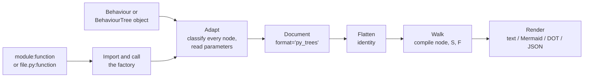

# py_trees reference for the Beehave adapter

This document is the reference for Beehave's **py_trees adapter**: the code that takes a live `py_trees` tree, built in Python, and converts it to the format-agnostic model (`beehave.model`), so that the existing flatten, walk and render steps apply unchanged ([ADR 0002](../design/adr/0002-one-model-many-parsers.md)). It gives the tick semantics of every class a py_trees tree can contain as a rule for the continuation-passing walk, `compile(node, on_success, on_failure) -> entry`, a mapping table from py_trees classes to `NodeKind` and `Semantics`, and a recommended API and CLI.

Everything here was checked against the source of **py_trees 2.6.0**, the latest release on PyPI. The PyPI wheel is byte-identical to tag `2.6.0` (commit `35dc6d3`) of the upstream repository. The default branch, `devel` (commit `41ec377`, 2026-09-17), differs from the tag only in `py_trees/ports.py` (longer error messages), so every line reference below holds for both. The semantics were then confirmed by **building tiny trees and ticking them**: the snippets and their real output are in §3. They give identical output on Python 3.10.20 and 3.12.3.

Notation, as in the [BT.CPP v3 reference](btcpp-v3-xml.md): `S` and `F` are the success and failure continuations passed to `compile`. An **activation** of a node runs from its first tick until it returns SUCCESS or FAILURE. A **single static pass** is one activation in which every child that is ticked completes. "Exact" means the rule reproduces every success/failure path of one activation. "Approximated" means Phase 1 draws the single-pass edges only and reports the node, following [ADR 0004](../design/adr/0004-approximate-and-report.md). `RUNNING` is an outcome the walk does not model. It matters only where it changes which child runs next, and those cases are flagged.

---

## 1. Summary: mapping table

*New* marks a proposed `Semantics` member (see §1.4). Approximation messages in quotes are the ones `walk.py` already emits for that member. The others are proposed, in the same style.

### 1.1 Composites (`py_trees.composites`)

| py_trees class | Kind | Semantics | Walk rule `compile(n, S, F)` | Phase 1 | Notes and approximation message |
|---|---|---|---|---|---|
| `Sequence(memory=True)` | control | `SEQUENCE` | `c1 -S-> c2 -S-> … cn -S-> S`, every `ci -F-> F` | exact | Resumes at the RUNNING child. Restarts at `c1` after SUCCESS or FAILURE. This is BT.CPP's plain `Sequence`, **not** `SequenceStar` (§3.1). |
| `Sequence(memory=False)` | control | `REACTIVE_SEQUENCE` | same as `Sequence` | approximated | "walked like a Sequence; its conditions are re-checked every tick, but preemption edges are not shown yet". Earlier children, **actions included**, are ticked again on every tick. |
| `Selector(memory=True)` | control | `FALLBACK` | `c1 -F-> c2 -F-> … cn -F-> F`, every `ci -S-> S` | exact | BT.CPP's plain `Fallback`. |
| `Selector(memory=False)` | control | `REACTIVE_FALLBACK` | same as `Fallback` | approximated | "walked like a Fallback; its conditions are re-checked every tick, but preemption edges are not shown yet". This is the usual py_trees priority selector: every `Selector` in the demos and tutorials uses it (§3.1). |
| `Parallel(SuccessOnAll)` | control | `PARALLEL` | walked like a Sequence | approximated | "children are shown as if they ran one after another". Ports: `policy`, `synchronise`, `success_threshold="-1"`, `failure_threshold="1"`. |
| `Parallel(SuccessOnOne)` | control | `PARALLEL` | walked like a Sequence | approximated | Proposed: "children are shown as if they ran one after another; one SUCCESS is enough while the others are RUNNING, and those edges are not shown yet". Ports as above with `success_threshold="1"`. |
| `Parallel(SuccessOnSelected)` | control | `PARALLEL` | walked like a Sequence | approximated | As above, plus a `selected` port with child **indices** (names are not unique). |
| empty `Sequence` / `Parallel` / `Selector` | control | as above | `entry = S` / `S` / `F` | exact | Verified in §3.2. |
| user `Composite` subclass that defines its own `tick` | control | `CUSTOM` | walked like a Sequence | approximated | Existing `unknown-control` diagnostic. |

### 1.2 Decorators (`py_trees.decorators`)

The child is `decorator.decorated`, which is always `decorator.children[0]` ([decorators.py L111-L114](https://github.com/splintered-reality/py_trees/blob/2.6.0/py_trees/decorators.py#L111-L114)).

| py_trees class (parameter attributes) | Kind | Semantics | Walk rule | Phase 1 | Notes and approximation message |
|---|---|---|---|---|---|
| `Inverter` | decorator | `INVERTER` | `compile(c, F, S)` | exact | RUNNING passes through. |
| `SuccessIsFailure` | decorator | `FORCE_FAILURE` | `compile(c, F, F)` | exact | |
| `FailureIsSuccess` | decorator | `FORCE_SUCCESS` | `compile(c, S, S)` | exact | |
| `SuccessIsRunning` | decorator | `KEEP_RUNNING_UNTIL_FAILURE` | `e = compile(c, e, F)` | approximated | "never succeeds (a successful child is ticked again); walked as transparent, the loop is not shown yet". Same status map as BT.CPP `KeepRunningUntilFailure`. |
| `FailureIsRunning` | decorator | `RETRY`, no count port | `e = compile(c, S, e)` | approximated | "the retry loop is folded into a note; the loop edge is not shown yet". Unbounded: `F` is unreachable. |
| `Condition(status=SUCCESS)` (`succeed_status`) | decorator | `RETRY`, port `status` | `e = compile(c, S, e)` | approximated | Same status map as `FailureIsRunning` (§3.3). Never returns FAILURE. |
| `Condition(status=FAILURE)` | decorator | *new* `STATUS_MAP` | `e = compile(c, e, S)` | approximated | Proposed: "waits for its child to fail; a successful child is ticked again, the loop is not shown yet". Phase 1 draws `compile(c, S, S)`. |
| `Condition(status=RUNNING)` | decorator | *new* `STATUS_MAP` | SUCCESS once the child is RUNNING; otherwise tick the child again | approximated | Proposed: "succeeds as soon as its child is RUNNING; not modelled, walked as transparent". |
| `RunningIsFailure` | decorator | *new* `STATUS_MAP` | `compile(c, S, F)` plus "still running" edges to `F` | approximated | Proposed: "a RUNNING child is halted and counts as FAILURE; those edges are not shown yet". Used by the `pick_up_where_you_left_off` demo. |
| `RunningIsSuccess` | decorator | *new* `STATUS_MAP` | `compile(c, S, F)` plus "still running" edges to `S` | approximated | Proposed: "a RUNNING child is halted and counts as SUCCESS; those edges are not shown yet". |
| `Retry` (`num_failures`) | decorator | `RETRY`, port `num_failures` | `e = compile(c, S, R)`, `R = e if k < N else F` | approximated, exact if `N ≤ 1` | `N` is the number of **attempts**. **`-1` does not mean forever**: any `N ≤ 1` fails on the first failure (§3.4). |
| `Repeat` (`num_success`) | decorator | `REPEAT`, port `num_success` | `e = compile(c, L, F)`, `L = e if k < N else S` | approximated, exact if `N = 1` | Any `N ≤ 0`, including the documented `-1`, never succeeds (§3.4). |
| `Timeout` (`duration`, seconds, default 5.0) | decorator | `TIMEOUT`, port `duration` | `compile(c, S, F)` plus timeout edges to `F` | approximated | "can also fail when time runs out; those failure edges are not shown yet". |
| `EternalGuard` (`condition`, `blackboard`) | **control** (desugared) | `REACTIVE_SEQUENCE` over `[guard condition, c]` | `[cond] -> compile(c, S, F)`, else `F` | approximated | The adapter emits a synthetic condition node as the first child (§3.5). The reactive message applies: the guard is checked before **every** tick. |
| `OneShot` (`policy`) | decorator | *new* `RUN_ONCE`, port `policy` | first activation: `compile(c, S, F)` | approximated | Proposed: "after its child completes, later activations return that result without running it; not shown yet". |
| `Count`, `PassThrough` | decorator | *new* `PASS_THROUGH` | `compile(c, S, F)` | exact | |
| `StatusToBlackboard` (`variable_name`) | decorator | *new* `PASS_THROUGH`, port `variable_name` | `compile(c, S, F)` | exact | Also writes the child's status to the blackboard. |
| `ForEach` (`source_key`, `target_key`, since 2.4.0) | decorator | `REPEAT`, ports `source_key`, `target_key` | like `Repeat` with `N = len(items)` | approximated | Proposed: "repeats its child once per item of `{source_key}`; the loop is not shown yet". With an empty list the child still runs once and its result is ignored (§3.5). |
| user `Decorator` subclass that defines its own `tick` or `update` | decorator | `CUSTOM` | transparent | approximated | Existing `unknown-decorator` diagnostic. |

### 1.3 Behaviours (leaves: `py_trees.behaviours`, `py_trees.timers`)

| py_trees class (parameter attributes) | Kind | Semantics | Walk rule | Phase 1 | Notes |
|---|---|---|---|---|---|
| `Success` | action (constant) | `ALWAYS_SUCCESS` | `entry = S` | exact | |
| `Failure` | action (constant) | `ALWAYS_FAILURE` | `entry = F` | exact | |
| `Running`, `Dummy` | action | *new* `ALWAYS_RUNNING` | a box with no outgoing edge | approximated | Usually the lowest-priority "Idle" child. Until the member exists: a `CUSTOM` action plus an adapter diagnostic, "never finishes; its SUCCESS and FAILURE edges are unreachable". |
| `CheckBlackboardVariableValue` (`check`) | **condition** | *new* `BLACKBOARD_CONDITION` | branch `[battery_level < 20]` | exact | Label and key built from the `ComparisonExpression` (§3.7). |
| `CheckBlackboardVariableExists` (`variable_name`) | **condition** | *new* `BLACKBOARD_CONDITION` | branch `[battery_level is set]` | exact | |
| `CheckBlackboardVariableValues` (`checks`, `operator`, `namespace`) | **condition** | *new* `BLACKBOARD_CONDITION` | branch `[(a == 1) xor (b == 2)]` | exact | Also writes each result under `namespace` when one is given. `either_or` relies on this. |
| `CompareBlackboardVariables` (`var1_key`, `var2_key`, `operator`, since 2.4.0) | **condition** | *new* `BLACKBOARD_CONDITION` | branch `[speed <= limit]` | exact | |
| `SuccessEveryN` (`every_n`) | **condition** | `CUSTOM`, port `n` | branch | exact | Never RUNNING. It is stateful: it counts its own ticks. |
| `BlackboardToStatus` (`variable_name`) | **condition** | `CUSTOM`, port `variable_name` | branch `[variable_name is SUCCESS]` | approximated | Returns whatever status is stored, RUNNING included. |
| `WaitForBlackboardVariable` (`variable_name`), `WaitForBlackboardVariableValue` (`check`) | action (a wait) | `CUSTOM`, port `expression` | a box | approximated | They block (RUNNING) instead of failing, so the FAILURE edge is unreachable. **They subclass the `Check…` classes** (§3.7). |
| `SetBlackboardVariable(overwrite=True)` (`variable_name`) | action | `SET_BLACKBOARD` | `entry = S` | exact | Always SUCCESS. |
| `SetBlackboardVariable(overwrite=False)` | action | `CUSTOM` | box with `-S->` and `-F->` | exact | FAILURE if the variable already exists. |
| `UnsetBlackboardVariable` (`key`) | action | `SET_BLACKBOARD` | `entry = S` | exact | Always SUCCESS. |
| `timers.Timer` (`duration`, seconds) | action | *new* `SLEEP` | box with a single `-S->` edge | approximated | RUNNING until the time is up, then SUCCESS, never FAILURE. BT.CPP v4 `Sleep` is the same node. |
| `Periodic`, `StatusQueue`, `TickCounter`, `ProbabilisticBehaviour` | action | `CUSTOM` | box with `-S->` and `-F->` | exact | Test and demo stand-ins for real work. |
| user `Behaviour` subclass | action, or condition from the config | `CUSTOM` | box, or branch | exact | py_trees has no "condition" base class (§4.4). |

**py_trees has no subtree reference node.** A live tree is always fully inlined (helper functions and the 2.5+ XML parser both build plain composites), so `NodeKind.SUBTREE` is never produced and flattening is the identity.

### 1.4 Proposed model and walk changes

Each new member needs an ADR ([ADR 0002](../design/adr/0002-one-model-many-parsers.md): "If a format has a concept the model cannot express, we extend the model with a new ADR"). Three of them will also be needed by the BT.CPP v4 parser.

| Proposed member | Used for | Walk rule | Also needed for |
|---|---|---|---|
| `BLACKBOARD_CONDITION` (condition leaf) | the four `Check…`/`Compare…` behaviours | `Condition(key=ports["expression"], label=ports["expression"])` | v4 `ScriptCondition` with a simple comparison |
| `PASS_THROUGH` (decorator) | `PassThrough`, `Count`, `StatusToBlackboard` | transparent, exact | |
| `STATUS_MAP` (decorator, ports `on_success`, `on_failure`, `on_running`) | `RunningIsFailure`, `RunningIsSuccess`, `Condition(FAILURE)`, `Condition(RUNNING)` | `compile(c, T(on_success), T(on_failure))` with `T(SUCCESS)=S`, `T(FAILURE)=F`, `T(RUNNING)=` the child's own outcome (Phase 1) or `entry(c)` (Phase 2) | |
| `RUN_ONCE` (decorator, port `policy`) | `OneShot` | transparent on the first activation | v4 `RunOnce` |
| `ALWAYS_RUNNING` (action leaf) | `Running`, `Dummy` | a vertex with no outgoing edge | |
| `SLEEP` (action leaf) | `timers.Timer` | a vertex with a single SUCCESS edge | v4 `Sleep` |

Only `BLACKBOARD_CONDITION` and `PASS_THROUGH` are needed for readable Phase 1 output. The others can be emulated with today's members plus an adapter diagnostic, as the trial in §6.5 does.

Small walk changes, independent of the new members:

1. `_LOOP_NOTES` reads `num_attempts` (BT.CPP) **or** `num_failures` (py_trees) for `RETRY`, and `num_cycles` **or** `num_success` for `REPEAT`, so the action box reads `retry ×3`.
2. The `PARALLEL` approximation message depends on the `policy` port (§1.1).
3. The key of a `CUSTOM` condition should include the instance name. Today it is `type(ports)`, so two instances of one user class with different constructor arguments, such as `IsAt("kitchen")` and `IsAt("door")`, would share a key. They would then be treated as one check, and real paths would be dropped as contradictory (§4.4).

### Pipeline



---

## 2. Versions, packaging and ROS 2

| Item | Value | Source |
|---|---|---|
| Latest release | **2.6.0**, tagged 2026-09-10, uploaded to PyPI 2026-09-10 | PyPI JSON API, `git tag` |
| Previous releases | 2.5.0 (2026-07-13), 2.4.0 (2025-11-13), 2.3.0 (2025-01-11), 2.2.3 (2023-02-08) | [CHANGELOG.rst](https://github.com/splintered-reality/py_trees/blob/2.6.0/CHANGELOG.rst) |
| Python | **No `Requires-Python` in the metadata.** It is commented out on purpose, because `colcon build` cannot parse it ([pyproject.toml L16-L20](https://github.com/splintered-reality/py_trees/blob/2.6.0/pyproject.toml#L16-L20)). The intended floor is 3.10 (the commented value is `>=3.10,<4.0`, and ruff and ty target `py310`). Verified to import and run on 3.10.20 and 3.12.3, and to import on 3.13.16. | wheel `METADATA` |
| Runtime dependencies | `pydot>=1.4`, which pulls in `pyparsing`. `import py_trees` imports `pydot`, because `py_trees/__init__.py` imports `display`. The Graphviz `dot` binary is only needed to render images. | `METADATA`, [`__init__.py`](https://github.com/splintered-reality/py_trees/blob/2.6.0/py_trees/__init__.py) |
| Licence | BSD-3-Clause | [pyproject.toml L15](https://github.com/splintered-reality/py_trees/blob/2.6.0/pyproject.toml#L15), [`package.xml`](https://github.com/splintered-reality/py_trees/blob/2.6.0/package.xml) |
| Typing | ships `py.typed` | wheel contents |

Changes that matter to the adapter:

| Version | Change |
|---|---|
| 2.2.0 | `memory` became a **required** argument of `Sequence` and `Selector`, with the semantics of §3.1. In 2.1.x it was an optional, experimental flag: a `Sequence` had memory by default and a `Selector` did not. `Repeat` and `Retry` were added. The `eternal_guard` **idiom** was removed (commit `a43e07f`, 2023-01-03), in favour of `Sequence(memory=False)` and the `EternalGuard` decorator. |
| 2.2.3 | `PassThrough` decorator. |
| 2.3.0 | `ProbabilisticBehaviour`. |
| 2.4.0 | `ForEach`, `CompareBlackboardVariables`, a callable `value` in `ComparisonExpression`. |
| 2.5.0 | Typed ports (`PortsMixin`, `BehaviourWithPorts`) and an **experimental XML parser** (§5.4). |
| 2.6.0 | Port fixes, and "Recover memory sequences after child replacement" (#505). |

**Recommendation:** support py_trees ≥ 2.2, and look up classes added later with `getattr(module, name, None)`.

**ROS 2.** py_trees is released into ROS 2 from `ros2-gbp/py_trees-release`. In rosdistro `master` (read 2026-10-17), Humble, Jazzy, Kilted and Rolling all list release `2.6.0-1`. The release tags show the history:

- Humble: `2.2.3-2`, `2.3.0-1`, `2.4.0-1/2`, `2.5.0-1/2`, `2.6.0-1`. Its `source` branch is still `release/2.2.x` (status *maintained*).
- Jazzy: `2.2.1-4` through `2.6.0-1` (status *developed*).

A Humble machine can therefore have any version from 2.2.3 to 2.6.0, depending on when it was last updated. All of them have the 2.2 semantics.

**py_trees_ros** (2.6.0-1 on Humble and Jazzy) adds ROS behaviours (subscribers, publishers, action and service clients) and `py_trees_ros.trees.BehaviourTree`, a subclass of `py_trees.trees.BehaviourTree`, so `.root` works the same way. It imports `rclpy` and ROS message packages at module level. **py_trees_ros_tutorials** (2.6.0-1) ships the tutorial trees as factory functions (§5.1).

---

## 3. Tick semantics, verified

### 3.0 Rules that apply to every node

Source: `Behaviour.tick` ([behaviour.py L264-L305](https://github.com/splintered-reality/py_trees/blob/2.6.0/py_trees/behaviour.py#L264-L305)), `Behaviour.stop` ([L344-L370](https://github.com/splintered-reality/py_trees/blob/2.6.0/py_trees/behaviour.py#L344-L370)), `Decorator.tick` and `Decorator.stop` ([decorators.py L116-L155](https://github.com/splintered-reality/py_trees/blob/2.6.0/py_trees/decorators.py#L116-L155)), and `Status` ([common.py L32-L42](https://github.com/splintered-reality/py_trees/blob/2.6.0/py_trees/common.py#L32-L42)).

- Statuses are `SUCCESS`, `FAILURE`, `RUNNING` and `INVALID`. `INVALID` means "not active". It plays the role of BT.CPP's IDLE.
- `initialise()` runs whenever a node is ticked while not RUNNING. A completed child that is ticked again therefore **starts over**.
- `stop(INVALID)` is the halt. It calls the user's `terminate(INVALID)`. Unlike BT.CPP, which halts only RUNNING children, py_trees calls it on children that **had already finished** too, when their parent resets them. The snippets log this as `reset`.
- A decorator ticks its child first, then computes its own status in `update()`. If that status is not RUNNING and the child is still RUNNING, the child is halted. This is why `RunningIsFailure` halts a running child.

The snippets use this helper. `Probe` is a scripted leaf that logs each update and each `stop(INVALID)`:

```python
# probe.py
import py_trees
from py_trees.common import Status

S, F, R = Status.SUCCESS, Status.FAILURE, Status.RUNNING
LOG: list[str] = []


class Probe(py_trees.behaviour.Behaviour):
    """A leaf that returns the scripted statuses in turn (the last one repeats).

    Every update is logged as ``name:S|F|R``. ``stop(INVALID)`` is logged as
    ``name:halted`` when the leaf was RUNNING, and as ``name:reset`` when it had
    already finished (py_trees calls it in both cases).
    """

    def __init__(self, name: str, *script: Status) -> None:
        super().__init__(name)
        self.script = list(script)

    def update(self) -> Status:
        status = self.script.pop(0) if len(self.script) > 1 else self.script[0]
        LOG.append(f"{self.name}:{status.name[0]}")
        return status

    def terminate(self, new_status: Status) -> None:
        if new_status == Status.INVALID:
            LOG.append(f"{self.name}:{'halted' if self.status == Status.RUNNING else 'reset'}")


def run(root: py_trees.behaviour.Behaviour, ticks: int) -> None:
    """Tick ``root`` and print what each tick did."""
    for i in range(1, ticks + 1):
        LOG.clear()
        root.tick_once()
        print(f"  tick {i}: {' '.join(LOG) or '(no leaf ticked)':<28} -> {root.status.name}")
```

### 3.1 `Sequence` and `Selector`, with and without memory

Sources: `Selector.tick` ([composites.py L372-L448](https://github.com/splintered-reality/py_trees/blob/2.6.0/py_trees/composites.py#L372-L448)) and `Sequence.tick` ([L509-L566](https://github.com/splintered-reality/py_trees/blob/2.6.0/py_trees/composites.py#L509-L566)). Both constructors are `(name, memory, children=None)` and store `self.memory` ([L363-L370](https://github.com/splintered-reality/py_trees/blob/2.6.0/py_trees/composites.py#L363-L370), [L500-L507](https://github.com/splintered-reality/py_trees/blob/2.6.0/py_trees/composites.py#L500-L507)).

| Node | Where a tick starts | On child SUCCESS | On child FAILURE | On child RUNNING | Next activation |
|---|---|---|---|---|---|
| `Sequence(memory=True)` | at the RUNNING child if the sequence is RUNNING, else at `c1` | tick next child in the same tick; after the last, SUCCESS | FAILURE | RUNNING | starts at `c1` |
| `Sequence(memory=False)` | **always at `c1`** | same | halt the later children, FAILURE | halt the later children, RUNNING | starts at `c1` |
| `Selector(memory=True)` | at the RUNNING child if the selector is RUNNING, else at `c1` | halt the later children, SUCCESS | tick next child; after the last, FAILURE | halt the later children, RUNNING | starts at `c1` |
| `Selector(memory=False)` | **always at `c1`** | halt the later children, SUCCESS | same | halt the later children, RUNNING | starts at `c1` |

"Memory" in py_trees means only **"resume at the child that was RUNNING"**. After any SUCCESS or FAILURE, the next activation starts at `c1` again, whatever `memory` says. Hence the BT.CPP equivalents:

| py_trees | BT.CPP equivalent | Beehave `Semantics` |
|---|---|---|
| `Sequence(memory=True)` | `Sequence` | `SEQUENCE` |
| `Sequence(memory=False)` | `ReactiveSequence` | `REACTIVE_SEQUENCE` |
| `Selector(memory=True)` | `Fallback` | `FALLBACK` |
| `Selector(memory=False)` | `ReactiveFallback` | `REACTIVE_FALLBACK` |

**Mapping `memory=True` to `SEQUENCE_WITH_MEMORY` would be wrong.** BT.CPP's `SequenceStar` (v3) and `SequenceWithMemory` (v4) keep their index after a FAILURE, so the next activation resumes at the child that failed ([btcpp-v3-xml.md §3.1](btcpp-v3-xml.md)). A py_trees memory sequence restarts at `c1` (snippet below). py_trees has no built-in node with that behaviour. The `pick_up_where_you_left_off` idiom (§3.8) gets it with blackboard flags.

`memory=False` is exactly BT.CPP's reactive behaviour, verified below. While a child is RUNNING, every earlier child is ticked again on every tick. Earlier **actions** run again too, because a completed child starts over. If an earlier child of a Sequence fails, the running child is halted and the Sequence fails. If an earlier child of a Selector returns SUCCESS or RUNNING, the lower-priority running child is halted. The single static pass is the same as with memory: `c1 -S-> … -S-> S` with `ci -F-> F` for a Sequence, and the dual for a Selector. Phase 2 preemption edges matter more for py_trees than for BT.CPP. In py_trees_ros_tutorials, all 12 `Selector`s are `memory=False` and all 18 `Sequence`s are `memory=True`. In the py_trees demos, the counts are 6 and 17, plus one `Sequence(memory=False)` (the eternal guard demo).

```python
# v01_sequence.py
from probe import F, R, S, Probe, run
from py_trees.composites import Sequence

for memory in (True, False):
    print(f"Sequence(memory={memory}), B is RUNNING twice:")
    run(Sequence("seq", memory=memory, children=[Probe("A", S), Probe("B", R, R, S)]), 3)

print("Sequence(memory=False), A fails while B is RUNNING:")
run(Sequence("seq", memory=False, children=[Probe("A", S, F), Probe("B", R)]), 2)

print("Sequence(memory=True), next activation after a FAILURE:")
run(Sequence("seq", memory=True, children=[Probe("A", S), Probe("B", F, S)]), 2)
```

```text
Sequence(memory=True), B is RUNNING twice:
  tick 1: A:S B:R                      -> RUNNING
  tick 2: B:R                          -> RUNNING
  tick 3: B:S                          -> SUCCESS
Sequence(memory=False), B is RUNNING twice:
  tick 1: A:S B:R                      -> RUNNING
  tick 2: A:S B:R                      -> RUNNING
  tick 3: A:S B:S                      -> SUCCESS
Sequence(memory=False), A fails while B is RUNNING:
  tick 1: A:S B:R                      -> RUNNING
  tick 2: A:F B:halted                 -> FAILURE
Sequence(memory=True), next activation after a FAILURE:
  tick 1: A:S B:F                      -> FAILURE
  tick 2: A:reset B:reset A:S B:S      -> SUCCESS
```

```python
# v02_selector.py
from probe import F, R, S, Probe, run
from py_trees.composites import Selector

for memory in (False, True):
    print(f"Selector(memory={memory}), A fails then succeeds, B is RUNNING:")
    run(Selector("sel", memory=memory, children=[Probe("A", F, S), Probe("B", R)]), 2)

print("Selector(memory=True), next activation after a SUCCESS:")
run(Selector("sel", memory=True, children=[Probe("A", F), Probe("B", S)]), 2)

print("Selector(memory=False), A becomes RUNNING while B is RUNNING:")
run(Selector("sel", memory=False, children=[Probe("A", F, R), Probe("B", R)]), 2)
```

```text
Selector(memory=False), A fails then succeeds, B is RUNNING:
  tick 1: A:F B:R                      -> RUNNING
  tick 2: A:S B:halted                 -> SUCCESS
Selector(memory=True), A fails then succeeds, B is RUNNING:
  tick 1: A:F B:R                      -> RUNNING
  tick 2: A:reset B:R                  -> RUNNING
Selector(memory=True), next activation after a SUCCESS:
  tick 1: A:F B:S                      -> SUCCESS
  tick 2: A:F B:S                      -> SUCCESS
Selector(memory=False), A becomes RUNNING while B is RUNNING:
  tick 1: A:F B:R                      -> RUNNING
  tick 2: A:R B:halted                 -> RUNNING
```

### 3.2 `Parallel`

Sources: `Parallel.tick` ([composites.py L662-L732](https://github.com/splintered-reality/py_trees/blob/2.6.0/py_trees/composites.py#L662-L732)), `ParallelPolicy` ([common.py L71-L143](https://github.com/splintered-reality/py_trees/blob/2.6.0/py_trees/common.py#L71-L143)). Constructor: `Parallel(name, policy, children=None)`. The policy object is `parallel.policy`.

- Every tick, **every** child is ticked, in order. If `policy.synchronise` is true, children that already returned SUCCESS in this activation are skipped. A child is ticked even after an earlier one failed in the same tick.
- Then: if **any** child has FAILURE, the parallel fails, so failure takes precedence over success. Otherwise:
  - `SuccessOnAll`: SUCCESS when all children have SUCCESS.
  - `SuccessOnOne`: SUCCESS when at least one has SUCCESS.
  - `SuccessOnSelected(children)`: SUCCESS when every selected child has SUCCESS. The selection is `policy.children`, a list of child **objects**. It is validated in `setup()` and on every tick.
  - Otherwise RUNNING.
- On SUCCESS or FAILURE, children that are still RUNNING are halted ([L734-L749](https://github.com/splintered-reality/py_trees/blob/2.6.0/py_trees/composites.py#L734-L749)).
- **`synchronise` defaults differ by policy:** `SuccessOnAll()` and `SuccessOnSelected(...)` default to `True`, `SuccessOnOne` is always `False`, and the `Base` default is `False` ([common.py L77, L97, L115-L117, L132](https://github.com/splintered-reality/py_trees/blob/2.6.0/py_trees/common.py#L71-L143)). The py_trees_ros tutorials mostly use `SuccessOnAll(synchronise=False)` at the root, so successful children are ticked again on every tick.

In BT.CPP v3 port terms, `SuccessOnAll` is `success_threshold = N` (`-1`) with `failure_threshold = 1`, and `SuccessOnOne` is `success_threshold = 1` with `failure_threshold = 1`. BT.CPP decides after each child, while py_trees ticks all of them first and lets FAILURE win, so the single pass agrees but the order of events does not. Recording these ports lets the Phase 2 fork/join rule for BT.CPP `Parallel` apply unchanged. `SuccessOnSelected` has no BT.CPP equivalent.

```python
# v03_parallel.py
from probe import F, R, S, Probe, run
from py_trees.common import ParallelPolicy
from py_trees.composites import Parallel

for sync in (False, True):
    print(f"SuccessOnAll(synchronise={sync}):")
    run(Parallel("par", ParallelPolicy.SuccessOnAll(synchronise=sync),
                 children=[Probe("A", S), Probe("B", R, S)]), 2)

print("SuccessOnOne, A succeeds while B runs:")
run(Parallel("par", ParallelPolicy.SuccessOnOne(), children=[Probe("A", S), Probe("B", R)]), 1)

print("SuccessOnOne, A succeeds and B fails in the same tick:")
run(Parallel("par", ParallelPolicy.SuccessOnOne(), children=[Probe("A", S), Probe("B", F)]), 1)

print("SuccessOnAll, A fails first: B is still ticked in that tick, then halted:")
run(Parallel("par", ParallelPolicy.SuccessOnAll(), children=[Probe("A", F), Probe("B", R)]), 1)

a, b = Probe("A", S), Probe("B", R)
print("SuccessOnSelected([A]):")
run(Parallel("par", ParallelPolicy.SuccessOnSelected([a]), children=[a, b]), 1)

from py_trees.composites import Selector, Sequence
for empty in (Sequence("seq", memory=True), Selector("sel", memory=False),
              Parallel("par", ParallelPolicy.SuccessOnAll())):
    empty.tick_once()
    print(f"empty {type(empty).__name__} -> {empty.status.name}")
```

```text
SuccessOnAll(synchronise=False):
  tick 1: A:S B:R                      -> RUNNING
  tick 2: A:S B:S                      -> SUCCESS
SuccessOnAll(synchronise=True):
  tick 1: A:S B:R                      -> RUNNING
  tick 2: B:S                          -> SUCCESS
SuccessOnOne, A succeeds while B runs:
  tick 1: A:S B:R B:halted             -> SUCCESS
SuccessOnOne, A succeeds and B fails in the same tick:
  tick 1: A:S B:F                      -> FAILURE
SuccessOnAll, A fails first: B is still ticked in that tick, then halted:
  tick 1: A:F B:R B:halted             -> FAILURE
SuccessOnSelected([A]):
  tick 1: A:S B:R B:halted             -> SUCCESS
empty Sequence -> SUCCESS
empty Selector -> FAILURE
empty Parallel -> SUCCESS
```

### 3.3 Status-mapping decorators

Sources: [decorators.py L660-L869](https://github.com/splintered-reality/py_trees/blob/2.6.0/py_trees/decorators.py#L660-L869). None of these decorators has parameters, except `Condition`, whose `status` argument is stored as **`succeed_status`** ([L823](https://github.com/splintered-reality/py_trees/blob/2.6.0/py_trees/decorators.py#L823)), and `StatusToBlackboard`, which stores `variable_name`. A decorator that returns RUNNING for a completed child makes the child **start over on the next tick**, which is a loop.

```python
# v04_status_maps.py
"""One tick of each status-mapping decorator over a child that returns S, F or R."""
import py_trees.decorators as d
from probe import LOG, F, R, S, Probe
from py_trees.common import Status

cases = {
    "Inverter": lambda c: d.Inverter("x", c),
    "SuccessIsFailure": lambda c: d.SuccessIsFailure("x", c),
    "FailureIsSuccess": lambda c: d.FailureIsSuccess("x", c),
    "SuccessIsRunning": lambda c: d.SuccessIsRunning("x", c),
    "FailureIsRunning": lambda c: d.FailureIsRunning("x", c),
    "RunningIsFailure": lambda c: d.RunningIsFailure("x", c),
    "RunningIsSuccess": lambda c: d.RunningIsSuccess("x", c),
    "Condition(SUCCESS)": lambda c: d.Condition("x", c, status=Status.SUCCESS),
    "Condition(FAILURE)": lambda c: d.Condition("x", c, status=Status.FAILURE),
    "Condition(RUNNING)": lambda c: d.Condition("x", c, status=Status.RUNNING),
    "PassThrough": lambda c: d.PassThrough("x", c),
    "Count": lambda c: d.Count("x", c),
    "StatusToBlackboard": lambda c: d.StatusToBlackboard("x", c, variable_name="st"),
}
print(f"{'decorator':<20} child S   child F   child R")
for label, make in cases.items():
    cells = []
    for status in (S, F, R):
        LOG.clear()
        node = make(Probe("c", status))
        node.tick_once()
        halted = " (c halted)" if "c:halted" in LOG else ""
        cells.append(f"{node.status.name[0]}{halted}")
    print(f"{label:<20} " + "   ".join(f"{c:<7}" for c in cells))
```

```text
decorator            child S   child F   child R
Inverter             F         S         R
SuccessIsFailure     F         F         R
FailureIsSuccess     S         S         R
SuccessIsRunning     R         F         R
FailureIsRunning     S         R         R
RunningIsFailure     S         F         F (c halted)
RunningIsSuccess     S         F         S (c halted)
Condition(SUCCESS)   S         R         R
Condition(FAILURE)   R         S         R
Condition(RUNNING)   R         R         S (c halted)
PassThrough          S         F         R
Count                S         F         R
StatusToBlackboard   S         F         R
```

Reading the table as walk rules. An R in the S or F column is a loop back to `entry(c)`, and an S or F in the R column is an abort edge from every action in `c` that can be RUNNING:

```text
Inverter(c)              = compile(c, F, S)
SuccessIsFailure(c)      = compile(c, F, F)                  # FORCE_FAILURE
FailureIsSuccess(c)      = compile(c, S, S)                  # FORCE_SUCCESS
SuccessIsRunning(c)      = e where e = compile(c, e, F)      # KEEP_RUNNING_UNTIL_FAILURE
FailureIsRunning(c)      = e where e = compile(c, S, e)      # RETRY, unbounded
Condition[SUCCESS](c)    = e where e = compile(c, S, e)      # identical to FailureIsRunning
Condition[FAILURE](c)    = e where e = compile(c, e, S)      # STATUS_MAP
Condition[RUNNING](c)    = e where e = compile(c, e, e), RUNNING -> S
RunningIsFailure(c)      = compile(c, S, F), RUNNING -> F    # STATUS_MAP
RunningIsSuccess(c)      = compile(c, S, F), RUNNING -> S    # STATUS_MAP
PassThrough(c) = Count(c) = StatusToBlackboard(c) = compile(c, S, F)
```

### 3.4 Loops: `Retry`, `Repeat`, `SuccessIsRunning`

Sources: `Repeat` ([decorators.py L178-L225](https://github.com/splintered-reality/py_trees/blob/2.6.0/py_trees/decorators.py#L178-L225)) and `Retry` ([L228-L273](https://github.com/splintered-reality/py_trees/blob/2.6.0/py_trees/decorators.py#L228-L273)). Both reset their counter in `initialise()`, so it lives for one activation. Unlike BT.CPP, they tick the child again on the **next** tick, returning RUNNING in between. The edges are the same.

- `Retry(name, child, num_failures)`: a child FAILURE increments `failures`. If `failures < num_failures` the decorator returns RUNNING, else FAILURE. A child SUCCESS is SUCCESS. So `num_failures` counts **attempts**, like BT.CPP's `num_attempts`. Any value ≤ 1, **including `-1`**, fails on the first failure. There is no "retry forever" value. Use `FailureIsRunning` for that.
- `Repeat(name, child, num_success)`: a child SUCCESS increments `success`. If `success == num_success` the decorator returns SUCCESS, else RUNNING. A child FAILURE is FAILURE at once. The test is `==`, so any `num_success ≤ 0` repeats forever, not only the documented `-1`.

```python
# v05_loops.py
from probe import F, R, S, Probe, run
from py_trees.decorators import Repeat, Retry, SuccessIsRunning

print("Retry(num_failures=3) over F, F, F:")
run(Retry("retry", Probe("A", F, F, F), num_failures=3), 3)
print("Retry(num_failures=3) over F, S:")
run(Retry("retry", Probe("A", F, S), num_failures=3), 2)
for n in (1, 0, -1):
    print(f"Retry(num_failures={n}) over F:")
    run(Retry("retry", Probe("A", F), num_failures=n), 1)

print("Repeat(num_success=3) over S:")
run(Repeat("repeat", Probe("A", S), num_success=3), 3)
print("Repeat(num_success=3) over S, F:")
run(Repeat("repeat", Probe("A", S, F), num_success=3), 2)
for n in (-1, 0):
    print(f"Repeat(num_success={n}) over S:")
    run(Repeat("repeat", Probe("A", S), num_success=n), 4)

print("SuccessIsRunning over S, S, F (the child is re-run every tick):")
run(SuccessIsRunning("sir", Probe("A", S, S, F)), 3)
```

```text
Retry(num_failures=3) over F, F, F:
  tick 1: A:F                          -> RUNNING
  tick 2: A:F                          -> RUNNING
  tick 3: A:F                          -> FAILURE
Retry(num_failures=3) over F, S:
  tick 1: A:F                          -> RUNNING
  tick 2: A:S                          -> SUCCESS
Retry(num_failures=1) over F:
  tick 1: A:F                          -> FAILURE
Retry(num_failures=0) over F:
  tick 1: A:F                          -> FAILURE
Retry(num_failures=-1) over F:
  tick 1: A:F                          -> FAILURE
Repeat(num_success=3) over S:
  tick 1: A:S                          -> RUNNING
  tick 2: A:S                          -> RUNNING
  tick 3: A:S                          -> SUCCESS
Repeat(num_success=3) over S, F:
  tick 1: A:S                          -> RUNNING
  tick 2: A:F                          -> FAILURE
Repeat(num_success=-1) over S:
  tick 1: A:S                          -> RUNNING
  tick 2: A:S                          -> RUNNING
  tick 3: A:S                          -> RUNNING
  tick 4: A:S                          -> RUNNING
Repeat(num_success=0) over S:
  tick 1: A:S                          -> RUNNING
  tick 2: A:S                          -> RUNNING
  tick 3: A:S                          -> RUNNING
  tick 4: A:S                          -> RUNNING
SuccessIsRunning over S, S, F (the child is re-run every tick):
  tick 1: A:S                          -> RUNNING
  tick 2: A:S                          -> RUNNING
  tick 3: A:F                          -> FAILURE
```

CPS rules (Phase 2, with the loop edges; Phase 1 is transparent plus a note):

```text
Retry[N](c)   = e where e = compile(c, S, RETRY),  RETRY = branch[k < N] -> e | F    (N <= 1: compile(c, S, F), exact)
Repeat[N](c)  = e where e = compile(c, LOOP, F),   LOOP  = branch[k < N] -> e | S    (N == 1: exact; N <= 0: LOOP = e)
```

### 3.5 Stateful decorators: `Timeout`, `OneShot`, `EternalGuard`, `ForEach`

- **`Timeout(name, child, duration=5.0)`** ([L444-L496](https://github.com/splintered-reality/py_trees/blob/2.6.0/py_trees/decorators.py#L444-L496)). The deadline is set in `initialise()` with `time.monotonic()`. Each tick, the child is ticked **first**. If it is still RUNNING after the deadline, it is halted and the decorator returns FAILURE. Otherwise the decorator returns the child's status. This is the same as BT.CPP `Timeout`.
- **`OneShot(name, child, policy)`** ([L584-L657](https://github.com/splintered-reality/py_trees/blob/2.6.0/py_trees/decorators.py#L584-L657)), with `policy` from `common.OneShotPolicy` ([common.py L146-L156](https://github.com/splintered-reality/py_trees/blob/2.6.0/py_trees/common.py#L146-L156)). The decorator is transparent until the child completes with a status in `policy.value`. `ON_SUCCESSFUL_COMPLETION` is `[SUCCESS]`, so failures are retried on the next activation. `ON_COMPLETION` is `[SUCCESS, FAILURE]`. After that, the stored status is in `final_status`, and the decorator returns it **without ticking the child**, for the rest of the process. This is BT.CPP v4's `RunOnce` with `then_skip="false"`.
- **`EternalGuard(name, child, condition, blackboard_keys=None)`** ([L313-L441](https://github.com/splintered-reality/py_trees/blob/2.6.0/py_trees/decorators.py#L313-L441)). Before **every** tick, `condition()` is called. It may return a `bool` or a `Status`, and FAILURE counts as false. If the condition is false, the decorator stops with FAILURE and halts a RUNNING child. If it is true, the decorator ticks the child and returns the child's status. If the callable has a parameter named `blackboard`, the decorator stores `functools.partial(condition, self.blackboard)` in `.condition`. So the user's function is `guard.condition.func` in that case, and `guard.condition` otherwise. The docstring ([L377-L380](https://github.com/splintered-reality/py_trees/blob/2.6.0/py_trees/decorators.py#L377-L380)) calls `Sequence(memory=False)` with the check first the "alternative means of implementing the eternal guard". That is exactly the desugaring proposed in §1.2: `ReactiveSequence[guard, child]`.
- **`ForEach(name, child, source_key, target_key)`** ([L872-L936](https://github.com/splintered-reality/py_trees/blob/2.6.0/py_trees/decorators.py#L872-L936), since 2.4.0). On `initialise()`, the decorator reads the iterable at `source_key` and writes the first item to `target_key`. A child SUCCESS moves to the next item (RUNNING), or returns SUCCESS after the last one. A child FAILURE is FAILURE. Because `Decorator.tick` ticks the child before `update()`, **the child runs once even when the list is empty**, and its result is then ignored. An item equal to `None` also ends the loop, because `None` is the "exhausted" marker.

```python
# v06_stateful.py
import time

import py_trees
from probe import LOG, F, R, S, Probe, run
from py_trees.common import OneShotPolicy
from py_trees.decorators import EternalGuard, ForEach, OneShot, Timeout

print("Timeout(duration=0.05) over a RUNNING child, ticked at t=0 and t=0.06 s:")
node = Timeout("timeout", Probe("A", R), duration=0.05)
for i in (1, 2):
    LOG.clear()
    node.tick_once()
    print(f"  tick {i}: {' '.join(LOG):<28} -> {node.status.name} ({node.feedback_message.split(' [')[0]})")
    time.sleep(0.06)

for policy in (OneShotPolicy.ON_SUCCESSFUL_COMPLETION, OneShotPolicy.ON_COMPLETION):
    print(f"OneShot(policy={policy.name}) over F, S, F:")
    run(OneShot("once", Probe("A", F, S, F), policy=policy), 3)

flags = [True, False]
print("EternalGuard: condition holds on tick 1, not on tick 2; the child is RUNNING:")
run(EternalGuard("guard", Probe("A", R), condition=lambda: flags.pop(0)), 2)

bb = py_trees.blackboard.Client(name="seed")
bb.register_key("items", access=py_trees.common.Access.WRITE)
for items in ([1, 2], []):
    bb.items = items
    print(f"ForEach over items={items}, child succeeds:")
    run(ForEach("each", Probe("A", S), source_key="items", target_key="item"), 2)
```

```text
Timeout(duration=0.05) over a RUNNING child, ticked at t=0 and t=0.06 s:
  tick 1: A:R                          -> RUNNING (time still ticking ...)
  tick 2: A:R A:halted                 -> FAILURE (timed out)
OneShot(policy=ON_SUCCESSFUL_COMPLETION) over F, S, F:
  tick 1: A:F                          -> FAILURE
  tick 2: A:S                          -> SUCCESS
  tick 3: (no leaf ticked)             -> SUCCESS
OneShot(policy=ON_COMPLETION) over F, S, F:
  tick 1: A:F                          -> FAILURE
  tick 2: (no leaf ticked)             -> FAILURE
  tick 3: (no leaf ticked)             -> FAILURE
EternalGuard: condition holds on tick 1, not on tick 2; the child is RUNNING:
  tick 1: A:R                          -> RUNNING
  tick 2: A:halted                     -> FAILURE
ForEach over items=[1, 2], child succeeds:
  tick 1: A:S                          -> RUNNING
  tick 2: A:S                          -> SUCCESS
ForEach over items=[], child succeeds:
  tick 1: A:S                          -> SUCCESS
  tick 2: A:S                          -> SUCCESS
```

### 3.6 Behaviours

Sources: [behaviours.py](https://github.com/splintered-reality/py_trees/blob/2.6.0/py_trees/behaviours.py) and [timers.py L25-L87](https://github.com/splintered-reality/py_trees/blob/2.6.0/py_trees/timers.py#L25-L87). `Success`, `Failure`, `Running` and `Dummy` are classes created at import time by `meta.create_behaviour_from_function` ([behaviours.py L85-L100](https://github.com/splintered-reality/py_trees/blob/2.6.0/py_trees/behaviours.py#L85-L100), [meta.py L34-L74](https://github.com/splintered-reality/py_trees/blob/2.6.0/py_trees/meta.py#L34-L74)). Their default name is the class name.

| Class | Constructor | Attributes to read | Returns | Class for Beehave |
|---|---|---|---|---|
| `Success` / `Failure` | `(name="Success")` | none | always SUCCESS / FAILURE | constant |
| `Running` / `Dummy` | `(name="Running")` | none | always RUNNING | action, never finishes |
| `Periodic` | `(name, n)` | `period` | RUNNING, SUCCESS, FAILURE in turn, `n` ticks each; not reset by `initialise()` | action (stub) |
| `StatusQueue` | `(name, queue, eventually)` | `queue`, `eventually` | pops the queue, then `eventually` (or cycles if `None`) | action (stub) |
| `SuccessEveryN` | `(name, n)` | `every_n` | SUCCESS on every n-th tick, FAILURE otherwise, never RUNNING | condition |
| `TickCounter` | `(name, duration, completion_status)` | `duration`, `completion_status` | RUNNING for `duration` ticks, then `completion_status` | action (stub) |
| `ProbabilisticBehaviour` | `(name, weights=None)` | `_weights` | random S/F/R | action (stub) |
| `BlackboardToStatus` | `(name, variable_name)` | `variable_name` | the stored `Status`; raises if missing or not a `Status` | condition (approx.) |
| `CheckBlackboardVariableExists` | `(name, variable_name)` | `variable_name` | SUCCESS if the variable exists, else FAILURE | condition |
| `WaitForBlackboardVariable` | `(name, variable_name)` | `variable_name` | SUCCESS if it exists, else **RUNNING** | action (wait) |
| `CheckBlackboardVariableValue` | `(name, check)` | `check` (a `ComparisonExpression`) | SUCCESS if the variable exists and the comparison holds, else FAILURE | condition |
| `WaitForBlackboardVariableValue` | `(name, check)` | `check` | SUCCESS if it holds, else **RUNNING** | action (wait) |
| `CheckBlackboardVariableValues` | `(name, checks, operator, namespace=None)` | `checks`, `operator` | `functools.reduce(operator, results)`; FAILURE if a variable is missing | condition |
| `CompareBlackboardVariables` | `(name, var1_key, var2_key, operator)` | `var1_key`, `var2_key`, `operator` | `operator(v1, v2)`; FAILURE if a variable is missing | condition |
| `SetBlackboardVariable` | `(name, variable_name, variable_value, overwrite)` | `variable_name`, `overwrite` | SUCCESS; FAILURE if `overwrite=False` and the variable exists; **raises `KeyError`** for a nested name whose parent key is missing | action (bookkeeping) |
| `UnsetBlackboardVariable` | `(name, key)` | `key` | always SUCCESS | action (bookkeeping) |
| `timers.Timer` | `(name="Timer", duration=5.0)` | `duration` | RUNNING until `duration` seconds have passed (wall clock), then SUCCESS | action (wait) |

"Condition" here means a side-effect-free check that returns SUCCESS or FAILURE and never RUNNING. `CheckBlackboardVariableValues` with a `namespace` writes its partial results, which is a side effect that later checks read (`either_or`, §3.8). The `WaitFor…` behaviours are not conditions: they never fail, they block. Drawing them as an action box ("waiting for `battery_level < 20`") is what an operator needs to see. Drawing them as a branch would invent a FAILURE edge.

### 3.7 Blackboard checks and readable guard labels

Source: `ComparisonExpression` ([common.py L189-L230](https://github.com/splintered-reality/py_trees/blob/2.6.0/py_trees/common.py#L189-L230)). It has three attributes:

- `variable`: the blackboard name, possibly nested, for example `battery.level`.
- `operator`: a callable, usually from the `operator` module.
- `value_generator`: **always a callable**. A constant `value` is wrapped as `lambda: value`. Since 2.4.0, `value` may also be the user's own callable.

To build a label like `battery_level < 20` without running user code:

1. Map the operator to a symbol: `lt <`, `le <=`, `eq ==`, `ne !=`, `ge >=`, `gt >`. For `CheckBlackboardVariableValues`, `and_`, `or_` and `xor` become words. Any other callable keeps its `__name__`, as in `within(battery_level, 20)`.
2. Read the value **from the closure** when `value_generator.__qualname__` is `ComparisonExpression.__init__.<locals>.<lambda>`: it is `value_generator.__closure__[0].cell_contents`. Show strings with `repr`, `Status` members by name, and anything else with `str`. If the value is the user's own callable, show `threshold()` and **do not call it**.
3. Negated label: keep the default `not battery_level < 20`. A missing variable also gives FAILURE, so `battery_level >= 20` would be wrong.
4. Key: the expression itself. Two checks of the same expression in one tick agree, unless something writes the variable between them. That caveat is the same as for BT.CPP `BlackboardCheck`.

**Classification trap:** `WaitForBlackboardVariableValue` is a subclass of `CheckBlackboardVariableValue`, and `WaitForBlackboardVariable` of `CheckBlackboardVariableExists`. `isinstance` would classify the waits as conditions. §4.3 gives a rule that does not fall into this.

**Label choice:** use the expression, not the behaviour name. Built-in checks are often named generically: every guard of `pick_up_where_you_left_off` is called `Done?`, and every option guard of `either_or` is called `Enabled?`. Keep the name available for a later "show names" option.

```python
# v07_blackboard_checks.py
import functools
import operator

import py_trees
from py_trees.behaviours import (
    CheckBlackboardVariableExists, CheckBlackboardVariableValue, CheckBlackboardVariableValues,
    CompareBlackboardVariables, WaitForBlackboardVariable, WaitForBlackboardVariableValue,
)
from py_trees.common import Access, ComparisonExpression

check = CheckBlackboardVariableValue(
    name="Battery Low?",
    check=ComparisonExpression(variable="battery_level", value=20, operator=operator.lt),
)
expr = check.check
print("variable:", expr.variable)
print("operator:", expr.operator, "->", expr.operator.__name__)
print("value_generator:", expr.value_generator.__qualname__)
print("constant from the closure (not called):", expr.value_generator.__closure__[0].cell_contents)

writer = py_trees.blackboard.Client(name="writer")
writer.register_key("battery_level", access=Access.WRITE)
wait = WaitForBlackboardVariableValue(
    name="Wait", check=ComparisonExpression("battery_level", 20, operator.lt)
)
for value in (None, 50, 15):
    if value is not None:
        writer.battery_level = value
    check.tick_once()
    wait.tick_once()
    print(f"battery_level={value}: Check -> {check.status.name}, WaitFor -> {wait.status.name}")

print("WaitForBlackboardVariableValue is a CheckBlackboardVariableValue:",
      isinstance(wait, CheckBlackboardVariableValue))
print("WaitForBlackboardVariable is a CheckBlackboardVariableExists:",
      isinstance(WaitForBlackboardVariable("w", "x"), CheckBlackboardVariableExists))

values = CheckBlackboardVariableValues(
    name="XOR",
    checks=[ComparisonExpression("joy1", "enabled", operator.eq),
            ComparisonExpression("joy2", "enabled", operator.eq)],
    operator=operator.xor,
)
print("CheckBlackboardVariableValues:", values.operator.__name__,
      [(c.variable, c.operator.__name__) for c in values.checks])
compare = CompareBlackboardVariables("cmp", "speed", "limit", operator.le)
print("CompareBlackboardVariables:", compare.var1_key, compare.operator.__name__, compare.var2_key)

def threshold() -> float:
    return 20.0
dynamic = ComparisonExpression("battery_level", threshold, operator.lt)
print("callable value:", dynamic.value_generator.__qualname__)

def low(blackboard) -> bool:
    return blackboard.battery_low_warning
guard = py_trees.decorators.EternalGuard(
    "Battery Low?", py_trees.behaviours.Success(), condition=low, blackboard_keys={"battery_low_warning"}
)
print("EternalGuard condition:", type(guard.condition).__name__, guard.condition.func.__qualname__)
lam = py_trees.decorators.EternalGuard("g", py_trees.behaviours.Success(), condition=lambda: True)
print("EternalGuard lambda condition:", lam.condition.__qualname__)
```

```text
variable: battery_level
operator: <built-in function lt> -> lt
value_generator: ComparisonExpression.__init__.<locals>.<lambda>
constant from the closure (not called): 20
battery_level=None: Check -> FAILURE, WaitFor -> RUNNING
battery_level=50: Check -> FAILURE, WaitFor -> RUNNING
battery_level=15: Check -> SUCCESS, WaitFor -> SUCCESS
WaitForBlackboardVariableValue is a CheckBlackboardVariableValue: True
WaitForBlackboardVariable is a CheckBlackboardVariableExists: True
CheckBlackboardVariableValues: xor [('joy1', 'eq'), ('joy2', 'eq')]
CompareBlackboardVariables: speed le limit
callable value: threshold
EternalGuard condition: partial low
EternalGuard lambda condition: <lambda>
```

For the synthetic `EternalGuard` condition, recommended values are: type = the callable's `__module__` and `__qualname__`, plus `@<line>` for a lambda, because `<lambda>` names collide. Name (the label) = the guard's instance name, such as `Battery Low?` in tutorial two. Port `blackboard_keys` = the sorted keys.

### 3.8 Idioms (`py_trees.idioms`)

py_trees 2.6.0 has three idioms ([idioms.py](https://github.com/splintered-reality/py_trees/blob/2.6.0/py_trees/idioms.py)). Each is a function that builds a subtree out of plain composites and blackboard behaviours. The walk handles them without special cases, so **recognising them is optional**. It would only help to collapse them into one annotated box (Phase 2), and it would have to key on the tree shape plus the hard-coded names below.

| Idiom | Shape built (names are hard-coded) | What the static walk shows |
|---|---|---|
| `pick_up_where_you_left_off(name, tasks)` ([L25-L91](https://github.com/splintered-reality/py_trees/blob/2.6.0/py_trees/idioms.py#L25-L91)) | `Sequence(name, memory=True)` [ for each task: `Selector("Do or Don't", memory=False)` [ `CheckBlackboardVariableValue("Done?", <task>_done == True)`, `Sequence("Worker", memory=True)` [ task, `SetBlackboardVariable("Mark\n<task>_done")` ] ], then for each task `UnsetBlackboardVariable("Clear\n<task>_done")` ] | Exactly the intended "skip the tasks already done" guards (trial below). This is how py_trees gets BT.CPP `SequenceStar`-like resumption. |
| `either_or(conditions, subtrees, name="Either Or", namespace=None)` ([L94-L185](https://github.com/splintered-reality/py_trees/blob/2.6.0/py_trees/idioms.py#L94-L185)) | `Sequence(name, memory=True)` [ `CheckBlackboardVariableValues("XOR", conditions, xor, namespace)`, `Selector("Chooser", memory=False)` [ for each: `Sequence("Option k", memory=True)` [ `CheckBlackboardVariableValue("Enabled?", <namespace>/k == True)`, subtree ] ] ] | Guards on the internal `<namespace>/k` variables that `XOR` writes. Correct, but the variables are internal to the idiom. |
| `oneshot(behaviour, name="Oneshot", variable_name="oneshot", policy=ON_SUCCESSFUL_COMPLETION)` ([L188-L259](https://github.com/splintered-reality/py_trees/blob/2.6.0/py_trees/idioms.py#L188-L259)) | `Selector(name, memory=False)` [ `Sequence("Oneshot w/ Guard", memory=True)` [ `Inverter("Not Completed?", CheckBlackboardVariableExists("Completed?"))`, `Sequence("OneShot")` [ behaviour, `SetBlackboardVariable("Mark Done\n[SUCCESS]")` ], or, for `ON_COMPLETION`, that sequence under a `Selector("Oneshot Handler")` with a `Bookkeeping` branch ], `CheckBlackboardVariableValue("Oneshot Result", oneshot == SUCCESS)` ] | One **infeasible** path: `Calibrate --[failure and oneshot == SUCCESS]--> SUCCESS`. The walk does not know that the earlier `SetBlackboardVariable` decides that check (§7). |
| `eternal_guard` (**removed in 2.2.0**; present in 2.0.0 to 2.1.6) | `Parallel(SuccessOnAll(synchronise=False))` [ `StatusToBlackboard(cond_i)`…, `Selector("Guarded Tasks")` [ `CheckBlackboardVariableValue("Abort on\n…", == FAILURE)`…, subtree ] ] | Only in trees written for py_trees < 2.2, which Beehave does not support. py_trees_ros_tutorials still mentions it in a docstring (`two_battery_check.py` L38). |

Node names built by the idioms contain **newlines** (`"Mark\ntask_1_done"`). The adapter should replace `\n` with a space before the name reaches a renderer.

Trial output. `oneshot` and `pick_up_where_you_left_off` were built over `TickCounter` tasks and walked with the prototype adapter of §6.5:

```text
=== oneshot (ON_SUCCESSFUL_COMPLETION)
START --[oneshot is set and oneshot == SUCCESS]--> SUCCESS
START --[oneshot is set and not oneshot == SUCCESS]--> FAILURE
START --[not oneshot is set]--> Calibrate
Calibrate --[success]--> SUCCESS
Calibrate --[failure and oneshot == SUCCESS]--> SUCCESS
Calibrate --[failure and not oneshot == SUCCESS]--> FAILURE
=== pick_up_where_you_left_off
START --[task_a_done == True and task_b_done == True]--> SUCCESS
START --[task_a_done == True and not task_b_done == True]--> Task B
START --[not task_a_done == True]--> Task A
Task A --[success and task_b_done == True]--> SUCCESS
Task A --[success and not task_b_done == True]--> Task B
Task A --[failure]--> FAILURE
Task B --[success]--> SUCCESS
Task B --[failure]--> FAILURE
```

---

## 4. Walking a live tree

### 4.1 Entry points

- **`py_trees.trees.BehaviourTree(root)`** stores the root in `.root` ([trees.py L167-L176](https://github.com/splintered-reality/py_trees/blob/2.6.0/py_trees/trees.py#L167-L176)). `py_trees_ros.trees.BehaviourTree` is a subclass. Construction does not tick or call `setup()`. py_trees_ros creates its ROS node only in `setup()`.
- **A root `Behaviour`**: any instance of `py_trees.behaviour.Behaviour`. Most factories return this (§5.1).
- The adapter should accept both, unwrapping with `isinstance(obj, py_trees.trees.BehaviourTree)`. It should reject anything else with a clear error.

### 4.2 Children, names and identity

- **Children:** `node.children` is the list for **both** composites and decorators. A decorator puts its child in `children[0]` and aliases it as `decorated` ([decorators.py L111-L114](https://github.com/splintered-reality/py_trees/blob/2.6.0/py_trees/decorators.py#L111-L114)). Leaves have `[]`. Recurse in list order with a path tuple, as the walk already does. Do not use `Behaviour.iterate()`, which is **post-order** ([behaviour.py L307-L330](https://github.com/splintered-reality/py_trees/blob/2.6.0/py_trees/behaviour.py#L307-L330)).
- **Names:** `name` is a required argument of `Behaviour.__init__` ([L65](https://github.com/splintered-reality/py_trees/blob/2.6.0/py_trees/behaviour.py#L65)), even though the docstring says it defaults to the class name. Composites and decorators always need one. Generated leaves default to their class name (`Success`, `Running`). `Timer` defaults to `"Timer"`. Names are **not unique**, and they can contain newlines.
- **Identity:** `node.id` is a random `uuid4`, so it is not stable between runs and must not reach the output (snapshot tests). Key nodes by tree path. `node.parent` is set when a child is added.
- **Sharing:** `add_child` refuses a child that already has a parent, but `insert_child` and `prepend_child` do not check ([composites.py L292-L321](https://github.com/splintered-reality/py_trees/blob/2.6.0/py_trees/composites.py#L292-L321)). One instance can therefore appear twice, or form a cycle. The adapter must track `id(node)` and fail cleanly.
- **Never call** `setup()`, `tick()`, `tick_once()`, `ComparisonExpression.value_generator()` for a user callable, or an `EternalGuard` condition. All of them run user code, and the first can reach middleware.

### 4.3 Classifying a node robustly

The family comes from `isinstance`, checked in this order: `py_trees.composites.Composite`, then `py_trees.decorators.Decorator` (a direct subclass of `Behaviour`, not of `Composite`), then a leaf. A leaf that has children is a hand-made composite: report it.

The precise class needs more care. `isinstance` against leaf classes falls into the `WaitFor…`/`Check…` trap (§3.7). An exact `type(node) is X` lookup misses harmless user subclasses, such as `class MySequence(Sequence)` with only an `__init__`. The rule that works is to take **the nearest class in the MRO that defines the tick logic**:

```python
def owner(cls: type) -> type:
    """The nearest class in the MRO that defines `tick` or `update`."""
    return next(k for k in cls.__mro__ if "tick" in vars(k) or "update" in vars(k))
```

Look `owner(type(node))` up in the table of §1. If it is a py_trees class, use its semantics. If it is a user class, use `CUSTOM` with the family's kind. Every one of the 40 built-in classes is its own owner, so the rule distinguishes them all (snippet below).

### 4.4 User behaviours: actions or conditions?

py_trees has no condition base class or flag. Its terminology only describes a *guard* as "a behaviour at the start of a sequence that checks for a particular condition (e.g. is battery low?)" ([docs/terminology.rst L36-L39](https://github.com/splintered-reality/py_trees/blob/2.6.0/docs/terminology.rst)). Recommendation:

- Default every user leaf to **action**, as for BT.CPP.
- Let the existing config keys `conditions:` and `actions:` name user classes, by `__name__` or by `module.__qualname__`. `Node.type` is the class `__name__`.
- Do not guess from names by default. py_trees users often end check names with `?` (`Battery Low?`, `Done?`, `Enabled?`). That could become an opt-in heuristic later, but a `?` name can also sit on a composite or on a blocking behaviour.
- **Condition keys must tell instances apart.** For `IsAt(name="At kitchen?", place="kitchen")` and `IsAt(name="At door?", place="door")`, the type and ports are equal, so the key needs the instance name. Optionally, the adapter can expose simple public instance attributes, such as `place`, and the keys registered by the node's blackboard clients (`client.read` / `client.write`) as ports:

```python
# v11_blackboard_clients.py
import operator

import py_trees
from py_trees.common import Access, ComparisonExpression


class IsAt(py_trees.behaviour.Behaviour):
    """A user condition: is the robot at a named place?"""

    def __init__(self, name: str, place: str) -> None:
        super().__init__(name)
        self.place = place
        self.bb = self.attach_blackboard_client(namespace="robot")
        self.bb.register_key("pose", access=Access.READ)

    def update(self) -> py_trees.common.Status:
        return py_trees.common.Status.SUCCESS


for node in (
    IsAt("At kitchen?", "kitchen"),
    py_trees.behaviours.CheckBlackboardVariableValue(
        "Battery Low?", ComparisonExpression("battery.level", 20, operator.lt)),
    py_trees.behaviours.SetBlackboardVariable("Mark done", "task_done", True, overwrite=True),
):
    for client in node.blackboards:
        print(f"{node.name!r}: read={sorted(client.read)} write={sorted(client.write)} "
              f"exclusive={sorted(client.exclusive)} remappings={client.remappings}")
print("user instance attributes:", {k: v for k, v in vars(IsAt('x', 'door')).items() if k == 'place'})
```

```text
'At kitchen?': read=['/robot/pose'] write=[] exclusive=[] remappings={'/robot/pose': '/robot/pose'}
'Battery Low?': read=['/battery'] write=[] exclusive=[] remappings={'/battery': '/battery'}
'Mark done': read=[] write=['/task_done'] exclusive=[] remappings={'/task_done': '/task_done'}
user instance attributes: {'place': 'door'}
```

Source locations: for a user class, `inspect.getsourcefile(cls)` and `inspect.getsourcelines(cls)[1]` give the file and line of the class definition. They raise `OSError` for generated classes such as `Success`, so wrap them. py_trees does not record where an instance was created. The factory's own location is a good `Tree.location`.

### 4.5 Verification of §4.1 to §4.3

```python
# v08_walking.py
import inspect

import py_trees
from py_trees import behaviour, behaviours, composites, decorators

root = composites.Sequence("root", memory=True)
inv = decorators.Inverter("inv", behaviours.Failure())
root.add_children([inv, behaviours.Success()])

tree = py_trees.trees.BehaviourTree(root)
print("BehaviourTree(root).root is root:", tree.root is root)
print("decorator .children == [.decorated]:", inv.children == [inv.decorated])
print("default leaf names:", [c.name for c in (behaviours.Success(), behaviours.Running(), behaviours.Dummy())])
try:
    composites.Sequence(memory=True)
except TypeError as exc:
    print("Sequence without a name:", exc)
print("ids are uuid4:", type(root.id).__name__, root.id.version)
print("post-order iterate():", [n.name for n in root.iterate()])

shared = behaviours.Success("shared")
a = composites.Sequence("a", memory=True, children=[shared])
try:
    composites.Sequence("b", memory=True, children=[shared])
except RuntimeError as exc:
    print("add_child twice:", exc)
b = composites.Sequence("b", memory=True)
b.insert_child(shared, 0)
print("insert_child does not check: shared in a and b:", shared in a.children and shared in b.children)

def owner(cls: type) -> type:
    """The nearest class in the MRO that defines the tick logic (tick or update)."""
    return next(k for k in cls.__mro__ if "tick" in vars(k) or "update" in vars(k))

public = [
    obj for module in (composites, decorators, behaviours)
    for _, obj in inspect.getmembers(module, inspect.isclass)
    if issubclass(obj, behaviour.Behaviour) and obj.__module__ == module.__name__
]
mismatch = [c.__qualname__ for c in public if owner(c) is not c]
print(f"{len(public)} built-in classes; owner(cls) is not cls for:", mismatch)

class GoTo(behaviour.Behaviour):
    def update(self):
        return py_trees.common.Status.SUCCESS

class MySequence(composites.Sequence):
    def __init__(self, name):
        super().__init__(name, memory=False)

class LowBattery(behaviours.CheckBlackboardVariableValue):
    pass

for cls in (GoTo, MySequence, LowBattery):
    print(f"owner({cls.__name__}) = {owner(cls).__module__}.{owner(cls).__qualname__}")
```

```text
BehaviourTree(root).root is root: True
decorator .children == [.decorated]: True
default leaf names: ['Success', 'Running', 'Dummy']
Sequence without a name: Sequence.__init__() missing 1 required positional argument: 'name'
ids are uuid4: UUID 4
post-order iterate(): ['Failure', 'inv', 'Success', 'root']
add_child twice: behaviour 'shared' already has parent 'a'
insert_child does not check: shared in a and b: True
40 built-in classes; owner(cls) is not cls for: []
owner(GoTo) = __main__.GoTo
owner(MySequence) = py_trees.composites.Sequence
owner(LowBattery) = py_trees.behaviours.CheckBlackboardVariableValue
```

The 40 classes are the 4 in `composites` (including `Composite`), the 18 in `decorators` (including `Decorator`) and the 18 in `behaviours`. `timers.Timer` and `ports.BehaviourWithPorts` are the only other `Behaviour` subclasses in the package, apart from the demos.

---

## 5. How py_trees trees are shipped

### 5.1 Factory functions

In practice, a py_trees tree is the return value of a function. No file describes it. The convention is visible in three places:

- the demos, where each function is called `create_root()` or `create_tree()`;
- py_trees_ros_tutorials, where each module has `tutorial_create_root()` and a `tutorial_main()` that ticks the tree;
- `py-trees-render`, which takes a dotted path to such a function. The tutorials' own docstrings say `py-trees-render -b py_trees_ros_tutorials.two_battery_check.tutorial_create_root`.

**py_trees demos usable as test fixtures** (no ROS needed). Each was imported and called in a fresh process, measuring output and blackboard state before and after:

| Factory (`module:function`) | Root | Nodes | Classes in the tree | Side effects of the call |
|---|---|---|---|---|
| `py_trees.demos.sequence:create_root` | `Sequence` "Sequence" | 4 | `StatusQueue` | none |
| `py_trees.demos.selector:create_root` | `Selector` "Selector" (no memory) | 3 | `StatusQueue`, `Running` | none |
| `py_trees.demos.eternal_guard:create_root` | `Sequence` "Eternal Guard" (no memory) | 6 | `StatusQueue`, `Success`, `Running` | none |
| `py_trees.demos.pick_up_where_you_left_off:create_root` | `Selector` "Root" | 16 | `RunningIsFailure`, `CheckBlackboardVariableValue`, `SetBlackboardVariable`, `UnsetBlackboardVariable`, `Periodic`, `StatusQueue` | registers 6 blackboard clients |
| `py_trees.demos.either_or:create_root` | `Parallel` "Root" | 23 | `FailureIsRunning`, `SuccessEveryN`, `TickCounter`, `CheckBlackboardVariableValue(s)`, `SetBlackboardVariable`, `Running` | registers 8 blackboard clients |
| `py_trees.demos.context_switching:create_root` | `Parallel` "Parallel" | 5 | `StatusQueue`, demo class `ContextSwitch` | none |
| `py_trees.demos.blackboard:create_root` | `Sequence` "Blackboard Demo" | 5 | `CheckBlackboardVariableValue`, `SetBlackboardVariable`, demo classes `BlackboardWriter`, `ParamsAndState` | registers 5 blackboard clients |
| `py_trees.demos.display_modes:create_root` | `Sequence` "root" | 9 | `StatusQueue` | none |
| `py_trees.demos.logging:create_tree` | `Selector` "Logging" | 7 | `Periodic`, `Success`, `SuccessEveryN` | none |
| `py_trees.demos.stewardship:create_tree` | `Selector` "Demo Tree" | 7 | `Success`, demo classes `Finisher`, `PeriodicSuccess`, `SuccessEveryN` | registers 3 blackboard clients |
| `py_trees.demos.dot_graphs:create_tree` (needs `level=`, one of `all`, `fine_detail`, `detail`, `component`, `big_picture`) | `Selector` "Demo Dot Graphs all" | 13 | `Running` | none |

Measured side effects: importing any of these modules prints nothing and changes no blackboard state. Calling a factory prints nothing, writes **no blackboard values**, adds no logging handlers and does not enable the activity stream. Some factories **register blackboard clients** in the process-global `py_trees.blackboard.Blackboard.clients` registry, as listed. Tests should therefore run each fixture in a fresh process, or clear `Blackboard` between tests (py_trees offers `Blackboard.clear()`).

The `logging` and `stewardship` trees have the same shape, but `stewardship` defines its own `SuccessEveryN` class. That makes them a ready-made test that user classes are classified by owner class and not by name.

Demos **without** a factory: `action` and `lifecycle` (one behaviour), `blackboard_namespaces` and `blackboard_remappings` (blackboard only), and `ports.basic`, `ports.remapping`, `ports.nested_subtrees` and `ports.xml_tree`. The ports demos build or parse their tree inside `main()` or a helper. The last two load `nested_subtrees.xml` and `xml_tree.xml` with the XML parser, which is useful for §5.4.

**py_trees_ros_tutorials** (tag 2.6.0, read but **not run**: they need `rclpy` and ROS message packages): `py_trees_ros_tutorials.one_data_gathering:tutorial_create_root`, `two_battery_check`, `five_action_clients`, `six_context_switching`, `seven_docking_cancelling_failing` and `eight_dynamic_application_loading`, all with `:tutorial_create_root`. They use `Parallel(SuccessOnAll(synchronise=False))` roots, `Selector(memory=False)` priorities, `EternalGuard`, `Running("Idle")`, `timers.Timer` and py_trees_ros behaviours. Those behaviours (`subscribers.ToBlackboard`, `EventToBlackboard`, `CheckData`, `WaitForData`, `action_clients.FromBlackboard`, …) would be user classes to Beehave. A config preset for them is a natural follow-up, for example `CheckData` as a condition and `ToBlackboard` as bookkeeping.

### 5.2 Is there a file format to parse instead?

| Candidate | What it contains | Usable as Beehave input? |
|---|---|---|
| `py_trees.display.dot_tree` / `py-trees-render` output ([display.py L399-L497](https://github.com/splintered-reality/py_trees/blob/2.6.0/py_trees/display.py#L399-L497)) | Node shape by family (octagon for a selector, box for a sequence, parallelogram for a parallel, ellipse otherwise), the name, a memory symbol, the parallel policy name and, with `--verbose`, the qualified class name | **No.** It has no decorator parameters, no comparison expressions, no `EternalGuard` condition and no `OneShot` policy, and it names nodes by their non-unique names. Rendering also needs a live tree. |
| `ascii_tree`, `unicode_tree`, `xhtml_tree` | Indented names with type symbols such as `{-}` and `[o]` | No, for the same reasons. |
| py_trees_ros snapshot stream (`~/snapshots`, `py_trees_ros_interfaces/BehaviourTree` messages) | Per behaviour: `name`, `class_name` (`module.Class`), `type` (`SEQUENCE`, `SELECTOR`, `PARALLEL`, `DECORATOR`, `BEHAVIOUR`…), `additional_detail` (`WithMemory`, parallel policy), child ids, blackboard access, `status`, `tip_id` | Not for the adapter: it has no decorator parameters and no expressions, and it needs a running ROS system. It is however **exactly** the stream the Phase 3 "live status" feature needs: the active tip and its status. |
| py_trees XML (2.5+, experimental) | A tree description that py_trees turns into a live tree (§5.4) | Indirectly, through py_trees' own parser. |

**Recommendation:** import the user's module and call a factory (`module:function`). This is how py_trees users and py-trees-render already work, and it is the only form that keeps every parameter the walk needs.

### 5.3 Importing user code: resolution and security

How comparable tools resolve user code, checked by running them:

- **`py-trees-render`** ([programs/render.py L161-L205](https://github.com/splintered-reality/py_trees/blob/2.6.0/py_trees/programs/render.py#L161-L205)) takes `pkg.module.function` or `pkg.module.Class.method`, plus `--kwargs` as JSON, and calls `importlib.import_module`. It does **not** put the working directory on `sys.path`. Run as `py-trees-render mission.create_root` next to `mission.py`, it fails with `ModuleNotFoundError: No module named 'mission'`, then crashes with a `ValueError` in its "maybe it's a class" fallback. With `PYTHONPATH=.` it works.
- **uvicorn** takes `module:attr`. `--app-dir` "Defaults to the current working directory", which is added to the path. `--factory` treats `attr` as a zero-argument factory.
- **pytest** imports test files with `--import-mode=prepend` by default: it puts each file's directory first on `sys.path`.
- The standard library has `pkgutil.resolve_name` (Python ≥ 3.9). It resolves both `pkg.mod:attr` and `pkg.mod.attr`, which was checked on `py_trees.demos.sequence:create_root`.

**Security.** Importing a module runs arbitrary code with the user's rights, and so does calling the factory. This changes Beehave's threat model. The BT.CPP path never runs code: [ADR 0005](../design/adr/0005-python-minimal-dependencies.md) notes that Beehave "reads files that may come from anywhere", and the XML reader refuses `DOCTYPE`. The py_trees path has the same trust model as `pytest` or `python -c "import mission"`. Therefore:

- It must be an **explicit opt-in**, through a dedicated CLI flag or API call. It must never be triggered by detecting a file's contents, and **never named in `beehave.yaml`**: running `beehave graph` in an untrusted checkout must not execute code from that checkout.
- The docs must say "this imports and runs your module; only point it at code you would run yourself". CI jobs that run it on pull requests from forks need the same care as running their tests.
- Beehave must run **in the environment of the tree**: the ROS workspace sourced, and the project's virtualenv active. The factory imports the project's dependencies (`rclpy`, message packages…), and they must be importable.

### 5.4 The py_trees XML dialect

py_trees 2.5.0 added an experimental parser, `py_trees.parsers.behaviour_tree_xml.parse_behaviour_tree_xml(xml_file, main_tree_id=None, node_registry="auto", …)` ([L295](https://github.com/splintered-reality/py_trees/blob/2.6.0/py_trees/parsers/behaviour_tree_xml.py#L295)). It builds a **live** tree, so the adapter covers it with no extra work: import the module that defines the node classes (that registers them), parse, then adapt. Verified on the `ports.xml_tree` demo:

```python
# v12_xml_route.py
import pathlib

import py_trees
import py_trees.demos.ports.xml_tree as demo  # importing registers its PortsMixin classes
from py_trees.parsers.behaviour_tree_xml import parse_behaviour_tree_xml

xml = pathlib.Path(demo.__file__).with_name("xml_tree.xml")
root = parse_behaviour_tree_xml(str(xml))
print(py_trees.display.ascii_tree(root), end="")
for node in root.iterate():
    if isinstance(node, py_trees.ports.PortsMixin):
        ports = {p: node._get_blackboard_key(p) for p in (*node.input_ports(), *node.output_ports())}
        print(f"{node.name}: {type(node).__name__} {ports}")
print("memory of the parsed Sequences:", [n.memory for n in root.iterate() if isinstance(n, py_trees.composites.Sequence)])
```

```text
{-} MainSeq
    {-} MainSeq.Composer1.ComposeSeq
        --> MainSeq.Composer1.ComposeSeq.producer
        --> MainSeq.Composer1.ComposeSeq.suffixer
    --> MainSeq.consumer
MainSeq.Composer1.ComposeSeq.producer: GreetingProducer {'output': '/Composer1/greeting'}
MainSeq.Composer1.ComposeSeq.suffixer: AddSuffix {'input': '/Composer1/greeting', 'suffix': '/Composer1/MainSeq_Composer1_ComposeSeq_suffixer_5528f26a-7bb7-4d4b-8e46-a5246508b538/suffix__const', 'output': '/final_message'}
MainSeq.consumer: PrintConsumer {'input': '/final_message'}
memory of the parsed Sequences: [True, True]
```

`_get_blackboard_key` is private, and constants are stored under keys that contain a random UUID. If ports are exposed, show the constant value instead.

**Detection hazard.** A py_trees XML file looks like BT.CPP **v3** XML: `<root main_tree_to_execute="…">`, `<BehaviorTree ID>`, `<Sequence>`, `<SubTree>`, and no `BTCPP_format`. Its meaning differs:

- Its `<Sequence>`, `<Selector>` and `<Fallback>` take `memory="true|false"`, default `true` ([L836](https://github.com/splintered-reality/py_trees/blob/2.6.0/py_trees/parsers/behaviour_tree_xml.py#L836)).
- `<Parallel policy=…>` defaults to `success_on_one` ([L843](https://github.com/splintered-reality/py_trees/blob/2.6.0/py_trees/parsers/behaviour_tree_xml.py#L843)).
- Decorators are lower-cased py_trees class names (`<retry num_failures="3">`, [L135-L141](https://github.com/splintered-reality/py_trees/blob/2.6.0/py_trees/parsers/behaviour_tree_xml.py#L135-L141)).
- `<SubTree>` uses v4-style `{key}` remapping.

Beehave's v3 parser would either reject such a file (unknown attributes) or misread it. The format detector should recognise `memory=` on control nodes, or `policy=` on `Parallel`, and say "this looks like py_trees XML; load it with `--py-trees`".

---

## 6. Recommended adapter API and CLI

### 6.1 Where the code lives

Put the adapter in `src/beehave/parsers/pytrees.py`. The file name is deliberately **not** `py_trees.py`, so nobody confuses it with the real package. In line with ADR 0002, it is a parser that produces a `Document`. The module must not import py_trees at import time:

```python
from __future__ import annotations

from typing import TYPE_CHECKING

if TYPE_CHECKING:  # py_trees ships py.typed
    import py_trees

def from_py_trees(tree: py_trees.behaviour.Behaviour | py_trees.trees.BehaviourTree, *, config: Config | None = None) -> Document:
    py_trees = _require_py_trees()  # imports lazily; raises UnsupportedFormatError if missing or < 2.2
    ...
```

`beehave/__init__.py` can then export `from_py_trees` without making py_trees a dependency. The error message should name the fix: "the py_trees adapter needs py_trees >= 2.2: pip install 'beehave-bt[py-trees]'". Read the version from `py_trees.version.__version__`, which exists in every release and does not depend on how py_trees was installed.

### 6.2 Python API

```python
import beehave

doc = beehave.from_py_trees(root)                # Behaviour or BehaviourTree -> Document(format="py_trees")
result = beehave.analyze_py_trees(root)          # -> Analysis, like analyze() for XML files
print(beehave.to_mermaid(result.graph))
```

- `from_py_trees(tree, *, config=None) -> Document`. The document holds one `Tree`, whose `id` is the root's name with newlines replaced, as `main_tree`. The adapter's diagnostics (approximated leaves, shared nodes, a leaf with children) go in `Document.diagnostics`, as the BT.CPP parser's do.
- `analyze_py_trees(tree, *, config=None, max_paths=DEFAULT_MAX_PATHS) -> Analysis`. Implement it by factoring the body of `api.analyze` into a private `_analyze(document, tree_id, max_paths)`, which both functions use.
- A helper for the CLI and for tests: `load_py_trees(spec: str, **kwargs) -> Behaviour` resolves a factory and calls it (§6.3). Keep it separate from `from_py_trees`, so that importing user code always happens on purpose.
- Accept a `BehaviourTree`, including py_trees_ros's, by unwrapping `.root`. Accept a `Behaviour` as the root. Reject anything else with a `BeehaveError`.

### 6.3 CLI

```text
beehave graph --py-trees my_robot.trees:create_root -f mermaid
beehave graph --py-trees trees/mission.py:create_root
beehave graph --py-trees py_trees.demos.dot_graphs:create_tree --kwargs '{"level": "all"}'
beehave stats --py-trees my_robot.trees:create_root --json
```

- `--py-trees SPEC` replaces the positional `FILE…`. The two are mutually exclusive, and `-t/--tree` does not apply.
- `SPEC` is `module.path:attr` or `path/to/file.py:attr`. For the dotted path, put the working directory first on `sys.path` (like `python -m` and uvicorn's `--app-dir`), then use `pkgutil.resolve_name`. This also accepts py-trees-render's `module.path.function` form, so commands in tutorial docstrings can be pasted. For a `.py` path, load it with `importlib.util.spec_from_file_location`, with its directory first on `sys.path` (pytest's `prepend` mode), so that sibling imports work.
- `attr` may be a `Behaviour` or `BehaviourTree` object, used as is, or a callable, which is called with `--kwargs` (a JSON object, as in py-trees-render). Anything else is an error.
- Errors from the import or the call are reported as `beehave: error: calling my_robot.trees:create_root raised ValueError: …`, with exit code 1, like other `BeehaveError`s.
- `beehave trees --py-trees SPEC` prints the root's name.

### 6.4 Packaging, tests and typing

- Add an optional extra: `[project.optional-dependencies] py-trees = ["py_trees>=2.2"]`, installed with `pip install 'beehave-bt[py-trees]'`. It pulls in `pydot` and `pyparsing`. It is consistent with ADR 0005, which allows optional dependencies behind an extra.
- **ROS caveat:** under ROS, py_trees comes from the distro (`/opt/ros/<distro>/…`). Installing the extra would add a second copy from PyPI, and which copy wins depends on `sys.path` order. ROS users should `pip install beehave-bt` without the extra and source their workspace. The adapter uses whatever py_trees is importable.
- Add `py_trees>=2.2` to the `test` and `lint` dependency groups. Then `mypy --strict` sees its types (it ships `py.typed`), and coverage, which must stay at 95 % or more, includes the adapter. Tests can use `pytest.importorskip("py_trees")`, so that a bare install still passes. CI should cover the oldest supported version (2.2.3, the long-time Humble release) and the newest (2.6.0).
- Fixtures: the demo factories of §5.1, plus small trees built in the tests. Expected output must not depend on `uuid4` values, and the global blackboard client registry must be cleared between tests.

### 6.5 Trial run

A throwaway prototype of the §1 mapping was run against every demo factory and the existing `flatten`, `build_graph` and `to_text`, imported from `src/`. It was not committed. It used only today's `Semantics` members, emulating the proposed ones: `PASS_THROUGH` as `DELAY`, `BLACKBOARD_CONDITION` as a `CUSTOM` condition named after its expression, and `STATUS_MAP`, `RUN_ONCE`, `ALWAYS_RUNNING` and `SLEEP` as transparent nodes or `CUSTOM` actions plus an adapter diagnostic. Every demo converted and walked. The `pick_up_where_you_left_off` demo gives the same guards as the idiom trial in §3.8, with one approximation diagnostic for its `RunningIsFailure` and three for its `Selector(memory=False)` nodes. The eternal guard demo:

```text
=== py_trees.demos.eternal_guard:create_root
START --> Condition 1
Condition 1 --[success]--> Condition 2
Condition 1 --[failure]--> FAILURE
Condition 2 --[success]--> Worker 2
Condition 2 --[failure]--> FAILURE
Worker 2 --[success]--> SUCCESS
Worker 2 --[failure]--> FAILURE
  ! warning: Running: never finishes; its SUCCESS and FAILURE edges are unreachable (proposed ALWAYS_RUNNING) [approximated]
  ! warning: Sequence: walked like a Sequence; its conditions are re-checked every tick, but preemption edges are not shown yet [approximated]
```

What the trial shows:

- In `eternal_guard`, "Condition 1/2" are `StatusQueue` stand-ins, so they are walked as actions. In a real tree they would be conditions, named in the config. "Worker 1" is `Success`, a constant, so it draws no box. "Worker 2" is `Running`: both of its outgoing edges are drawn, but neither can ever be taken. The proposed `ALWAYS_RUNNING` member removes them.
- In `either_or`, `FailureIsRunning(SuccessEveryN)` means "wait until the joystick fires". Walked as `RETRY` over a condition, it draws a `[not Joystick 1] -> FAILURE` edge that cannot happen. A `RETRY` with no bound whose child is a condition should become "wait until …" in Phase 2.
- The message `Sequence: walked like a Sequence; …` reads oddly. For py_trees, the diagnostic should name the configuration, as in `Sequence(memory=False): …`.

---

## 7. Limits and open points

- **Blackboard data flow is not tracked.** py_trees idioms pass decisions through the blackboard (`oneshot`, `either_or`, `StatusToBlackboard`/`BlackboardToStatus`), so a static walk shows some infeasible guard combinations (§3.8). This is a Phase 2 question for BT.CPP too (`SetBlackboard` followed by a check).
- **`BlackboardToStatus` hides control flow.** Its own docstring warns that "the graph of the tree communicates the local consequences, but not the reflected consequences" ([behaviours.py L300-L307](https://github.com/splintered-reality/py_trees/blob/2.6.0/py_trees/behaviours.py#L300-L307)). Report it.
- **Trees that change at run time.** `BehaviourTree.insert_subtree`, `replace_subtree` and `prune_subtree`, and "dynamic application loading" (tutorial eight), change the tree while it runs. The adapter sees the tree as the factory returns it.
- **Not verified by running:** the py_trees_ros and py_trees_ros_tutorials factories, which need `rclpy` and ROS messages (read from source at tag 2.6.0 only); which py_trees version the Humble and Jazzy binary packages ship today (rosdistro lists `2.6.0-1`, but the timing of binary syncs was not checked); and py_trees on Python 3.14.

---

## Sources

- py_trees **2.6.0**: PyPI wheel `py_trees-2.6.0-py3-none-any.whl`, identical to tag [`2.6.0`](https://github.com/splintered-reality/py_trees/tree/2.6.0) (commit `35dc6d3a7fb34dd7f830e7299b55a247faef3ada`). Files cited: [`composites.py`](https://github.com/splintered-reality/py_trees/blob/2.6.0/py_trees/composites.py), [`decorators.py`](https://github.com/splintered-reality/py_trees/blob/2.6.0/py_trees/decorators.py), [`behaviours.py`](https://github.com/splintered-reality/py_trees/blob/2.6.0/py_trees/behaviours.py), [`behaviour.py`](https://github.com/splintered-reality/py_trees/blob/2.6.0/py_trees/behaviour.py), [`common.py`](https://github.com/splintered-reality/py_trees/blob/2.6.0/py_trees/common.py), [`meta.py`](https://github.com/splintered-reality/py_trees/blob/2.6.0/py_trees/meta.py), [`trees.py`](https://github.com/splintered-reality/py_trees/blob/2.6.0/py_trees/trees.py), [`idioms.py`](https://github.com/splintered-reality/py_trees/blob/2.6.0/py_trees/idioms.py), [`timers.py`](https://github.com/splintered-reality/py_trees/blob/2.6.0/py_trees/timers.py), [`display.py`](https://github.com/splintered-reality/py_trees/blob/2.6.0/py_trees/display.py), [`programs/render.py`](https://github.com/splintered-reality/py_trees/blob/2.6.0/py_trees/programs/render.py), [`parsers/behaviour_tree_xml.py`](https://github.com/splintered-reality/py_trees/blob/2.6.0/py_trees/parsers/behaviour_tree_xml.py), [`demos/`](https://github.com/splintered-reality/py_trees/tree/2.6.0/py_trees/demos), [`pyproject.toml`](https://github.com/splintered-reality/py_trees/blob/2.6.0/pyproject.toml), [`CHANGELOG.rst`](https://github.com/splintered-reality/py_trees/blob/2.6.0/CHANGELOG.rst), [`docs/terminology.rst`](https://github.com/splintered-reality/py_trees/blob/2.6.0/docs/terminology.rst). `devel` checked at commit `41ec377`. The history of the `eternal_guard` idiom is from tags 2.0.0 to 2.2.0 and commit `a43e07f`.
- [py_trees_ros](https://github.com/splintered-reality/py_trees_ros) tag 2.6.0 (`trees.py`, `conversions.py`, `subscribers.py`), [py_trees_ros_tutorials](https://github.com/splintered-reality/py_trees_ros_tutorials) tag 2.6.0, and [py_trees_ros_interfaces](https://github.com/splintered-reality/py_trees_ros_interfaces) `msg/Behaviour.msg`.
- ROS 2 releases: [rosdistro](https://github.com/ros/rosdistro) `humble/`, `jazzy/`, `kilted/` and `rolling/distribution.yaml` on `master` (read 2026-10-17), and the release tags of `ros2-gbp/py_trees-release` and `ros2-gbp/py_trees_ros-release`.
- Comparable tools: `pytest --help` (pytest 9.1.1), `uvicorn --help` (uvicorn 0.54.0), and the Python standard library documentation for `pkgutil.resolve_name`.
- The verification snippets in §3 to §5 were run with py_trees 2.6.0 on CPython 3.10.20 and 3.12.3, with identical output. The demo side-effect measurements in §5.1 and the trial in §6.5 used CPython 3.12.3.
